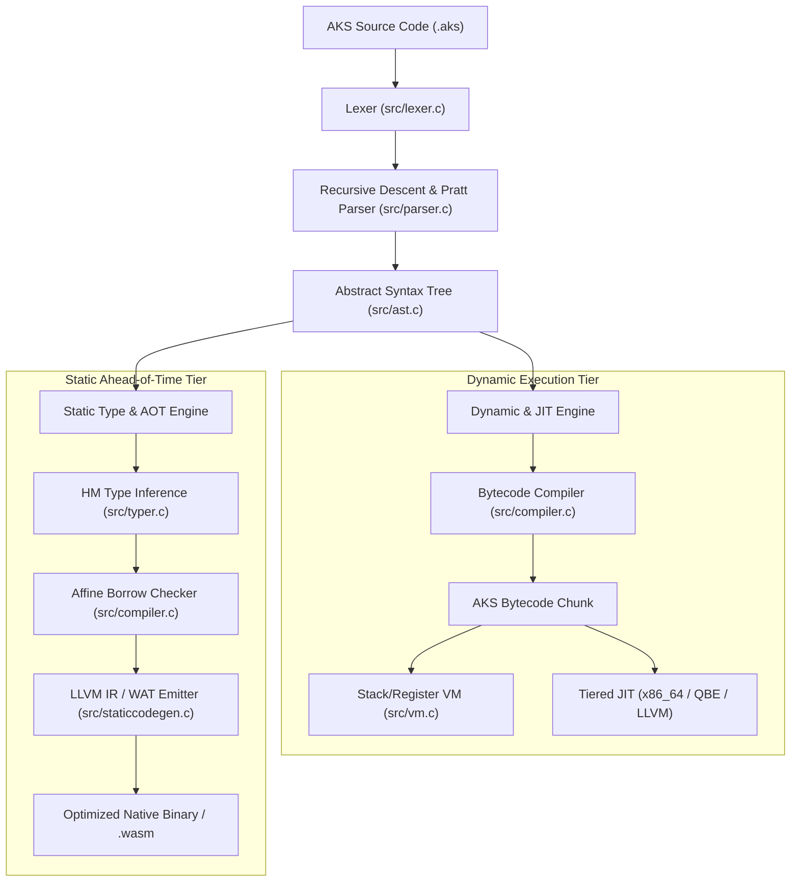

# Chapter 01: Introduction & Systems Architecture

AKS is a general-purpose, high-performance systems and application programming language engineered from the ground up for modern x86-64 and AArch64 hardware architectures. It bridges the gap between dynamic scripting productivity and low-level bare-metal systems programming through a unified, dual-tier compilation and execution pipeline.

---

## 1.1 The Genesis & Architectural Vision of AKS

Historically, software engineering forced developers into a false dichotomy:

1. **High-Level Dynamic Languages (Python, Ruby, JavaScript)**:
   - *Strengths*: Instant prototyping, expressive syntax, dynamic typing, automatic memory management, interactive REPL workflows, rapid iteration cycles.
   - *Weaknesses*: Heavy interpreter overhead, unpredictable garbage collection pauses, large memory footprints, lack of fine-grained hardware and SIMD vector control, absence of compile-time type guarantees in mission-critical codebases.

2. **Low-Level Systems Languages (C, C++, Rust, Zig)**:
   - *Strengths*: Maximum execution throughput, zero-cost abstractions, deterministic resource management, bare-metal hardware and operating system integration.
   - *Weaknesses*: Steep learning curves, complex build systems, strict ownership rules that slow down early experimental prototyping, longer compilation times.

AKS eliminates this divide. During initial development, testing, and rapid scripting, AKS operates as a dynamic, interactive runtime with automatic reference counting, a fast register-and-stack hybrid bytecode virtual machine, and a tiered JIT compiler. When scaling to production or targeting embedded and systems environments, the exact same codebase can be compiled ahead-of-time (AOT) with strict Hindley-Milner type inference, compile-time affine borrow checking, and direct native code generation via LLVM IR or WebAssembly WAT.



---

## 1.2 The Complete Compilation Pipeline

To write efficient software in AKS, one must understand how source text transforms into executing machine instructions. The AKS compiler pipeline proceeds through five distinct stages:

### Stage 1: Lexical Analysis (`src/lexer.c`)
The Lexer converts raw UTF-8 source bytes into a discrete stream of typed `Token` structures. It strips whitespace and comments, interns string identifiers, and records exact source line and column numbers for precision diagnostic reporting:

```c
typedef struct {
    TokenType type;     // TOKEN_LET, TOKEN_IDENTIFIER, TOKEN_INT, etc.
    const char *start;  // Pointer into source buffer
    int length;         // Length in bytes
    int line;           // Source line number
    int column;         // Source column number
} Token;
```

### Stage 2: Recursive-Descent & Pratt Parsing (`src/parser.c`)
The Parser consumes the token stream to construct a strongly typed Abstract Syntax Tree (AST). It combines traditional recursive-descent parsing for statements (`if`, `while`, `for`, `fn`, `struct`) with top-down operator precedence (Pratt parsing) for mathematical and logical expressions to handle complex operator associativity and precedence with zero recursion overhead.

### Stage 3: AST Construction & Semantic Analysis (`src/ast.c`)
Every AST node (`AstNode`) is allocated in a contiguous arena memory pool for cache locality. The AST preserves full type annotations, variable binding scopes, function prototypes, and structural attributes:

```c
typedef struct AstNode {
    AstNodeType type;
    int line;
    int col;
    union {
        struct { char *name; struct AstNode *init; SType *type_ann; } var_decl;
        struct { char *name; struct AstNode **params; int param_count; struct AstNode *body; } fn_decl;
        struct { struct AstNode *cond; struct AstNode *then_b; struct AstNode *else_b; } if_stmt;
        struct { OperatorType op; struct AstNode *left; struct AstNode *right; } binary_op;
        // ...
    } as;
} AstNode;
```

### Stage 4: Bytecode Emission (`src/compiler.c`)
The compiler traverses the AST and generates a linear bytecode stream contained in an `AKSChunk`. The compiler performs constant folding (evaluating `3 + 7` $\to$ `10` at compile time), local variable stack slot allocation, jump offset patching, and upvalue capture analysis.

### Stage 5: Virtual Machine & JIT Execution (`src/vm.c`)
The Virtual Machine executes the compiled bytecode chunks using a contiguous evaluation stack and register cache. Hot loops are monitored via execution counters; when a loop exceeds execution thresholds, the tiered JIT compiler compiles the bytecode into native machine instructions on the fly.

---

## 1.3 Core Runtime & Virtual Machine Internals

### 1.3.1 Value Representation (`AKSValue`)

In the dynamic runtime tier, every AKS entity is represented as an efficient tagged union value (`AKSValue`):

```c
// Core AKSValue structure in include/value.h
typedef enum {
    VAL_NIL,
    VAL_BOOL,
    VAL_INT,
    VAL_FLOAT,
    VAL_OBJ
} ValueType;

typedef struct {
    ValueType type;
    union {
        bool boolean;
        int64_t integer;
        double number;
        struct AKSObject *obj;
    } as;
} AKSValue;
```

- **Primitive Immediates**: Integers (`int64_t`), double-precision floats (`double`), and Booleans (`bool`) are stored directly inline inside the 16-byte `AKSValue` union without any heap allocation or pointer indirection.
- **Heap Objects (`AKSObject`)**: Strings, arrays, hash maps, structs, closures, fibers, and native handles point to a reference-counted header `AKSObject` allocated on 64-byte aligned boundaries for cache-line locality.

```text
+-------------------+---------------------------------------+
|  ValueType (8B)   |           Payload Union (8B)          |
+-------------------+---------------------------------------+
| VAL_INT           | 64-bit Signed Integer (int64_t)       |
| VAL_FLOAT         | 64-bit IEEE 754 Float (double)        |
| VAL_BOOL          | Boolean (true / false)                |
| VAL_OBJ           | Pointer to AKSObject (heap allocated) |
+-------------------+---------------------------------------+
```

### 1.3.2 Heap Object Header (`AKSObject`)

All dynamic allocations in AKS share a common object header:

```c
typedef struct AKSObject {
    ObjType type;         // OBJ_STRING, OBJ_ARRAY, OBJ_MAP, OBJ_STRUCT, OBJ_CLOSURE, etc.
    uint32_t refcount;    // Deterministic reference counter
    bool is_marked;       // Garbage collection / cycle detection marker
    bool is_static_safe;  // Flag indicating refcount elimination by static analyzer
    struct AKSObject *next; // Intrusive global allocation tracker for leak diagnostics
} AKSObject;
```

### 1.3.3 The Bytecode Execution Loop

The virtual machine (`src/vm.c`) implements an instruction dispatcher utilizing computed `goto` dispatch on supported compilers (GCC/Clang) and optimized switch tables on MSVC. The VM maintains a contiguous evaluation stack:

- **Evaluation Stack**: A contiguous array of `AKSValue` slots (default capacity 65,536 elements, expandable dynamically).
- **Call Frame Stack**: Maintains active call frames containing function metadata, return instruction pointers (`ip`), and base stack offsets for local variable lookups:

```c
typedef struct {
    AKSClosure *closure; // Pointer to active compiled closure
    uint8_t *ip;         // Instruction pointer into bytecode stream
    AKSValue *slots;     // Pointer to base local variable slot in evaluation stack
} CallFrame;
```

---

## 1.4 Setting Up the Development Environment

### 1.4.1 System Requirements

AKS runs natively on Windows (x86-64 and ARM64), Linux, and macOS. For Windows native builds, Microsoft Visual C++ (MSVC) or MinGW-w64 is supported.

### 1.4.2 Building from Source

To build all AKS compiler binaries, standard tools, and test suites from source in your local project directory:

```cmd
cd aks-lang
build.bat
```

The build script compiles the following toolchain executables into the project root:

| Executable | Purpose | Key Subsystems |
| :--- | :--- | :--- |
| `aks.exe` | Compiler, VM & CLI Runner | Bytecode compiler, VM, JIT engine, AOT generator, package manager, test runner. |
| `aksls.exe` | Language Server Protocol (LSP) | Full IDE protocol server for VS Code and modern IDEs (diagnostics, autocomplete). |
| `aksfmt.exe` | Code Formatter | AST-based code standardizer. |
| `akslint.exe` | Static Linter & Analyzer | Rule engine for detecting dead code, type mismatches, and anti-patterns. |
| `aks.dll` | C Embedding Shared Library | Complete AKS engine exposed via C API for embedding inside host applications. |

---

## 1.5 The `aks` Command-Line Interface

The `aks` driver provides a comprehensive set of subcommands:

### 1. Running Source Files

```bash
# Execute a script via the dynamic VM
aks run script.aks

# Execute with strict type inference enabled
aks run --strict-types script.aks

# Execute with compile-time borrow checker enabled
aks run --borrow-check script.aks

# Execute with memory tracing and leak diagnostics
aks run --trace-mem script.aks
```

### 2. Interactive REPL (Read-Eval-Print Loop)

Launching `aks` without arguments opens the interactive shell:

```text
AKS Interactive REPL (v2026.1 - Windows x86_64)
Type .help for command list, .exit to quit.
>>> let message = "Welcome to AKS";
>>> let tokens = split(message, " ");
>>> print(tokens);
["Welcome", "to", "AKS"]
>>> 
```

Useful REPL commands:
- `.help` - Displays the command reference.
- `.vars` - Dumps all active variables in the current environment with their types and values.
- `.disasm <fn>` - Disassembles a function or code block into human-readable bytecode instructions.
- `.clear` - Resets the global variable environment and heap state.
- `.exit` - Gracefully terminates the REPL.

### 3. Ahead-of-Time (AOT) Code Generation

```bash
# Emit LLVM Intermediate Representation
aks emit-ir --static -o program.ll program.aks

# Emit WebAssembly Text (WAT)
aks emit-wat -o program.wat program.aks
```

### 4. Running Benchmarks and Test Suites

```bash
# Run a single benchmark file with microsecond timer precision
aks bench benchmarks/matrix_multiply.aks

# Run the full automated test suite (254+ test modules)
aks test
```

---

## 1.6 Your First AKS Programs

Let us explore two fundamental programs to understand how AKS handles both simple scripting and structured systems tasks.

### Example 1: Hello World & String Manipulation

Create a file named `hello_world.aks`:

```aks
// hello_world.aks
fn main() {
    let name = "Systems Programmer";
    let greeting = "Hello, " + name + "! Welcome to AKS.";
    
    print(greeting);
    print("Length of greeting: " + String(Length(greeting)));
    
    let uppercase_greeting = upper(greeting);
    print("Uppercase: " + uppercase_greeting);
}

main();
```

Run the program:

```bash
aks run hello_world.aks
```

Output:
```text
Hello, Systems Programmer! Welcome to AKS.
Length of greeting: 41
Uppercase: HELLO, SYSTEMS PROGRAMMER! WELCOME TO AKS.
Memory diagnostics: all runtime references clean. 0 leaks.
```

### Example 2: High-Performance Fibonacci with Microsecond Timing

This example demonstrates loop structures, 64-bit integer calculations, recursion, and the high-resolution hardware clock:

```aks
// fibonacci.aks
fn fib_iterative(n) {
    if (n <= 1) {
        return n;
    }
    let a = 0;
    let b = 1;
    for (let i = 2; i <= n; i += 1) {
        let temp = a + b;
        a = b;
        b = temp;
    }
    return b;
}

fn main() {
    let target = 50;
    
    let start_time = clock();
    let result = fib_iterative(target);
    let elapsed = clock() - start_time;
    
    print("Fibonacci(" + String(target) + ") = " + String(result));
    print("Calculated in: " + String(elapsed) + " seconds");
}

main();
```

Output:
```text
Fibonacci(50) = 12586269025
Calculated in: 0.000004 seconds
Memory diagnostics: all runtime references clean. 0 leaks.
```

---

## 1.7 Summary & Next Steps

In this introductory chapter, we examined:
1. The dual dynamic/static architecture of AKS.
2. The complete 5-stage compilation pipeline from source bytes to machine code.
3. The internal representation of values (`AKSValue`), object headers (`AKSObject`), and the VM stack machine.
4. How to build, install, and utilize the `aks` toolchain.
5. Writing, executing, and benchmarking basic AKS scripts.

Proceed to [Chapter 02: Language Basics, Lexical Structure & Primitive Types](Chapter%2002%20-%20Language%20Basics%20and%20Primitive%20Types.md) for an in-depth dive into variables, scoping rules, primitive representations, memory alignment, and operator semantics.
