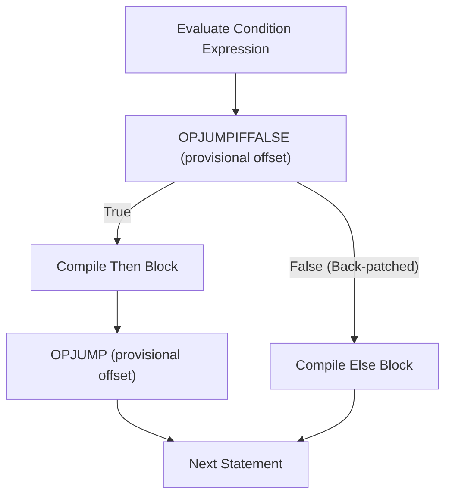

# Chapter 03: Control Flow, Loops & Pattern Matching

Control flow structures dictate how programs execute across branches, iterations, and pattern-matching decision trees. This chapter covers conditional branching, loops, pattern matching mechanics, jump offset back-patching, and VM bytecode generation.

---

## 3.1 Conditional Branching (`if`, `else if`, `else`)

AKS provides standard structured conditional branching:

```aks
let cpu_temperature = 78.5;

if (cpu_temperature > 90.0) {
    print("CRITICAL: Thermal throttling activated!");
} else if (cpu_temperature > 75.0) {
    print("WARNING: Increasing fan speed to maximum.");
} else {
    print("Normal operating temperature.");
}
```

### 3.1.1 Ternary Conditional Expressions

For inline value selection based on a condition, the ternary operator `cond ? true_val : false_val` is supported:

```aks
let buffer_capacity = is_high_throughput ? 65536 : 4096;
```

---

## 3.2 Iteration & Loop Structures

AKS provides four distinct loop constructs tailored for different algorithmic workflows:

### 3.2.1 The `while` Loop

Executes a block continuously as long as the boolean condition evaluates to truthy:

```aks
let counter = 0;
while (counter < 5) {
    print("Iteration: " + String(counter));
    counter += 1;
}
```

### 3.2.2 The 3-Clause C-Style `for` Loop

Provides structured loop initialization, condition evaluation, and post-iteration step expressions:

```aks
for (let i = 0; i < 10; i += 2) {
    print("Even index: " + String(i));
}
```

### 3.2.3 The Collection Iteration `for..in` Loop

Iterates directly over elements in dynamic arrays, strings, or keys in hash maps:

```aks
let core_frequencies = [3.2, 3.6, 4.0, 4.2];

for (freq in core_frequencies) {
    print("Core Frequency: " + String(freq) + " GHz");
}
```

### 3.2.4 The Unconditional `loop` Construct

Creates an infinite loop, ideal for server event loops, worker threads, and fiber schedulers:

```aks
let attempts = 0;
loop {
    attempts += 1;
    if (attempts >= 3) {
        print("Maximum retry limit reached. Breaking loop.");
        break;
    }
}
```

### 3.2.5 Loop Control Statements (`break` and `continue`)

- **`break`**: Immediately terminates the innermost enclosing loop and jumps to the statement following the loop.
- **`continue`**: Skips the remainder of the current iteration and jumps to the condition evaluation or step clause.

```aks
for (let i = 1; i <= 10; i += 1) {
    if (i % 2 != 0) {
        continue; // Skip odd numbers
    }
    if (i > 6) {
        break; // Stop after reaching 6
    }
    print("Even number: " + String(i));
}
```

---

## 3.3 Bytecode Generation & Jump Back-Patching

To appreciate how the AKS compiler emits machine-efficient bytecode for control flow, let us inspect the jump mechanics.

### 3.3.1 How `if` Statements are Compiled

When compiling an `if` statement, the compiler cannot know ahead of time how many bytecode bytes the `then` block will occupy. It emits a provisional `OPJUMPIFFALSE` instruction with a placeholder offset. Once the entire `then` block is compiled, the compiler calculates the exact byte distance and **back-patches** the offset into the jump instruction:



### 3.3.2 Bytecode Disassembly of a Loop

Consider this loop:

```aks
let i = 0;
while (i < 3) {
    i += 1;
}
```

The disassembled bytecode output (`aks run --debug`):

```text
Bytecode Chunk: while_loop
0000    OPPUSHINT           0
0009    OPSTORE             0
0012    OPLOAD              0
0015    OPPUSHINT           3
0024    OPLT
0025    OPJUMPIFFALSE       +28
0030    OPLOAD              0
0033    OPPUSHINT           1
0042    OPADD
0043    OPSTORE             0
0046    OPPOP
0047    OPJUMP              -39
0052    OPRETURN
```

---

## 3.4 Pattern Matching (`match`)

AKS features a first-class, pattern-matching engine capable of matching literals, variables, ranges, tuples, arrays, structs, and guard conditions.

### 3.4.1 Basic Literal & Wildcard Matching

```aks
let status_code = 404;

let response_message = match (status_code) {
    200 => "OK: Request succeeded",
    301 => "Moved Permanently",
    400 => "Bad Request",
    404 => "Not Found: Resource does not exist",
    500 => "Internal Server Error",
    _   => "Unknown HTTP Status Code"
};

print(response_message);
```

### 3.4.2 Pattern Guards (`if` Clauses)

Pattern arms can include guard expressions that must evaluate to truthy for the arm to match:

```aks
let packet_size = 1500;

match (packet_size) {
    s if s <= 64   => print("Small TCP Control Packet"),
    s if s <= 1500 => print("Standard Ethernet MTU Frame"),
    s if s > 9000  => print("Jumbo Frame"),
    _              => print("Custom Frame Size")
};
```

### 3.4.3 Destructuring Arrays and Structs

Pattern matching can decompose composite structures directly into named variables:

```aks
let coordinate = [10, 20];

match (coordinate) {
    [0, 0]   => print("Origin point"),
    [x, 0]   => print("On X-axis at " + String(x)),
    [0, y]   => print("On Y-axis at " + String(y)),
    [x, y]   => print("Cartesian point (" + String(x) + ", " + String(y) + ")"),
    _        => print("Invalid coordinate dimensions")
};
```

### 3.4.4 Exhaustiveness Checking

In static mode (`--strict-types`), the compiler performs exhaustiveness analysis over `match` expressions. When matching on enums, Algebraic Data Types, or boolean conditions, all variants must either be explicitly covered or a fallback wildcard `_` must be provided:

```aks
enum Status { Pending, Active, Suspended }

// Compile error if any variant is omitted without a wildcard:
match (status) {
    Status.Pending   => "Job queued",
    Status.Active    => "Job running",
    Status.Suspended => "Job paused"
};
```

### 3.4.5 Multiple Alternative Patterns (OR Patterns)

Multiple discrete patterns can be combined on a single branch using the pipe `|` operator, avoiding repetitive arms:

```aks
let status_code = 404;

let category = match (status_code) {
    200 | 201 | 204 => "Success",
    301 | 302 | 307 => "Redirection",
    400 | 401 | 403 | 404 => "Client Error",
    500 | 502 | 503 => "Server Error",
    _ => "Unknown Status"
};
```

### 3.4.6 Struct Pattern Matching

Struct instances can be destructured directly in pattern arms, inspecting specific fields while extracting others:

```aks
struct Message { topic: string, priority: int, payload: any }

let msg = Message { topic: "alerts", priority: 1, payload: "High CPU" };

match (msg) {
    Message { topic: "alerts", priority: 1, payload } => print("Critical alert: " + String(payload)),
    Message { topic: "telemetry", payload }           => print("Telemetry data received"),
    _ => print("Standard message")
};
```

---

## 3.5 Modern Syntactic Expressiveness

AKS incorporates contemporary syntactic constructs designed to maximize ergonomics without sacrificing execution speed:

### 3.5.1 Formatted String Interpolation & Specifiers
Formatted string literals evaluate expressions directly inside `{...}` braces, with optional format specifiers for precision, base conversion, and alignment:

```aks
let username = "AksDev";
let latency = 4.2568;
let count = 255;

// Basic interpolation
print(f"User {username} ping response: {latency}ms (Status: {latency < 10.0})");

// Precision specifiers: floating-point rounding
print(f"Formatted latency: {latency:.2f}ms"); // 4.26ms

// Numeric base formatting: hex and binary
print(f"Hex: {count:x}, Binary: {count:b}"); // Hex: ff, Binary: 11111111

// Width and padding
print(f"Padded ID: {count:06d}"); // 000255
```

### 3.5.2 Range Literals & Iteration
The `..` operator creates zero-allocation range sequences with `.start`, `.end`, and `Length()` support:

```aks
let r = 1..10;
print("Range count: " + String(Length(r))); // 9 elements

for (i in 0..5) {
    print("Iteration index: " + String(i));
}
```

### 3.5.3 Chained Comparison Operators
Comparisons can be naturally chained together without redundant `&&` conjunctions:

```aks
let temperature = 72;
if (65 <= temperature < 80) {
    print("Room temperature is optimal");
}
```

### 3.5.4 Struct Update Syntax (`...`)
Copy-and-update creates new struct instances from existing objects, overriding specific fields:

```aks
struct Config { host: string, port: int, ssl: bool }
let base_cfg = Config { host: "localhost", port: 8080, ssl: false };
let prod_cfg = Config { ...base_cfg, port: 443, ssl: true };
```

### 3.5.5 Trailing Lambdas
When the final argument of a function is a callback or lambda, it can be passed following the parameter list:

```aks
fn filter_records(records, predicate) { ... }

let valid = filter_records(user_db) fn(user) {
    return user.active && user.verified;
};
```

### 3.5.6 The Try-Propagation Operator (`?`)
For ergonomic error handling, postfix `?` unwraps `Result.Ok` or `Option.Some` values, immediately returning `Err` or `None` from the enclosing function upon failure:

```aks
fn parse_and_process(raw: string) -> Result {
    let json = parse_json(raw)?;
    let host = json.host?;
    let port = json.port?;
    return Ok(f"Connecting to {host}:{port}");
}
```

---

## 3.6 Summary & Next Steps

In this chapter, we explored:
1. `if`, `else if`, `else`, and ternary expressions.
2. The four loop constructs: `while`, 3-clause `for`, collection `for..in`, and `loop`.
3. Bytecode jump offset back-patching and loop disassemblies.
4. `match` pattern matching with literal values, wildcards, guards, composite destructuring, and static exhaustiveness verification.
5. Modern syntactic features: string interpolation, range literals, chained comparisons, struct updates, and trailing lambdas.

Proceed to [Chapter 04: Functions, Closures, Stack Frames & Error Handling](Chapter%2004%20-%20Functions,%20Closures%20and%20Error%20Handling.md) to explore stack frames, algebraic effects, verified contracts, and error handling models.
