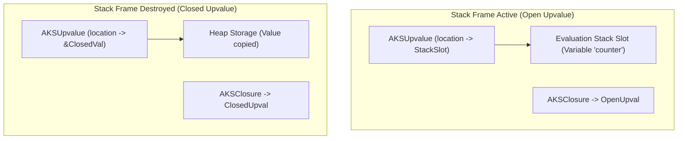

# Chapter 04: Functions, Closures, Stack Frames & Error Handling

Functions represent the primary unit of code abstraction, execution encapsulation, and stack frame management in AKS. This chapter covers function declarations, closures, upvalue lifetime lifting, virtual machine `CallFrame` stack layout, structured exception handling, panics, and algebraic error models.

---

## 4.1 Function Declarations & Signatures

In AKS, functions are declared using the `fn` keyword:

```aks
fn calculate_kinetic_energy(mass: float, velocity: float) -> float {
    return 0.5 * mass * (velocity ** 2.0);
}

let ke = calculate_kinetic_energy(1200.0, 28.0);
print("Kinetic Energy: " + String(ke) + " Joules");
```

### 4.1.1 Default & Optional Parameters

Function parameters can specify default values. Parameters with default values are evaluated if the caller omits the argument:

```aks
fn initialize_socket_connection(host: str, port: int = 8080, timeout_ms: int = 5000) {
    print("Connecting to " + host + ":" + String(port) + " (Timeout: " + String(timeout_ms) + "ms)");
}

initialize_socket_connection("127.0.0.1");             // port=8080, timeout_ms=5000
initialize_socket_connection("10.0.0.1", 443);         // port=443,  timeout_ms=5000
initialize_socket_connection("192.168.1.1", 22, 1000); // port=22,   timeout_ms=1000
```

### 4.1.2 Variadic Arguments (`...args`)

Functions can accept an arbitrary number of arguments using the rest parameter syntax `...args`, which bundles extra arguments into a dynamic array:

```aks
fn calculate_sum(...numbers) {
    let total = 0;
    for (num in numbers) {
        total += num;
    }
    return total;
}

print(calculate_sum(10, 20, 30, 40)); // 100
```

---

## 4.2 First-Class Functions & Higher-Order Pipelines

In AKS, functions are first-class values: they can be assigned to variables, passed as arguments to other functions, returned from functions, and stored inside structs or arrays:

```aks
fn transform_dataset(arr, transform_fn) {
    let result = [];
    for (item in arr) {
        Push(result, transform_fn(item));
    }
    return result;
}

let raw_data = [1, 2, 3, 4, 5];
let squared = transform_dataset(raw_data, fn(x) { return x * x; });
print(squared); // [1, 4, 9, 16, 25]
```

---

## 4.3 Closures & Upvalue Lifetime Management

A **closure** is a function that retains access to variables declared in its enclosing lexical scope even after that enclosing scope has finished execution.

### 4.3.1 The Upvalue Problem

When an outer function returns, its local stack frame is discarded. If an inner closure references an outer variable, accessing that stack location directly would cause dangling pointer corruption.

AKS solves this with **Upvalues**:



1. **Open Upvalue**: While the outer function is still executing on the stack, the upvalue points directly to the evaluation stack slot.
2. **Closing the Upvalue**: When the outer function returns, the VM automatically moves the value from the stack slot into dedicated heap storage and updates the internal reference. The inner closure can now safely execute indefinitely.

### 4.3.2 Closure Example

```aks
fn make_accumulator(initial_value) {
    let sum = initial_value;
    
    // Returns closure capturing 'sum' upvalue
    return fn(delta) {
        sum += delta;
        return sum;
    };
}

let acc = make_accumulator(100);
print(acc(15)); // 115
print(acc(25)); // 140
```

---

## 4.4 The Virtual Machine Call Stack (`CallFrame`)

Each time a function or closure is invoked, the virtual machine pushes a new `CallFrame` onto the call frame stack (`src/vm.c`):

```c
typedef struct {
    AKSClosure *closure; // Pointer to the executing closure
    uint8_t *ip;         // Current instruction pointer in the bytecode
    AKSValue *slots;     // Pointer to the base of this frame's local variables on the evaluation stack
} CallFrame;
```

```text
Virtual Machine Evaluation Stack Layout during nested function call:
+------------------------------------+ <--- Evaluation Stack Base (Slot 0: Script)
| Slot 0: global / script locals     |
+------------------------------------+
| Slot 1: Caller argument 0 (arg1)   | <--- Frame 1 (Caller Slots Base)
| Slot 2: Caller local variable (x)  |
+------------------------------------+
| Slot 3: Callee function closure    | <--- Frame 2 (Callee Slots Base)
| Slot 4: Callee argument 0 (a)      |
| Slot 5: Callee local variable (y)  | <--- Top of Stack (stacktop)
+------------------------------------+
```

- **Slot Independence**: Inside the callee, local variable instructions (`OPLOAD 0`, `OPSTORE 1`) compute addresses relative to `frame->slots`, achieving $O(1)$ local variable access with zero hash table lookups.
- **Recursion Safety**: The VM enforces a maximum call depth limit (default 1,024 frames) to prevent stack overflow crashes.

---

## 4.5 Error Handling Architectures

AKS provides two complementary error handling mechanisms:
1. Structured Exceptions (`try`/`catch`/`finally`) & Panics for unrecoverable errors.
2. Algebraic Data Types (`Option<T>` and `Result<T, E>`) for predictable domain errors.

### 4.5.1 Structured Exceptions (`try`, `catch`, `finally`, `throw`)

```aks
fn parse_configuration(raw_text) {
    if (Length(raw_text) == 0) {
        throw "ConfigError: Configuration buffer cannot be empty.";
    }
    return { "status": "loaded" };
}

fn safe_loader() {
    try {
        let config = parse_configuration("");
        print(config);
    } catch (err) {
        print("Caught Exception: " + String(err));
    } finally {
        print("Cleanup: File handles released.");
    }
}

safe_loader();
```

### 4.5.2 Explicit `panic()` & Panic Hooks

For unrecoverable integrity failures, `panic(message)` halts execution immediately, dumping a full call frame stack trace and the source line numbers:

```aks
fn divide_memory_pages(total_bytes, page_size) {
    if (page_size == 0) {
        panic("DivisionByZero: Page size cannot be zero.");
    }
    return total_bytes / page_size;
}
```

### 4.5.3 First-Class `Option` & `Result` Ergonomics

AKS provides native algebraic data types for robust error handling without exceptions. `Option` represents optional presence, while `Result` represents either success or an error:

```aks
// Top-level constructors
let opt = Some(42);
let empty = None; // Bare None identifier compiles to Option.None

let ok_res = Ok("data loaded");
let err_res = Err("disk read failure");

// Boolean inspection methods
assert(opt.IsSome());
assert(empty.IsNone());
assert(ok_res.IsOk());
assert(err_res.IsErr());

// Safe unwrapping and fallbacks
let val = opt.Unwrap();               // 42 (panics if None)
let fallback = empty.UnwrapOr(100);    // 100
let ensured = opt.Expect("critical"); // 42

// Transforming error payloads
let mapped = err_res.MapErr(fn(e) { return "IO Error: " + e; });
```

### 4.5.4 The Postfix Try-Propagation Operator (`?`)

The `?` operator unwraps successful values or early-returns failure from the enclosing function:

```aks
fn fetch_user_avatar(user_id: int) -> Result {
    let user = find_user(user_id)?;     // Early-returns Err if user not found
    let profile = user.profile?;        // Unwraps profile or early-returns Err/None
    let url = profile.avatar_url?;
    return Ok(url);
}
```

### 4.5.5 Guaranteed Scope Cleanup: `defer`

The `defer` statement schedules a statement or block to execute unconditionally when the enclosing function or block exits, regardless of whether exit occurs via normal return or error unwinding:

```aks
fn process_transaction(file_path: string) {
    let file = FileOpen(file_path, "r");
    defer FileClose(file); // Guaranteed to execute on function exit!

    let lock = AcquireLock();
    defer ReleaseLock(lock); // Multiple defers execute in LIFO (reverse) order!

    // File and lock are deterministically released at scope exit
    ReadPayload(file);
}
```

### 4.5.6 Transactional Error Cleanup: `errdefer`

The `errdefer` statement executes its cleanup block **only** if the function or block exits via an error, panic, or unhandled exception. If execution succeeds normally, `errdefer` actions are cancelled:

```aks
fn create_user_account(name: string) -> Result {
    let tx = DatabaseBegin();
    errdefer DatabaseRollback(tx); // Only runs if an error or early return occurs!

    let user_id = InsertUser(tx, name)?;
    InsertDefaultSettings(tx, user_id)?;

    DatabaseCommit(tx);
    return Ok(user_id);
}
```

---

## 4.6 The Algebraic Effect System

AKS features a first-class **Algebraic Effect System**, allowing programs to decouple the declaration and invocation of computational effects from their concrete runtime interpretations. Unlike traditional exceptions which terminate stack frames unconditionally, algebraic effects permit **one-shot resumptions** that yield a value back to the call site and continue execution seamlessly.

### 4.6.1 Declaring & Performing Effects

Effects are declared using the `effect` keyword:

```aks
effect State {
    fn Get() -> any;
    fn Put(v: any);
}

effect Logger {
    fn Log(msg: string) -> string;
}

fn compute_pipeline(x: int) -> int {
    // Both scoped (Logger.Log) and direct (Log) invocations are supported:
    perform Logger.Log("Starting computation for x = " + String(x));
    let current_offset = perform State.Get();
    let total = x * 2 + current_offset;
    perform State.Put(total);
    perform Logger.Log("Updated state to " + String(total));
    return total;
}
```

### 4.6.2 Effect Handlers & Delimited Continuations

Handlers intercept effects dynamically through `handle (expr) with { ... }` blocks. Within each effect arm, `resume <val>` yields execution back into the suspended computation:

```aks
let initial_state = 10;
let final_result = handle (compute_pipeline(5)) with {
    State.Get() => {
        resume initial_state;
    },
    State.Put(v) => {
        initial_state = v;
        resume nil;
    },
    Logger.Log(msg) => {
        print("[AUDIT]: " + msg);
        resume "logged";
    }
};

print("Final computed value: " + String(final_result)); // 20
print("Final state variable: " + String(initial_state)); // 20
```

Effects can be nested arbitrarily, providing composable, testable abstractions for asynchronous I/O, transactional state, dependency injection, and probabilistic simulation.

---

## 4.7 Verified Function Contracts

AKS provides native **Design-by-Contract** specifications through `requires` (preconditions) and `ensures` (postconditions) clauses attached directly to function signatures.

```aks
fn SafeDivide(a: int, b: int) -> int
    requires b != 0
    ensures result != null
{
    return a / b;
}

fn Clamp(val: int, minVal: int, maxVal: int) -> int
    requires minVal <= maxVal
    ensures result >= minVal
    ensures result <= maxVal
{
    if (val < minVal) { return minVal; }
    if (val > maxVal) { return maxVal; }
    return val;
}
```

- **Runtime Enforcement**: In standard debug and execution modes, contract violations immediately abort and raise descriptive invariant exceptions.
- **Static Verification**: In static mode (`--strict-types`), the compiler uses SMT/Z3 solvers when available to prove contract satisfaction ahead-of-time, eliminating runtime assertions for proven invariants.
- **The `result` Identifier**: Inside `ensures` postconditions, `result` binds to the evaluated return value of the function.

---

## 4.8 Summary & Next Steps

In this chapter, we covered:
1. Function declarations, default parameters, and variadic rest arguments.
2. First-class higher-order function pipelines.
3. Closures, open vs closed upvalues, and heap migration mechanics.
4. VM `CallFrame` stack layout, relative slot addressing, and call depth limits.
5. Structured exception handling, panic hooks, and algebraic `Result` patterns.
6. First-class algebraic effects, handlers, and delimited resumptions (`handle ... with`, `resume`).
7. Verified function contracts (`requires`, `ensures`) with compile-time and runtime validation.

Proceed to [Chapter 05: Collections, Structs & Object Architecture](Chapter%2005%20-%20Collections,%20Structs%20and%20Object%20Model.md) to explore dynamic arrays, Robin Hood hash maps, and struct object models.
