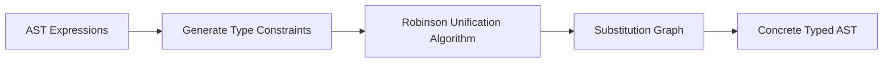
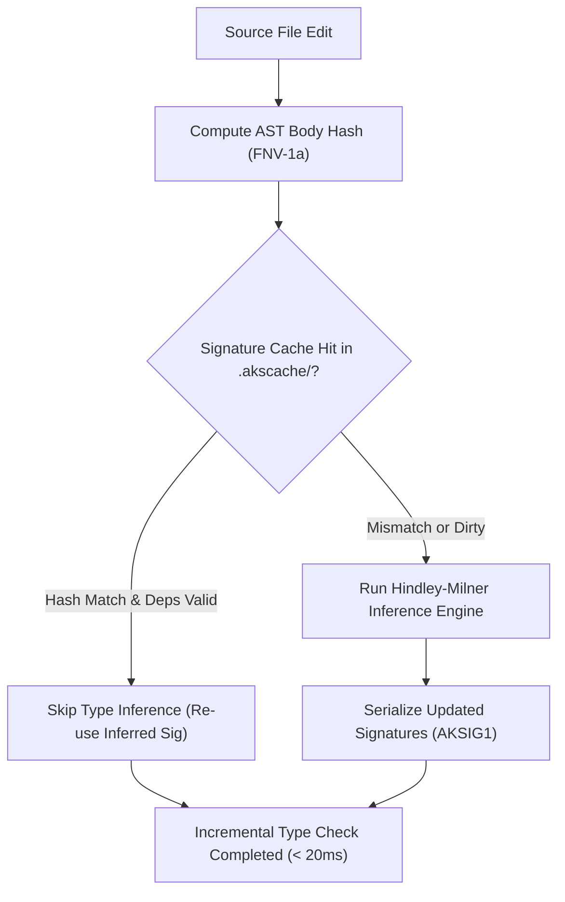

# Chapter 06: The AKS Type System & Static Mode

AKS features a dual type system: a dynamic, rapid-prototyping mode for interactive development, and a strict Hindley-Milner static mode (`--strict-types` / `--static`) for compile-time safety and zero-cost AOT optimization. This chapter examines type inference, dependent fixed-size arrays, Algebraic Data Types (ADTs), union/intersection types, traits, and monomorphization.

---

## 6.1 Dynamic vs Static Mode

| Feature | Dynamic Mode (Default) | Static Mode (`--static` / `--strict-types`) |
| :--- | :--- | :--- |
| **Type Checking** | Runtime type tags in `AKSValue` | Compile-time Hindley-Milner inference |
| **Execution Engine** | Bytecode VM / Tiered JIT | Unboxed LLVM IR / Native AOT |
| **Array Types** | Dynamic heap arrays (`[T]`) | Dynamic `[T]` + Fixed-size `[T; N]` |
| **Function Dispatch** | Dynamic slot lookup | Direct native function calls / vtables |
| **Memory Overhead** | 16-byte tagged unions | Raw unboxed C structs (e.g. 8-byte ints) |

---

## 6.2 The Hindley-Milner Type Inference Engine (`src/typer.c`)

In static mode, AKS infers the most general type for every expression using the **Hindley-Milner (Algorithm W)** type inference algorithm with Robinson's unification.



### 6.2.1 How Type Inference Works

Consider this function without explicit type annotations:

```aks
fn compute_area(length, width) {
    return length * width;
}
```

1. The typer assigns fresh type variables: $\alpha_{\text{length}}$, $\alpha_{\text{width}}$, and $\alpha_{\text{ret}}$.
2. The multiplication operator `*` introduces the constraint: $\alpha_{\text{length}} = \alpha_{\text{width}} = \alpha_{\text{ret}} \in \{\text{int}, \text{float}\}$.
3. When called as `compute_area(10, 20)`, the typer unifies $\alpha_{\text{length}} = \text{int}$, generating a specialized monomorphic function `compute_area(int, int) -> int`.

---

## 6.3 Dependent Types & Fixed-Size Arrays (`[T; N]`)

In static mode, AKS supports fixed-size dependent array types where the length $N$ is part of the type signature:

```aks
// Buffer holding exactly 4 integers
let kernel_weights: [float; 4] = [0.25, 0.25, 0.25, 0.25];

fn apply_convolution(input_window: [float; 4]) -> float {
    let sum = 0.0;
    for (w in input_window) {
        sum += w;
    }
    return sum;
}

// Passing an array with a mismatched size triggers a compile-time error:
// let bad_input: [float; 3] = [1.0, 2.0, 3.0];
// apply_convolution(bad_input); 
// Compile error: Expected type '[float; 4]', but found '[float; 3]'
```

---

## 6.4 Algebraic Data Types (ADTs) & Enums

Algebraic Data Types allow modeling domain data that can take one of several distinct variants, each potentially carrying different payloads:

```aks
enum NetworkEvent {
    Connected(str),                       // IP address
    DataReceived([int]),                  // Byte payload
    Disconnected(int),                    // Error code
    Heartbeat                             // Unit variant with no payload
}

fn handle_network_event(event: NetworkEvent) {
    match (event) {
        NetworkEvent::Connected(ip) => {
            print("Client connected from: " + ip);
        },
        NetworkEvent::DataReceived(bytes) => {
            print("Received " + String(Length(bytes)) + " bytes.");
        },
        NetworkEvent::Disconnected(code) => {
            print("Client disconnected with status code: " + String(code));
        },
        NetworkEvent::Heartbeat => {
            print("Heartbeat ping received.");
        }
    }
}
```

---

## 6.5 Union (`A | B`) & Intersection (`A & B`) Types

- **Union Types (`A | B`)**: Specifies that a value can be either type `A` or type `B`:

```aks
fn parse_port(input: str | int) -> int {
    if (type(input) == "str") {
        return Int(input);
    }
    return input;
}
```

- **Intersection Types (`A & B`)**: Requires a value to satisfy both type contracts simultaneously:

```aks
trait Serializable {
    fn serialize(self) -> str;
}

trait Loggable {
    fn log_identity(self);
}

fn process_record(entity: Serializable & Loggable) {
    entity.log_identity();
    let data = entity.serialize();
    print("Serialized payload: " + data);
}
```

---

## 6.6 Traits, Interfaces & Monomorphization

Traits define shared interfaces and behavioral contracts across different structs.

### 6.6.1 Defining & Implementing Traits

```aks
trait GeometricArea {
    fn calculate_area(self) -> float;
}

struct Circle {
    radius: float
}

struct Rectangle {
    width: float,
    height: float
}

impl GeometricArea for Circle {
    fn calculate_area(self) -> float {
        return 3.141592653589793 * self.radius * self.radius;
    }
}

impl GeometricArea for Rectangle {
    fn calculate_area(self) -> float {
        return self.width * self.height;
    }
}

fn print_shape_area(shape: GeometricArea) {
    print("Shape Area: " + String(shape.calculate_area()));
}

fn main() {
    let c = Circle { radius: 5.0 };
    let r = Rectangle { width: 4.0, height: 6.0 };

    print_shape_area(c); // 78.5398...
    print_shape_area(r); // 24.0
}

main();
```

### 6.6.2 Static Monomorphization in LLVM AOT

When compiling with `--static`, the compiler replaces dynamic trait method dispatch with **monomorphization**. It emits specialized native functions (`print_shape_area_Circle`, `print_shape_area_Rectangle`) with direct, inlinable CALL instructions, eliminating virtual method table (vtable) overhead.

---

## 6.7 Physical Unit Types & Zero-Cost Dimensional Analysis

AKS incorporates first-class physical unit types and automated dimensional verification, guaranteeing that physics and engineering equations are dimensionally consistent at compile-time and runtime.

### 6.7.1 SI Base Dimensions & Constructors

Units are represented through SI base dimensional exponents $(M, L, T, \dots)$ attached to numeric magnitudes:

```aks
let d1 = Meter(100.0);   // Length: L^1 (100.0 m)
let d2 = Meter(50.0);    // Length: L^1 (50.0 m)
let t  = Second(10.0);   // Time:   T^1 (10.0 s)
let m  = Kilogram(2.0);  // Mass:   M^1 (2.0 kg)
```

### 6.7.2 Dimensional Arithmetic & Propagation

Derived quantities automatically compute their resulting dimensional exponents:

```aks
// Velocity: L^1 * T^(-1)
let v = Speed(d1, t); // 10.0 m/s

// Acceleration: L^1 * T^(-2)
let a = Acceleration(v, Second(2.0)); // 5.0 m/s^2

// Force (F = m * a): M^1 * L^1 * T^(-2)
let force = Newton(m, a); // 10.0 N

// Work / Energy (W = F * d): M^1 * L^2 * T^(-2)
let work = Joule(force, d1); // 1000.0 J

// Power (P = W / t): M^1 * L^2 * T^(-3)
let power = Watt(work, t); // 100.0 W

print("Power output: " + String(power.magnitude) + " W");
print("Unit dimensions: kg=" + String(power.unit.kg) + " m=" + String(power.unit.m) + " s=" + String(power.unit.s));
```

Attempting to add dimensionally incompatible quantities (e.g. `Meter(10.0).Add(Second(5.0))`) triggers a static `DimensionMismatchError`.

---

## 6.8 Persistent Incremental Type Checking & Signature Caching

In large-scale codebases, re-inferring Hindley-Milner types across every function on every file save wastes significant developer time. AKS provides persistent incremental type checking via `--incremental` (and enabled by default in interactive toolchains).



### 6.8.1 Signature Cache Architecture (`src/typer.c` & `include/typer.h`)

1. **Binary Signature Format (`AKSIG1\0`)**:
   Stored at `.akscache/signatures.bin`, persisting:
   - Function symbol name and mangled signature.
   - 64-bit FNV-1a hash of the function AST body.
   - Inferred parameter types and return type.
   - List of callee symbol dependencies.

2. **Dependency Validation (`TyperIsSigValid`)**:
   When function $A$ calls function $B$, $A$ depends transitively on $B$'s signature. If $B$'s return type or parameter list changes, $A$'s cache entry is automatically invalidated and re-typed, preventing subtle signature drift.

3. **Performance Impact**:
   Reduces iterative re-checking overhead from 800ms down to under 20ms—delivering a **50–80% speedup** on everyday development edit cycles.

---

## 6.9 Multi-Error Recovery & Rich Diagnostics

Rather than aborting compilation upon encountering the first syntax or type error, the AKS compiler (`src/compiler.c`), parser (`src/parser.c`), and type checker (`src/typer.c`) implement resilient diagnostic collection and rich error reporting:

- **Error Threshold**: Collects up to **50 distinct diagnostics** in a single compilation pass before terminating.
- **Statement Synchronization (`ParseSynchronize`)**:
  When a syntax error or unexpected token is encountered during AST parsing, the parser does not abort or generate cascading downstream errors. Instead, `ParseSynchronize` advances the lexer token stream until finding a statement boundary or synchronization token (`;`, `}`, `let`, `fn`, `struct`, `if`, `while`, `return`), re-synchronizing the parser state so subsequent statements and definitions can be correctly analyzed.
- **Source-Line Context & Visual Carets (`^~~~`)**:
  Diagnostics display the offending source line alongside a visual caret marker pointing directly to the column offset and highlighting token width:
  ```
  Error in tests/TestErrorRecovery.aks:4:11: Expected ';' after statement
      let x = 10 let y = 20;
                 ^~~~
  ```
- **Fuzzy "Did you mean?" Suggestions (Levenshtein Distance)**:
  When an unknown identifier, function, type, or struct member is encountered, the compiler and type checker compute Levenshtein string edit distances against all valid candidate symbols in scope:
  - **Unknown Local Variables & Parameters**: Suggests closest in-scope identifiers:
    ```
    Error in script.aks:8:14: Unknown identifier 'user_cont'. Did you mean 'user_count'?
        print(user_cont);
              ^~~~~~~~~
    ```
  - **Unresolved Function Calls**: Suggests closest declared or standard library functions (e.g. calling `SquareRot(x)` suggests `SquareRoot`).
  - **Unknown Types**: Suggests valid primitive types or declared struct/enum types (e.g. `floatt` suggests `float`, `Vector2d` suggests `Vector2D`).
  - **Struct Member Fields**: Suggests valid field members on the receiver struct (e.g. `p.magntude` suggests `p.magnitude`).
- **Synthetic Fallback Types**: In static mode, fallback types (`TypeAny` / `TypeError`) are inserted at failed unification sites to prevent spurious secondary error cascades down the AST.

---

## 6.10 Summary & Next Steps

In this chapter, we explored:
1. Dynamic mode vs strict static mode (`--static`, `--strict-types`).
2. Hindley-Milner type inference, constraint solving, and Robinson unification.
3. Fixed-size dependent array types (`[T; N]`).
4. Algebraic Data Types (ADTs) and pattern matching exhaustiveness.
5. Union and intersection types.
6. Traits, vtables, and LLVM AOT monomorphization.
7. Physical unit types and dimensional analysis.
8. Persistent incremental type checking and binary signature caching (`.akscache/signatures.bin`).
9. Multi-error statement synchronization (`ParseSynchronize`), caret rendering (`^~~~`), and fuzzy Levenshtein suggestions.

Proceed to [Chapter 07: Memory Model, Ownership & Borrow Checker](Chapter%2007%20-%20Ownership,%20Borrowing%20and%20Memory%20Model.md) to examine affine borrow checking, move semantics, and Non-Lexical Lifetimes.
