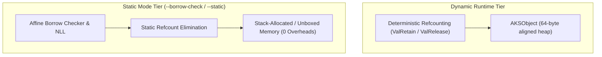

# Chapter 07: Memory Model, Ownership & Borrow Checker

AKS incorporates an affine borrow checker and hybrid memory architecture. It allows developers to enjoy automatic reference counting during rapid prototyping while enforcing strict compile-time ownership, move semantics, and zero-cost static deallocation when building high-performance systems.

---

## 7.1 The Dual-Tier Memory Architecture



1. **Dynamic Tier (Default)**: Memory is reclaimed deterministically as soon as an object's reference count drops to zero (`refcount == 0`), eliminating non-deterministic stop-the-world garbage collection pauses.
2. **Static Tier (`--borrow-check` / `--static`)**: The compiler performs compile-time dataflow analysis. When a value's lifetime is bounded statically, the compiler removes reference count increment/decrement operations (`ValRetain`/`ValRelease`), emitting unboxed stack allocations with zero runtime overhead.

---

## 7.2 Move Semantics vs Copy Types

In static mode, AKS classifies every type as either a **`Copy` Type** or a **Move-Semantics Type**:

- **`Copy` Types (`int`, `float`, `bool`)**: Primitive immediate types stored inline inside stack slots. Assigning a `Copy` variable creates a bitwise duplicate without invalidating the source variable.
- **Move-Semantics Types (`str`, `[T]`, `{K: V}`, `struct`)**: Non-primitive structures own heap resources. Assigning a move-semantics variable transfers ownership to the new binding. Accessing the original variable afterward triggers a compile-time borrow checker error (`E0382`).

```aks
// Move Semantics Example
let source_buffer = [10, 20, 30, 40, 50];

// Ownership of the array is MOVED to target_buffer
let target_buffer = source_buffer;

print(target_buffer); // Valid

// In static mode (--borrow-check), the following line is rejected at compile time:
// print(source_buffer); 
// Compiler error on line 8: error[E0382]: Use of moved value `source_buffer`
```

---

## 7.3 Borrowing Rules & Non-Lexical Lifetimes (NLL)

To share data without transferring ownership, AKS provides references via the **borrowing mechanism**.

### 7.3.1 The Fundamental Borrowing Rule: Aliasing XOR Mutability

At any given point in execution, a program may have:
1. **Any number of immutable references (`&T`)** to a resource, OR
2. **Exactly one mutable reference (`&mut T`)** to a resource.
3. *Never both simultaneously.*

```aks
let mut telemetry_data = [100, 200, 300];

// Creating an immutable borrow
let r1 = &telemetry_data;
let r2 = &telemetry_data; // Valid: multiple immutable borrows allowed
print("Telemetry sample: " + String(r1[0]));

// Creating a mutable borrow
let r_mut = &mut telemetry_data;
Push(r_mut, 400); // Valid: exclusive mutable access
```

### 7.3.2 Non-Lexical Lifetimes (NLL)

Unlike early compiler systems where a borrow's lifetime lasted until the end of its enclosing curly-brace scope, AKS uses **Non-Lexical Lifetimes (NLL)**. A reference's lifetime ends at the point of its **last syntactic usage**, allowing subsequent mutable borrows earlier in the same scope:

```aks
let mut dataset = [1, 2, 3];

let read_ref = &dataset;
print(read_ref[0]); // Last use of `read_ref`! Lifetime of read_ref ends here.

// Valid under NLL: `read_ref` is no longer active, so mutable borrow succeeds:
let write_ref = &mut dataset;
Push(write_ref, 4);
```

---

## 7.4 Compile-Time Borrow Checker Error Codes

When `--borrow-check` is active, the compiler emits detailed diagnostics:

### 1. `error[E0382]`: Use of Moved Value

```aks
fn process_payload(data: [int]) {
    print("Processing payload of " + String(Length(data)) + " items.");
}

let packet = [0xAA, 0xBB, 0xCC];
process_payload(packet); // Ownership moved into function parameter

// Error: `packet` used here after move
// print(packet);
```

*Solution*: Pass an immutable reference `process_payload(&packet)` instead of moving ownership.

### 2. `error[E0499]`: Multiple Simultaneous Mutable Borrows

```aks
let mut config_table = { "port": 8080 };

let m1 = &mut config_table;
// let m2 = &mut config_table; // Compile error[E0499]: Cannot borrow `config_table` mutably more than once at a time
```

### 3. `error[E0502]`: Simultaneous Mutable & Immutable Borrows

```aks
let mut hardware_state = [1, 0, 1];

let view = &hardware_state;
// let mut_view = &mut hardware_state; // Compile error[E0502]: Cannot borrow `hardware_state` mutably while immutably borrowed
print(view);
```

### 4. `error[E0515]`: Returning Reference to Local Variable

```aks
fn create_local_buffer() -> &[int] {
    let local_arr = [10, 20, 30];
    // return &local_arr; // Compile error[E0515]: Cannot return reference to local variable `local_arr`
    return local_arr; // Valid: Move ownership to caller
}
```

---

## 7.5 Lexical Region Scopes & Arena Allocation

For high-throughput systems workloads that create thousands of short-lived objects, AKS provides bump-pointer **Region Scopes** (`region (r)`). Objects allocated within a region bypass standard heap allocation overhead and are reclaimed in bulk:

```aks
region (r) {
    // Allocate high-speed bump-pointer collections
    let buffer = r.AllocArray(1024);
    let node = r.AllocStruct("TreeNode");

    // Introspect active region memory usage
    let object_count = r.AllocCount();       // Active object count (e.g. 2)
    let memory_bytes = r.AllocatedBytes();   // Raw bytes consumed including headers

    print(f"Allocations: {object_count}, Consumed: {memory_bytes} bytes");

    // O(1) bulk reset: Invalidates all allocations and resets bump pointer for reuse
    r.Reset();
    assert(r.AllocCount() == 0);

    // Reuse arena without incurring OS re-allocation overhead
    let reused_buffer = r.AllocArray(512);
    assert(r.AllocCount() == 1);
} // Scope exit: Total O(1) teardown of all allocated memory
```

Standard library native functions `ArenaReset()`, `ArenaAllocCount()`, and `ArenaAllocatedBytes()` allow direct management of `AKSArena` handles.

---

## 7.6 Deterministic RAII & The `Drop` Trait

When custom resources (file handles, network sockets, GPU buffers) must be deterministically released when their owner goes out of scope, types can implement the `Drop` trait:

```aks
trait Drop {
    fn drop(self);
}

struct ManagedFile {
    handle: int;
}

impl ManagedFile {
    fn drop(self) {
        if (self.handle != 0) {
            CloseHandle(self.handle);
            print(f"Handle {self.handle} closed via Drop trait.");
        }
    }
}
```

When an instance of a type implementing `Drop` goes out of scope, the compiler automatically invokes `drop(self)` prior to deallocating the memory.

---

## 7.7 Summary & Next Steps

In this chapter, we explored:
1. The dual-tier memory model: deterministic refcounting vs static ownership.
2. Move semantics vs `Copy` types.
3. Immutable (`&T`) vs mutable (`&mut T`) borrowing rules and Non-Lexical Lifetimes (NLL).
4. Static reference count elimination.
5. Diagnosing and resolving borrow checker error codes (`E0382`, `E0499`, `E0502`, `E0515`, `E0596`).
6. Lexical region scopes (`region (r)`), bump-pointer arenas, allocation introspection (`AllocCount`, `AllocatedBytes`), and `Reset()` reuse.
7. Deterministic RAII resource management via the `Drop` trait.

Proceed to [Chapter 08: Concurrency, Async, Fibers & Parallelism](Chapter%2008%20-%20Concurrency,%20Async%20and%20Fibers.md) to explore asynchronous microtasks, Win32 Fibers, and thread synchronization.
