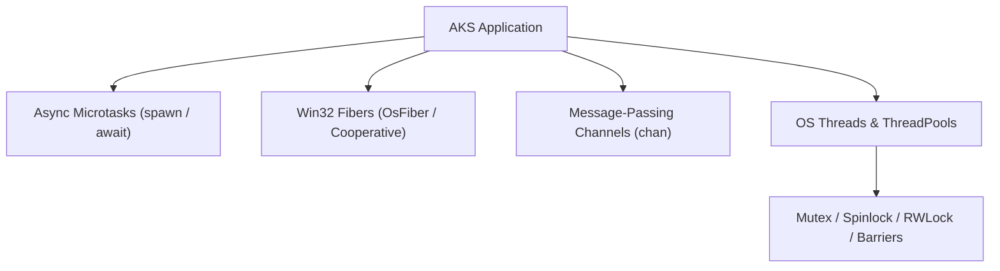
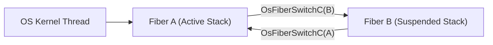

# Chapter 08: Concurrency, Async, Fibers & Parallelism

Modern software must leverage multi-core CPUs while managing thousands of concurrent I/O connections without thread exhaustion. AKS provides a tiered concurrency model: asynchronous microtasks (`spawn`/`await`), cooperative user-mode Win32 Fibers (`OsFiber`), typed message-passing channels (`chan`), and low-level thread synchronization primitives.

---

## 8.1 Concurrency Models in AKS



---

## 8.2 Asynchronous Microtasks (`spawn` & `await`)

Asynchronous microtasks represent lightweight, non-blocking units of work managed by the VM event loop:

```aks
fn fetch_database_metric(metric_name: str) {
    print("Starting async query for: " + metric_name);
    // Simulates non-blocking async operation
    let result = "MetricData[" + metric_name + "]=99.4";
    return result;
}

fn main() {
    print("Spawning asynchronous database tasks...");
    
    // Spawns tasks onto the event loop
    let task1 = spawn fetch_database_metric("cpu_load");
    let task2 = spawn fetch_database_metric("memory_usage");
    
    // Await results
    let res1 = await task1;
    let res2 = await task2;
    
    print("Completed: " + res1);
    print("Completed: " + res2);
}

main();
```

---

## 8.3 Cooperative User-Mode Win32 Fibers (`OsFiber`)

Fibers are lightweight execution units scheduled in user mode rather than kernel mode. Switching between fibers requires no kernel transitions or page table swaps, taking only a few CPU cycles:



### 8.3.1 Fiber Lifecycle Management

- **`OsFiberCreateC(stack_size, fn, param)`**: Allocates a private execution stack (default 64 KB) and initializes a fiber execution context.
- **`OsFiberSwitchC(target_fiber)`**: Performs a user-mode CPU register swap, yielding execution immediately to the target fiber.
- **`OsFiberDeleteC(fiber)`**: Deallocates the fiber stack.

```aks
// fiber_demo.aks
fn fiber_worker(param) {
    print("Inside Fiber Worker! Received param: " + String(param));
    // Yield execution back to caller fiber
    OsFiberSwitchC(param);
    print("Resumed Fiber Worker!");
}

fn main() {
    print("Creating user-mode Win32 Fiber...");
    let fiber_h = OsFiberCreateC(65536, fiber_worker, 0);
    
    print("Switching context to Fiber...");
    OsFiberSwitchC(fiber_h);
    
    print("Returned to main thread context.");
    OsFiberDeleteC(fiber_h);
}

main();
```

---

## 8.4 Typed Channels (`chan`)

Channels facilitate safe, structured communication between concurrent routines using message passing:

```aks
fn producer(ch) {
    for (let i = 1; i <= 3; i += 1) {
        ChannelSend(ch, "Message #" + String(i));
    }
}

fn consumer(ch) {
    for (let i = 1; i <= 3; i += 1) {
        let msg = ChannelReceive(ch);
        print("Consumer received: " + msg);
    }
}

fn main() {
    let ch = Channel(4); // Bounded buffer of capacity 4
    
    spawn producer(ch);
    spawn consumer(ch);
}

main();
```

---

## 8.5 Thread Synchronization Primitives

When multiple OS threads share memory structures, AKS provides hardware and OS synchronization primitives:

### 8.5.1 Mutexes & Shared Spinlocks

- **Kernel Mutex (`MutexNewC`)**: OS-managed lock. If contended, the waiting thread enters kernel sleep, freeing the CPU core.
- **Shared Spinlock (`SharedSpinlockNewC`)**: User-space atomic test-and-set spinlock. Ideal for short, low-latency critical sections where thread sleep overhead exceeds spin time.

```aks
let mtx = MutexNewC();

MutexLockC(mtx);
// Critical section: update shared state
print("Protected resource update.");
MutexUnlockC(mtx);
```

### 8.5.2 Thread Barriers (`ThreadBarrierNewC`)

Synchronizes a designated number of threads at a rendezvous point. No thread proceeds until all participants have arrived at the barrier:

```aks
let barrier = ThreadBarrierNewC(4); // 4 participating threads

// Inside worker threads:
// ThreadBarrierWaitC(barrier); // Blocks until 4th thread arrives
```

### 8.5.3 Condition Variables (`ConditionVariableNewC`)

Allows threads to suspend execution until notified that a specific state condition has been satisfied:

```aks
let cv = ConditionVariableNewC();

// Signaling thread:
ConditionVariableSignalC(cv); // Wakes one waiting worker
```

---

## 8.6 The Actor Model & State-Isolated Mailboxes

To eliminate shared-memory data races entirely without manual lock orchestration, AKS implements the **Actor Model**. Actors encapsulate private state, processing sequential messages received via lock-free concurrent mailboxes.

### 8.6.1 Declaring & Spawning Actors

Actors are defined with the `actor` keyword, enclosing encapsulated fields and handling methods:

```aks
actor BankAccount {
    balance: float;

    fn Deposit(amount: float) -> float {
        self.balance += amount;
        return self.balance;
    }

    fn Withdraw(amount: float) -> float {
        if (self.balance >= amount) {
            self.balance -= amount;
        }
        return self.balance;
    }

    fn GetBalance() -> float {
        return self.balance;
    }
}
```

### 8.6.2 Asynchronous Messaging & Request-Reply

Actors communicate through actor references (`aref`):

```aks
// Spawn an actor instance onto the scheduler
let account = BankAccount.Spawn({ balance: 1000.0 });
print("Account active: " + String(account.IsAlive()));

// Asynchronous fire-and-forget message (non-blocking)
account.Send({ type: "Deposit", amount: 250.0 });

// Synchronous request-reply with timeout (ms)
let current_balance = account.Call({ type: "GetBalance" }, 1000);
print("Current Balance: $" + String(current_balance)); // $1250.0

// Gracefully terminate actor fiber
account.Stop();
```

---

## 8.6 Structured Concurrency: Nurseries & Lexical Regions

Unstructured concurrency (e.g. Go goroutines, C++ raw threads) often leads to orphaned background workers, leaked file descriptors, and silently abandoned failures. AKS solves this by enforcing **Structured Concurrency** through scope-bounded **Nurseries** and **Lexical Region Scopes**.

### Nurseries (`nursery`)

A `nursery` establishes a lexical boundary around concurrent task execution. The language runtime guarantees that **no spawned fiber can outlive the nursery scope**: execution cannot leave the block until every child fiber has completed or been joined.

```aks
// Structured Nursery block: execution blocks at '}' until all child tasks finish
nursery (n) {
    n.Spawn(task_worker_1);
    n.SpawnArg(task_worker_2, payload);
    
    // Dynamically track existing spawned tasks
    let t = spawn background_compute();
    n.Track(t);
}
// Guaranteed Invariant: 100% of tasks spawned inside n have completed here!
```

If an error or cancellation occurs within the nursery, `n.CancelAll()` can proactively signal all active sibling tasks.

### Lexical Region Memory Scopes (`region`)

Region scopes integrate structured memory management with task execution. A `region` binds an arena bump-allocator that cleans up in $O(1)$ batch time at scope exit:

```aks
region (r) {
    // Fast contiguous allocations tied to the lexical region
    let buffer = r.AllocArray(1024);
    let scratch = r.AllocStruct("ScratchState");
    // Work with buffer and scratch...
}
// All region allocations are instantaneously deallocated in O(1) batch time
```

---

## 8.7 Summary & Next Steps

In this chapter, we explored:
1. Asynchronous microtasks with `spawn` and `await`.
2. Win32 user-mode Fibers (`OsFiber`) and user-space context switching.
3. Message-passing communication via typed channels (`chan`).
4. Synchronization primitives: Mutexes, Spinlocks, Barriers, Condition Variables, and RWLocks.
5. The Actor Model: isolated state, lock-free mailboxes, non-blocking `Send`, and request-reply `Call`.
6. Structured Concurrency: scope-bounded `nursery` blocks with guaranteed zero task leaks and lexical `region` scopes.

Proceed to [Chapter 09: Lock-Free Concurrency, Data Structures & Memory Reclamation](Chapter%2009%20-%20Lock-Free%20Data%20Structures.md) to explore hardware atomic CAS instructions, lock-free queues, and Hazard Pointers.
