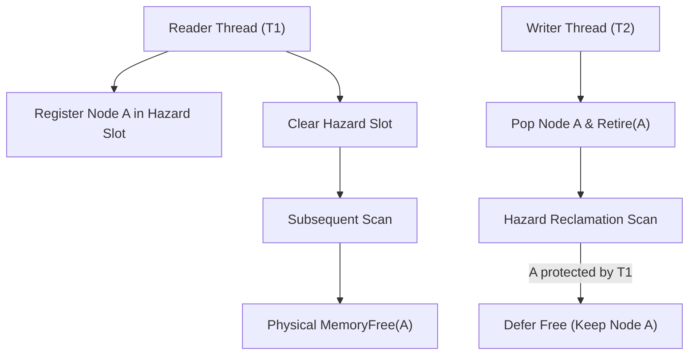

# Chapter 09: Lock-Free Concurrency, Data Structures & Memory Reclamation

Lock-free programming eliminates mutex lock contention, deadlocks, and priority inversions by utilizing hardware atomic primitives. This chapter covers the hardware cache coherence foundation, the ABA problem, the Lock-Free Treiber Stack, MPSC Queues, the Chase-Lev Work-Stealing Deque, Hazard Pointers safe memory reclamation, and Windows I/O Completion Ports (IOCP).

---

## 9.1 Hardware Atomic Primitives & Cache Coherence

Lock-free algorithms rely on hardware atomic instructions that operate directly at the CPU cache-line level (MESI/MOESI cache coherence protocols).

### 9.1.1 Compare-And-Swap (CAS)

The fundamental atomic primitive is **Compare-And-Swap (CAS)** (the `lock cmpxchg` instruction on x86-64). CAS atomically checks if a memory location holds an expected value; if so, it updates the location to a desired value:

$$\text{CAS}(\text{address}, \text{expected}, \text{desired}) \to \begin{cases} \text{true}, & \text{if } *\text{address} == \text{expected} \ (\text{updated}) \\ \text{false}, & \text{otherwise} \ (\text{unchanged}) \end{cases}$$

```aks
let atomic_counter = AtomicI64New(100);

// Atomically exchange value if it equals 100
let success = AtomicI64Cas(atomic_counter, 100, 200);
print("CAS Success: " + String(success)); // true
print("Updated Value: " + String(AtomicI64Load(atomic_counter))); // 200
```

---

## 9.2 The ABA Problem & Hazard Pointers Memory Reclamation

### 9.2.1 The ABA Problem

In lock-free pointer-based structures, thread $T_1$ reads pointer $A$. Thread $T_2$ pops $A$, frees it, allocates node $B$, and then allocates a new node that happens to reuse memory address $A$. When $T_1$ performs a CAS on $A$, the CAS succeeds because the pointer address matches $A$, unaware that the node contents have changed.

### 9.2.2 Hazard Pointers Solution

AKS provides a **Hazard Pointer Domain** (`HazardPointerDomainNewC`). Before accessing a node, a reader registers the node's pointer in a thread-local hazard pointer slot. When a node is popped, it is retired rather than immediately freed. The memory reclamation scanner inspects all hazard slots across all active threads, ensuring a node is only physically freed when no thread holds an active reference to it:



```aks
let domain = HazardPointerDomainNewC(8); // 8 worker threads

// Reader marks node address as protected:
HazardPointerAcquireC(domain, 0, 0x100040);

// Writer pops and marks node for deferred reclamation:
let retired_count = HazardPointerRetireC(domain, 0x100040);

// Reader releases protection:
HazardPointerReleaseC(domain, 0);
```

---

## 9.3 Lock-Free Treiber Stack

The Treiber Stack achieves thread-safe push and pop operations without any mutex locks using an atomic CAS loop:

```aks
let stack = LockFreeStackNewC();

// Concurrently push values
LockFreeStackPushC(stack, 1001);
LockFreeStackPushC(stack, 1002);

// Concurrently pop values
let v1 = LockFreeStackPopC(stack);
let v2 = LockFreeStackPopC(stack);

print("Popped item: " + String(v1)); // 1002
print("Popped item: " + String(v2)); // 1001
```

---

## 9.4 Multi-Producer Single-Consumer (MPSC) Queue

The MPSC Queue provides a high-throughput, lock-free ring buffer where multiple producer threads can push tasks simultaneously while a dedicated consumer thread drains tasks sequentially:

```aks
let mpsc = MpscQueueNewC(1024); // Capacity 1024 items

// Multiple worker threads push tasks concurrently:
MpscQueuePushC(mpsc, "TASK_INGEST_LOGS");
MpscQueuePushC(mpsc, "TASK_COMPUTE_STATS");

// Dedicated consumer thread pops tasks:
let task = MpscQueuePopC(mpsc);
print("Consumer processing: " + String(task));
```

---

## 9.5 Chase-Lev Work-Stealing Deque

The Chase-Lev Deque is the foundation of high-performance task schedulers (such as Go runtime, Tokio, and Rayon). 

- **Local Worker**: Pushes and pops tasks from the **bottom** of the deque in LIFO order (exploiting CPU cache locality).
- **Stealer Workers**: Idle threads steal tasks from the **top** of the deque in FIFO order using atomic CAS:

```aks
let deque = StealingDequeNewC(256);

// Local worker thread:
StealingDequePushC(deque, "LOCAL_TASK_1");
StealingDequePushC(deque, "LOCAL_TASK_2");

// Idle thief thread steals from top:
let stolen_task = StealingDequeStealC(deque);
print("Stealer worker executed: " + String(stolen_task)); // "LOCAL_TASK_1"
```

---

## 9.6 Windows I/O Completion Ports (IOCP)

Windows IOCP is the highest-performance asynchronous I/O and task dispatching mechanism in the Windows NT kernel:

```aks
let iocp = OsIoCompletionPortCreateC(4); // Bind to 4 worker threads

// Post completion packet to IOCP kernel queue
OsIoCompletionPortPostC(iocp, 512, 101, 0);

// Worker thread waits for packet:
let packet = OsIoCompletionPortWaitC(iocp, 1000); // 1000ms timeout
print("IOCP Packet Dequeued: Bytes=" + String(packet.bytes) + ", Key=" + String(packet.key));
```

---

## 9.7 Summary & Next Steps

In this chapter, we explored:
1. Hardware atomic Compare-And-Swap (CAS) instructions and cache coherence.
2. The ABA problem and Hazard Pointers safe memory reclamation.
3. Lock-free Treiber Stacks and MPSC Queues.
4. The Chase-Lev Work-Stealing Deque algorithm.
5. Windows I/O Completion Ports (IOCP) kernel event queues.

Proceed to [Chapter 10: Advanced Pure Data Structures](Chapter%2010%20-%20Advanced%20Pure%20Data%20Structures.md) to explore Fenwick Trees, Segment Trees, DSU, SkipLists, Treaps, and Wavelet Trees.
