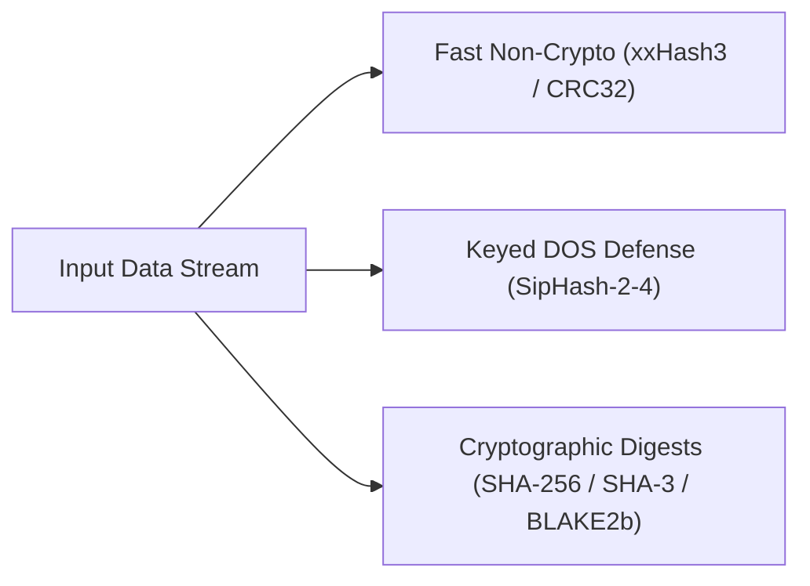

# Chapter 13: Cryptography & Security Engine

Security and cryptography are first-class subsystems in AKS. This chapter covers non-cryptographic and cryptographic hashing (CRC32, xxHash3, SipHash, SHA-256, SHA-512/256, SHA-3, BLAKE2b), message authentication (HMAC, CMAC), key derivation (PBKDF2, Argon2id, HKDF), symmetric ciphers (AES-CBC, ChaCha20, XChaCha20-Poly1305 AEAD), asymmetric elliptic curves (X25519, Ed25519), and multi-factor authentication (TOTP).

---

## 13.1 Cryptographic & Non-Cryptographic Hashing



```aks
let plaintext = "Sensitive Transaction Payload";

// Fast non-cryptographic hashes
let xx_hash = CryptoXxHashC([0x01, 0x02, 0x03, 0x04]);
print("xxHash3 64-bit: " + Hex(xx_hash));

// SHA-256 Digest
let sha256_hex = CryptoSha256(plaintext);
print("SHA-256: " + sha256_hex);

// BLAKE2b 256-bit Digest
let blake2b_hex = CryptoBlake2(plaintext);
print("BLAKE2b: " + blake2b_hex);

// SHA-3 (Keccak-256)
let sha3_hex = CryptoSha3(plaintext);
print("SHA-3:   " + sha3_hex);
```

---

## 13.2 Message Authentication Codes (HMAC & CMAC)

Message authentication ensures message integrity and authenticity using a shared secret:

```aks
let shared_key = "TopSecretAuthenticationKey";
let message = "Transfer $1,000,000 to Account #9821";

// HMAC-SHA256
let hmac_tag = CryptoHmac(shared_key, message);
print("HMAC-SHA256 Tag: " + hmac_tag);

// CMAC-AES (Cipher-based MAC)
let cmac_tag = CryptoCmacAes(shared_key, message);
print("CMAC-AES Tag:    " + cmac_tag);
```

---

## 13.3 Key Derivation Functions (Argon2id, PBKDF2, HKDF)

KDFs transform passwords into high-entropy cryptographic keys:

```aks
let password = "SuperSecureUserPassword!2026";
let salt = "random_salt_16bytes";

// Argon2id Memory-Hard Password Hashing (Winner of Password Hashing Competition)
let argon_hash = CryptoArgon2(password, salt, 65536, 3); // 64MB memory, 3 iterations
print("Argon2id Hash: " + argon_hash);

// HKDF Subkey Derivation (RFC 5869)
let initial_key_material = [0xAA, 0xBB, 0xCC, 0xDD];
let derived_aes_key = CryptoHkdf(initial_key_material, salt, "AES_ENCRYPTION_KEY", 32);
print("Derived 256-bit Key Length: " + String(Length(derived_aes_key)) + " bytes");
```

---

## 13.4 Symmetric Encryption: AES-CBC & XChaCha20-Poly1305 AEAD

### 13.4.1 AES-256-CBC with PKCS#7 Padding

```aks
let aes_key = "12345678901234567890123456789012"; // 32-byte 256-bit key
let iv = "1234567890123456";                 // 16-byte initialization vector

let secret_text = "CONFIDENTIAL_PAYLOAD_DATA";

// Encrypt
let encrypted_bytes = CryptoAesCbcEncryptC(aes_key, iv, secret_text);
print("Encrypted Block Count: " + String(Length(encrypted_bytes)) + " bytes");

// Decrypt
let decrypted_text = CryptoAesCbcDecryptC(aes_key, iv, encrypted_bytes);
print("Decrypted Plaintext: " + decrypted_text);
```

### 13.4.2 XChaCha20-Poly1305 Authenticated Encryption with Associated Data (AEAD)

Combines the XChaCha20 stream cipher with an extended 192-bit (24-byte) nonce and Poly1305 authentication tag, protecting against replay and forgery:

```aks
let cipher_packet = CryptoXChaCha20Poly1305(
    derived_aes_key, 
    [0,1,2,3,4,5,6,7,8,9,10,11,12,13,14,15,16,17,18,19,20,21,22,23], // 24-byte nonce
    "AUTHENTICATED_BODY", 
    "AUTH_HEADER"
);
```

---

## 13.5 Asymmetric Elliptic Curves: X25519 & Ed25519

### 13.5.1 X25519 Elliptic Curve Diffie-Hellman (ECDH) Key Agreement

Enables two parties to establish a shared secret over an insecure channel:

```aks
// Alice private/public keypair
let alice_priv = [0x77,0x07,0x6D,0x0A,0x73,0x18,0xA5,0x7D,0x3C,0x16,0xC1,0x72,0x51,0xB2,0x66,0x45,
                  0xDF,0x4C,0x2F,0x87,0xEB,0xC0,0x99,0x2A,0xB1,0x77,0xFB,0xA5,0x1D,0xB9,0x2C,0x2A];
let alice_pub  = [0x85,0x20,0xF0,0x09,0x89,0x30,0xA7,0x54,0x74,0x8B,0x7D,0xDC,0xB4,0x3E,0xF7,0x5A,
                  0x0D,0xBF,0x3A,0x0D,0x26,0x38,0x15,0xE4,0x2B,0x60,0x48,0x20,0xF9,0x25,0x34,0x77];

// Bob private/public keypair
let bob_priv   = [0x5D,0xAB,0x08,0x7E,0x62,0x4A,0x8A,0x4B,0x79,0xE1,0x7F,0x8A,0xB3,0x8E,0x06,0x5D,
                  0x72,0xA9,0x75,0xCC,0x7D,0x2E,0x19,0x53,0x43,0x57,0x7A,0xD2,0x19,0x19,0x0E,0x5C];
let bob_pub    = [0xDE,0x9E,0xDB,0x7D,0x7B,0x7D,0xC1,0xB4,0xD3,0x5B,0x61,0xC2,0xEC,0xE4,0x35,0x37,
                  0x3F,0x83,0x43,0xC8,0x5B,0x78,0x67,0x4D,0xAD,0xFC,0x7E,0x14,0x6F,0x88,0x2B,0x4F];

// Compute shared secret:
let alice_secret = CryptoX25519C(alice_priv, bob_pub);
let bob_secret   = CryptoX25519C(bob_priv, alice_pub);

print("Alice derived secret == Bob derived secret: " + String(alice_secret == bob_secret)); // true
```

### 13.5.2 Ed25519 Digital Signatures

High-speed, constant-time digital signatures:

```aks
let doc = "RELEASE_FIRMWARE_V2.0_CHECKSUM_OK";

let signature = CryptoEd25519Sign(alice_priv, doc);
let is_valid = CryptoEd25519Verify(alice_pub, doc, signature);

print("Signature Verification Status: " + String(is_valid)); // true
```

---

## 13.6 RFC 6238 TOTP Multi-Factor Tokens

Generates 6-digit Time-Based One-Time Password tokens compatible with Google Authenticator and standard 2FA hardware tokens:

```aks
let secret_base32 = "JBSWY3DPEHPK3PXP";
let current_step = Int(clock() / 30.0); // 30-second time window

let token = CryptoTotpC(secret_base32, current_step);
print("Current 2FA TOTP Code: " + token); // e.g. "482910"
```

---

## 13.7 Summary & Next Steps

In this chapter, we explored:
1. Fast non-cryptographic (xxHash3) and cryptographic (SHA-256, SHA-3, BLAKE2b) hashes.
2. HMAC and CMAC message authentication codes.
3. KDFs: Argon2id, PBKDF2, and HKDF.
4. AES-256-CBC and XChaCha20-Poly1305 AEAD symmetric encryption.
5. Asymmetric X25519 key agreements and Ed25519 digital signatures.
6. RFC 6238 TOTP two-factor authentication tokens.

Proceed to [Chapter 14: SIMD Hardware Acceleration & High-Performance Computing](Chapter%2014%20-%20SIMD%20and%20Hardware%20Acceleration.md) to explore AVX/AVX2 vector primitives, FMA dot products, and BMI2 bit manipulation.
