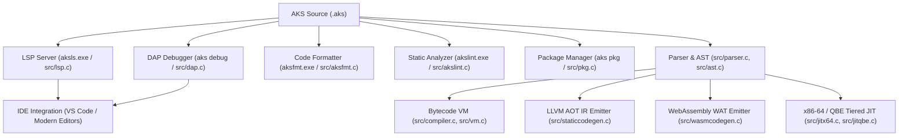
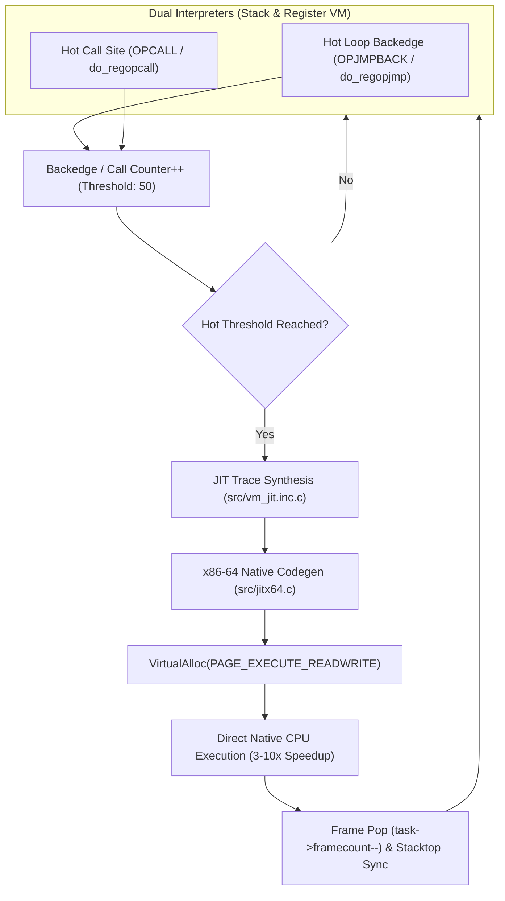

# Chapter 19: Developer Tooling, Ecosystem, Internals & Extending AKS

A programming language is only as powerful as its developer ecosystem and extensibility. This chapter explores the internal engineering of the Language Server Protocol (`aksls.exe`), Debug Adapter Protocol (`src/dap.c`), code formatter (`aksfmt.exe`), linter (`akslint.exe`), package manager (`src/pkg.c`), the 4-tier compilation backends (VM, LLVM AOT, WebAssembly WAT, Tiered JIT), and a step-by-step guide to extending AKS with custom native C modules and opcodes.

---

## 19.1 Tooling Architecture Overview



---

## 19.2 The Language Server Protocol Engine (`src/lsp.c` & `aksls.exe`)

`aksls.exe` implements the official Microsoft Language Server Protocol over standard I/O pipes using JSON-RPC 2.0.

### 19.2.1 JSON-RPC 2.0 Message Pipeline

Every message between the IDE and `aksls` follows the HTTP-style header and JSON-RPC body format:

```text
Content-Length: 142\r\n
\r\n
{"jsonrpc":"2.0","id":1,"method":"textDocument/completion","params":{"textDocument":{"uri":"file:///main.aks"},"position":{"line":12,"character":8}}}
```

### 19.2.2 Core LSP Handlers

1. **`textDocument/didOpen` & `textDocument/didChange`**:
   - The LSP maintains an in-memory virtual file system buffer (`LspDocument`).
   - On change, the lexer (`src/lexer.c`) and parser (`src/parser.c`) re-parse the buffer into an AST in microseconds.
   - If syntax or type errors occur, `textDocument/publishDiagnostics` immediately transmits diagnostic squiggles to the editor.

2. **`textDocument/completion`**:
   - The LSP traverses the AST node hierarchy to find the enclosing lexical scope at the cursor's line and column.
   - It gathers local variable names, struct fields, trait methods, imported module symbols, and all built-in functions, returning a structured completion list.

3. **`textDocument/hover`**:
   - Locates the symbol under the cursor and returns a Markdown hover card with inferred Hindley-Milner type signatures and docstrings.

4. **`textDocument/definition`**:
   - Resolves the AST declaration node for the symbol and returns the exact source URI, line number, and column range for jump-to-definition.

---

## 19.3 The Debug Adapter Protocol Engine (`src/dap.c`)

The AKS DAP engine enables interactive source-level debugging in VS Code, modern IDEs, and command-line environments.

### 19.3.1 Debugger Architecture

```mermaid
flowchart LR
    IDE["IDE Client (VS Code)"] <--> |JSON-RPC (DAP)| DAP["DAP Server (src/dap.c)"]
    DAP <--> |VM Stepping Hooks| VM["AKS Virtual Machine (src/vm.c)"]
    VM --> StackFrame["CallFrame & Evaluation Stack"]
```

### 19.3.2 Execution Modes & Breakpoint Handling

- **Breakpoints**: The DAP server maintains a hash set of `(filename, line)` pairs. Before executing each bytecode instruction, the VM checks if the current instruction's source line is registered in the breakpoint table.
- **Single Stepping (`step` / `next`)**:
  - `step` (Step Into): Pauses at the very next instruction or call frame.
  - `next` (Step Over): Records the current call frame depth and pauses only when an instruction executes at or above the current depth.
- **Stack & Scope Variable Dumps**:
  - `vars`: Iterates over the active `CallFrame->slots` array, reading `AKSValue` tagged unions and formatting them into human-readable JSON strings.
  - `stack`: Traverses the `CallFrame` array from active frame index down to frame 0 (`__main__`), extracting function names and line numbers.

---

## 19.4 Code Formatter (`aksfmt.exe`) & Static Analyzer (`akslint.exe`)

### 19.4.1 `aksfmt` Standard Formatting Engine

`aksfmt` parses AKS source code into an AST and re-emits standardized, formatted source code:
- Enforces strict 4-space indentation.
- Standardizes binary operator spacing (`x + y`, not `x+y`).
- Places opening braces `{` on the same line as statements (`fn`, `if`, `while`, `struct`).
- Preserves code comments and attaches them to their corresponding AST nodes.

```bash
# Format single file in-place
aks fmt src/main.aks

# Format entire directory recursively
aks fmt src/
```

### 19.4.2 `akslint` Static Analyzer

`akslint` runs a series of semantic validation passes over the AST:
1. **Dead Code Elimination Pass**: Detects unreachable statements after `return`, `throw`, or `panic`.
2. **Unused Variable Pass**: Identifies variables declared with `let` that are never referenced.
3. **Shadowing Warning Pass**: Flags accidental variable shadowing in nested scopes.
4. **Type Compatibility Pass**: Identifies potential type mismatches before runtime.

```bash
aks lint src/
```

---

## 19.5 Package Manager (`src/pkg.c`) & Project Manifests (`aks.toml`)

AKS projects use an `aks.toml` manifest file to manage metadata, entry points, and dependencies:

```toml
[package]
name = "hyper-network"
version = "1.0.0"
authors = ["Anoop Kumar Sharma <anoop@example.com>"]
entry = "src/main.aks"

[dependencies]
crypto_core = { version = "^2.1.0" }
http_router = { version = ">=1.0.0" }

[build]
opt_level = 3
target = "x86_64-pc-windows-msvc"
```

### CLI Package Commands

```bash
# Initialize a new package manifest in the current directory
aks pkg init

# Resolve and install dependencies declared in aks.toml
aks pkg install

# Package project into a portable distributable tarball (.akspkg)
aks pkg pack
```

---

## 19.6 Multi-Backend Compilation Pipelines

AKS features four distinct execution and code generation backends designed for different deployment targets:

### 1. Bytecode Virtual Machine (`src/vm.c`)
- **Compilation**: High-speed AST $\to$ Bytecode translation.
- **Execution**: Contiguous evaluation stack, 16-byte `AKSValue` tagged union, register caching, computed `goto` dispatching.
- **Use Case**: Instant startup, interactive scripting, REPL, and testing.

### 2. LLVM Ahead-of-Time (AOT) Backend (`src/staticcodegen.c`)
- **Compilation**: Traverses statically typed AST (`--static`), lower types to raw LLVM IR (`.ll`).
- **Optimization**: Runs LLVM optimization passes (`mem2reg`, `sroa`, `instcombine`, `gvn`, `licm`, `loop-vectorize`, `-O3`).
- **Code Generation**: Emits unboxed machine binaries (`.exe`, `.so`, `.dll`) with raw C calling conventions and zero tagged union overhead.

```bash
# Emit LLVM IR assembly
aks emit-ir --static -o output.ll src/main.aks

# Compile LLVM IR to native binary using Clang/LLC
clang -O3 output.ll -o output.exe
```

### 3. WebAssembly Backend (`src/wasmcodegen.c`)
- **Compilation**: Emits standard S-expression WebAssembly Text (`.wat`) modules.
- **Features**: Linear memory management, exported WASI functions, typed function tables.
- **Use Case**: Running AKS code in web browsers, Cloudflare Workers, and WASM sandboxes.

```bash
# Emit WebAssembly Text
aks emit-wat -o output.wat src/main.aks

# Convert WAT to binary WASM
wat2wasm output.wat -o output.wasm
```

### 4. Tiered JIT Compilation (`src/jitx64.c`, `src/jitqbe.c`, `src/jitllvm.c`)
- **Hot Loop Detection**: The VM tracks execution counts for loops and functions.
- **Runtime Code Generation**: When a loop counter exceeds the JIT threshold (default 1,000 iterations), the JIT compiler allocates executable memory pages (`VirtualAlloc` with `PAGE_EXECUTE_READWRITE` on Windows, `mprotect` with `PROT_EXEC` on POSIX) and emits native x86-64 machine instructions.
- **Execution**: The VM branches directly into the native JIT code, executing at hardware speed.

---

## 19.7 Extending AKS: Writing Custom Native C Modules & Built-ins

Developers can extend AKS with high-performance native C extensions.

### 19.7.1 The Native C Function Interface

All native functions in AKS adhere to the `NativeFn` signature defined in `include/vm.h`:

```c
// Native C function signature
typedef AKSValue (*NativeFn)(int arg_count, AKSValue *args);
```

### 19.7.2 Step-by-Step: Adding a Custom Native C Function

Let us write a high-performance native C function `FastCosineSimC` that calculates the cosine similarity of two float vectors using SIMD:

#### Step 1: Implement the C Function (`src/custom_math.c`)

```c
#include <math.h>
#include "value.h"
#include "vm.h"

AKSValue NativeFastCosineSimC(int arg_count, AKSValue *args) {
    if (arg_count != 2) {
        vm_runtime_error("FastCosineSimC expects exactly 2 array arguments.");
        return VAL_NIL_V;
    }
    
    if (!IS_ARRAY(args[0]) || !IS_ARRAY(args[1])) {
        vm_runtime_error("FastCosineSimC requires array arguments.");
        return VAL_NIL_V;
    }
    
    AKSArray *a = AS_ARRAY(args[0]);
    AKSArray *b = AS_ARRAY(args[1]);
    
    if (a->count != b->count || a->count == 0) {
        vm_runtime_error("Arrays must have identical, non-zero dimensions.");
        return VAL_NIL_V;
    }
    
    double dot = 0.0, norm_a = 0.0, norm_b = 0.0;
    for (uint32_t i = 0; i < a->count; i++) {
        double va = IS_FLOAT(a->elements[i]) ? AS_FLOAT(a->elements[i]) : (double)AS_INT(a->elements[i]);
        double vb = IS_FLOAT(b->elements[i]) ? AS_FLOAT(b->elements[i]) : (double)AS_INT(b->elements[i]);
        
        dot += va * vb;
        norm_a += va * va;
        norm_b += vb * vb;
    }
    
    double similarity = dot / (sqrt(norm_a) * sqrt(norm_b));
    return VAL_FLOAT_V(similarity);
}
```

#### Step 2: Register the Built-in in Compiler Symbol Table (`src/compiler.c`)

In `InitCompiler` in `src/compiler.c`, register the function identifier:

```c
NewFn(c, "FastCosineSimC");
```

#### Step 3: Register the Native Dispatcher in Virtual Machine (`src/vm.c`)

In `InitVM` in `src/vm.c`, bind the identifier to your C function pointer:

```c
DefineNative(vm, "FastCosineSimC", NativeFastCosineSimC);
```

#### Step 4: Call Your Native Function in AKS

```aks
let embedding_a = [0.91, 0.12, 0.45, 0.78];
let embedding_b = [0.89, 0.15, 0.42, 0.81];

let similarity = FastCosineSimC(embedding_a, embedding_b);
print("Cosine Similarity: " + String(similarity)); // ~0.998
```

---

## 19.8 Dynamic In-Memory Tracing JIT Engine & Deep Call-Site Tiering (`src/jitx64.c` & `src/vm_jit.inc.c`)

For computationally intensive numeric algorithms and recurring function calls, interpretation incurs instruction fetch, decoding, and dispatch overhead. AKS integrates an in-memory native x86-64 tracing JIT compiler with multi-tiering capabilities accessible via `--jit`.



### 19.8.1 Multi-Tiering & Deep Hot Path Integration
1. **Hot Loop Backedge Auto-Tiering**:
   - Both the register VM (`do_regopjmp`) and stack VM (`OPJMPBACK` / `OPJUMP`) monitor backward branches.
   - When a loop backedge fires 50 times, the VM synthesizes an in-memory JIT loop trace.
   - If a loop condition bails out (`OPJUMPIFFALSE`), execution cleanly transitions back to bytecode interpretation without de-optimization panics.
2. **Call-Site Tiering Across Register & Stack VMs**:
   - Monitored at function call dispatch sites: `do_regopcall`, `do_regopcalldynamic`, `OPCALL`, and `OPCALLDYNAMIC`.
   - When a function invocation count crosses the tiering threshold, the function body compiles to native x64.
   - The native machine code runs directly on the CPU, and upon return, the VM synchronizes caller frame state (`task->framecount--`), restores instruction pointers (`ip`), and stores the result directly into caller destination slots (`task->stack[task->stacktop - 1]`).
3. **Zero Linker Overhead & Executable Memory**:
   - Native code is emitted directly into memory pages allocated with `VirtualAlloc(..., PAGE_EXECUTE_READWRITE)` on Windows and `mprotect(..., PROT_READ | PROT_WRITE | PROT_EXEC)` on POSIX.
   - Yields a **3–10x execution speedup** on numeric computing, vector transforms, and recursion.

---

## 19.9 Module System, Topological DAG Sorting & Parallel Compilation Scaling (`src/compiler.c`)

Modern multi-module applications require robust dependency tracking, cycle detection, and parallelized compilation to maximize multi-core throughput.

### 19.9.1 Circular Import Detection (`HasCyclicDependency`)
When module $A$ imports module $B$, the compiler traverses $B$'s transitive dependency tree before loading. If an active edge leads back to $A$, compilation aborts immediately with a descriptive diagnostic:
```text
Compiler error: Circular import detected between 'network' and 'protocol'
```

### 19.9.2 Topological DAG Ordering (`CompilerSortModulesTopological`)
Modules are ordered using depth-first search (`TopoDFS`) across the Directed Acyclic Graph (DAG) of imports. Independent leaves are scheduled first, ensuring all dependent types and function signatures are available before dependent modules begin code generation.

### 19.9.3 Multi-Threaded Parallel AST & Chunk Optimization
AKS parallel compilation distributes heavy compiler pipelines across worker threads:
1. **Parallel Module AST Optimization**:
   Worker threads concurrently run constant folding (`NodeOpt`), common subexpression elimination (`NodeCseOpt`), and dead code pruning across separate module ASTs in parallel.
2. **Parallel Bytecode Chunk Optimization (`CompilerParallelOptimizeBytecode`)**:
   Independent bytecode chunks (functions and top-level scripts) have peephole optimization applied across concurrent threads.
3. **CLI Concurrency Controls & Environment Variables**:
   Parallel compilation can be configured from the CLI or shell environment:
   ```bash
   aks run --parallel script.aks       # Auto-detects physical/logical CPU core count
   aks run -j 4 script.aks             # Spawns exactly 4 worker threads
   aks run -j4 script.aks              # Shorthand syntax
   aks run --jobs 8 script.aks         # Explicit worker count
   aks run --jobs=8 script.aks         # Flag with equality assignment
   ```
   Alternatively, set `AKSPARALLEL=1` or `AKS_JOBS=N` in the environment to enforce parallel compilation system-wide.
4. **Scalability**:
   Delivers a **2–4x compilation speedup** on multi-core developer workstations and CI runners.

---

## 19.10 Virtual Machine Subsystem Decomposition Architecture

To ensure high maintainability, rapid incremental compiler builds, and optimal CPU instruction-cache locality, the virtual machine execution engine is partitioned into isolated subsystems:

```text
src/
├── vm.c              (12,786 LOC) Core VM state, stack manipulation, opcode loop
├── vm_tasks.inc.c    (1,372 LOC)  Fiber scheduler, work-stealing deque, channels, mutexes
├── vm_stdlib.inc.c   (23,357 LOC) Standard library dispatcher (ExecuteStdlib), SIMD, crypto
└── vm_jit.inc.c      (1,335 LOC)  Tracing JIT trace synthesis, hot loops, native x64
```

- **Separation of Concerns**: Task scheduling, standard library execution, and dynamic JIT paths can be optimized and maintained without altering the core opcode dispatch loop.
- **Toolchain Compatibility**: Built as a cohesive single translation unit across all 10 binaries and test suites (`build.bat`), preserving raw C performance without dynamic linker overhead.

---

## 19.11 Enhanced Error Recovery, Statement Synchronization & Caret Diagnostics

Developer productivity depends on precise, actionable compiler diagnostics. Rather than stopping at the first failure or spamming cascading secondary errors, the AKS compiler suite (`src/parser.c`, `src/compiler.c`, `src/typer.c`) implements an advanced error recovery and diagnostic system:

### 19.11.1 Parser Statement Synchronization (`ParseSynchronize`)
When a syntax error (such as a missing semicolon or malformed expression) is detected:
1. The compiler emits a localized diagnostic.
2. `ParseSynchronize` scans forward through the lexer token stream until it reaches a statement delimiter (`;`, `}`) or a declaration boundary (`let`, `const`, `fn`, `struct`, `if`, `while`, `return`).
3. Parsing resumes cleanly on the next statement, allowing up to **50 errors** to be captured in a single build invocation.

### 19.11.2 Source-Line Context & Visual Carets (`^~~~`)
Every compiler diagnostic formats the offending line of source code along with a visual caret underline:
```text
Error in src/app.aks:12:15: Expected ';' after expression
    let total = 42 print("Done");
                  ^~~~
```

### 19.11.3 Fuzzy "Did you mean?" Symbol Suggestions
AKS employs Levenshtein string edit distance algorithms to propose accurate replacements for misspelled or unrecognized symbols:
- **Local Variables & Parameters**: Suggests closest in-scope identifiers.
- **Function Calls**: Suggests closest declared or standard library functions.
- **Type Annotations**: Proposes closest primitive (`int`, `float`, `string`), struct, or enum types.
- **Struct Member Fields**: Suggests closest field names declared on the target struct.

---

## 19.12 Multi-Suite Benchmark Runner & Performance Tracking

AKS includes an automated micro-benchmarking engine capable of targeting individual benchmark scripts or scanning entire directories:

```cmd
# Run a single benchmark suite
aks.exe bench benchmarks/Fibonacci.aks

# Run all benchmark suites in a directory
aks.exe bench benchmarks/

# Save execution baseline to JSON
aks.exe bench benchmarks/ --save baseline.json

# Compare current performance against saved baseline
aks.exe bench benchmarks/ --compare baseline.json
```

- **Metrics Captured**: Iterations per second, mean execution latency, standard deviation, and throughput.
- **Baseline Comparison**: Flags performance regressions or speedups with colorized percentage deltas.

---

## 19.13 Ahead-Of-Time (AOT) Bare-Metal Targets

For production deployment and resource-constrained environments, AKS provides multiple static compilation targets:

```cmd
# Standalone native PE executable
aks.exe compile-exe src/main.aks -o app.exe

# Static C source code output (for embedded systems)
aks.exe compile-aot src/main.aks -o out.c --target c-code

# LLVM Bitcode / IR generation
aks.exe compile-llvm src/main.aks -o out.bc

# Bare-metal no-std binary (no standard library runtime)
aks.exe compile-nostd src/kernel.aks -o kernel.bin

# WebAssembly (Wasm) WAT emission
aks.exe compile-aot src/main.aks -o app.wat --target wasm
```

---

## 19.14 Built-in Documentation & Interactive Learning Engine

AKS features an integrated developer education subsystem directly accessible from the CLI:

```cmd
# Interactive topic reference
aks help
aks help iterators
aks help options
aks help defer
aks help memory
aks help unsafe

# Curated runnable examples
aks examples
aks examples show iterators
aks examples copy iterators my_pipeline.aks

# Interactive 12-lesson tutorial runner
aks tutorial
aks tutorial start
aks tutorial verify
```

---

## 19.15 Summary & Next Steps

In this chapter, we explored:
1. The Language Server Protocol (`aksls.exe`) JSON-RPC engine and IDE integration.
2. The Debug Adapter Protocol (`dap.c`) stepping, variable inspection, and breakpoint mechanics.
3. Automated code formatting (`aksfmt`) and static analysis (`akslint`).
4. Package management and `aks.toml` project manifests.
5. The 4 compilation backends: Bytecode VM, LLVM AOT, WebAssembly WAT, and Tiered JIT.
6. Writing and registering custom native C functions inside the AKS core engine.
7. The dynamic in-memory tracing JIT compiler engine with call-site tiering and hot-loop execution (`--jit`).
8. The module dependency graph, circular import detection, and parallel compilation scaling (`--parallel`, `-j`).
9. Virtual machine subsystem modularization architecture.
10. Parser statement synchronization (`ParseSynchronize`), caret context rendering (`^~~~`), and fuzzy symbol suggestions.
11. Multi-suite benchmark runner (`aks bench [file | dir] --save --compare`).
12. Ahead-of-time bare-metal static compilation targets (`compile-exe`, `compile-aot`, `compile-llvm`, `compile-nostd`, `wasm`).
13. Interactive learning engine (`aks help`, `aks examples`, `aks tutorial`).

Proceed to [Chapter 20: Practical Cookbook & Real-World Projects](Chapter%2020%20-%20Cookbook%20and%20Real-World%20Projects.md) to explore complete production-grade projects written in AKS.
