# The AKS Programming Language Book

**Complete Developer Guide, Language Specification, Systems Manual & Standard Library Reference**

**Author:** Anoop Kumar Sharma

**Release:** Version 2026.1 Enterprise

---

# Chapter 01: Introduction & Systems Architecture

AKS is a general-purpose, high-performance systems and application programming language engineered from the ground up for modern x86-64 and AArch64 hardware architectures. It bridges the gap between dynamic scripting productivity and low-level bare-metal systems programming through a unified, dual-tier compilation and execution pipeline.

---

## 1.1 The Genesis & Architectural Vision of AKS

Historically, software engineering forced developers into a false dichotomy:

1. **High-Level Dynamic Languages (Python, Ruby, JavaScript)**:
   - *Strengths*: Instant prototyping, expressive syntax, dynamic typing, automatic memory management, interactive REPL workflows, rapid iteration cycles.
   - *Weaknesses*: Heavy interpreter overhead, unpredictable garbage collection pauses, large memory footprints, lack of fine-grained hardware and SIMD vector control, absence of compile-time type guarantees in mission-critical codebases.

2. **Low-Level Systems Languages (C, C++, Rust, Zig)**:
   - *Strengths*: Maximum execution throughput, zero-cost abstractions, deterministic resource management, bare-metal hardware and operating system integration.
   - *Weaknesses*: Steep learning curves, complex build systems, strict ownership rules that slow down early experimental prototyping, longer compilation times.

AKS eliminates this divide. During initial development, testing, and rapid scripting, AKS operates as a dynamic, interactive runtime with automatic reference counting, a fast register-and-stack hybrid bytecode virtual machine, and a tiered JIT compiler. When scaling to production or targeting embedded and systems environments, the exact same codebase can be compiled ahead-of-time (AOT) with strict Hindley-Milner type inference, compile-time affine borrow checking, and direct native code generation via LLVM IR or WebAssembly WAT.

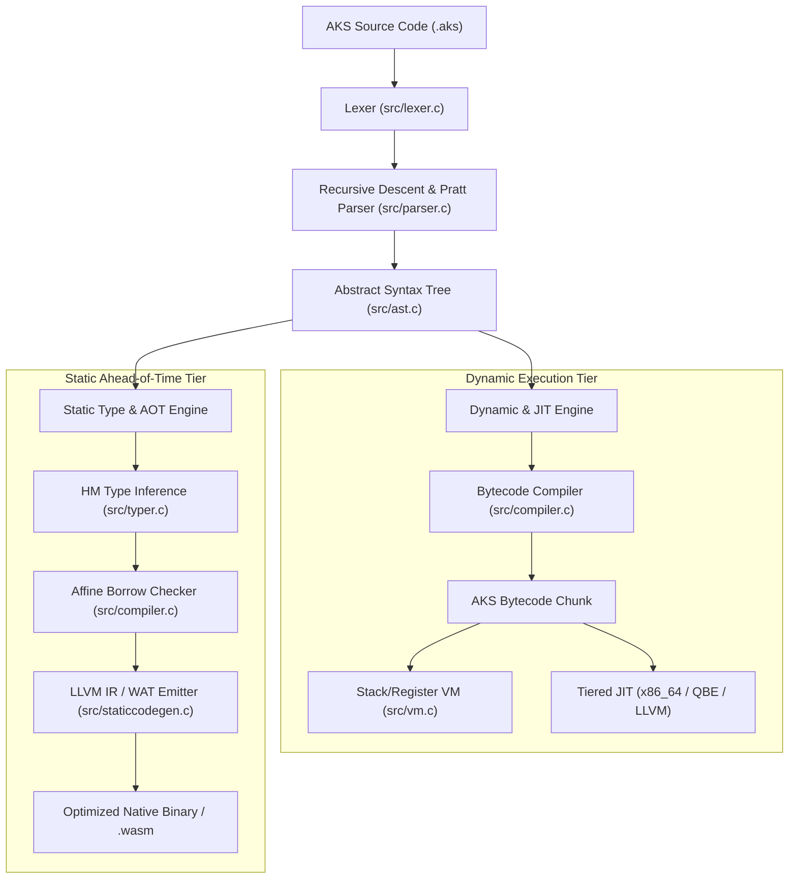

---

## 1.2 The Complete Compilation Pipeline

To write efficient software in AKS, one must understand how source text transforms into executing machine instructions. The AKS compiler pipeline proceeds through five distinct stages:

### Stage 1: Lexical Analysis (`src/lexer.c`)
The Lexer converts raw UTF-8 source bytes into a discrete stream of typed `Token` structures. It strips whitespace and comments, interns string identifiers, and records exact source line and column numbers for precision diagnostic reporting:

```c
typedef struct {
    TokenType type;     // TOKEN_LET, TOKEN_IDENTIFIER, TOKEN_INT, etc.
    const char *start;  // Pointer into source buffer
    int length;         // Length in bytes
    int line;           // Source line number
    int column;         // Source column number
} Token;
```

### Stage 2: Recursive-Descent & Pratt Parsing (`src/parser.c`)
The Parser consumes the token stream to construct a strongly typed Abstract Syntax Tree (AST). It combines traditional recursive-descent parsing for statements (`if`, `while`, `for`, `fn`, `struct`) with top-down operator precedence (Pratt parsing) for mathematical and logical expressions to handle complex operator associativity and precedence with zero recursion overhead.

### Stage 3: AST Construction & Semantic Analysis (`src/ast.c`)
Every AST node (`AstNode`) is allocated in a contiguous arena memory pool for cache locality. The AST preserves full type annotations, variable binding scopes, function prototypes, and structural attributes:

```c
typedef struct AstNode {
    AstNodeType type;
    int line;
    int col;
    union {
        struct { char *name; struct AstNode *init; SType *type_ann; } var_decl;
        struct { char *name; struct AstNode **params; int param_count; struct AstNode *body; } fn_decl;
        struct { struct AstNode *cond; struct AstNode *then_b; struct AstNode *else_b; } if_stmt;
        struct { OperatorType op; struct AstNode *left; struct AstNode *right; } binary_op;
        // ...
    } as;
} AstNode;
```

### Stage 4: Bytecode Emission (`src/compiler.c`)
The compiler traverses the AST and generates a linear bytecode stream contained in an `AKSChunk`. The compiler performs constant folding (evaluating `3 + 7` $\to$ `10` at compile time), local variable stack slot allocation, jump offset patching, and upvalue capture analysis.

### Stage 5: Virtual Machine & JIT Execution (`src/vm.c`)
The Virtual Machine executes the compiled bytecode chunks using a contiguous evaluation stack and register cache. Hot loops are monitored via execution counters; when a loop exceeds execution thresholds, the tiered JIT compiler compiles the bytecode into native machine instructions on the fly.

---

## 1.3 Core Runtime & Virtual Machine Internals

### 1.3.1 Value Representation (`AKSValue`)

In the dynamic runtime tier, every AKS entity is represented as an efficient tagged union value (`AKSValue`):

```c
// Core AKSValue structure in include/value.h
typedef enum {
    VAL_NIL,
    VAL_BOOL,
    VAL_INT,
    VAL_FLOAT,
    VAL_OBJ
} ValueType;

typedef struct {
    ValueType type;
    union {
        bool boolean;
        int64_t integer;
        double number;
        struct AKSObject *obj;
    } as;
} AKSValue;
```

- **Primitive Immediates**: Integers (`int64_t`), double-precision floats (`double`), and Booleans (`bool`) are stored directly inline inside the 16-byte `AKSValue` union without any heap allocation or pointer indirection.
- **Heap Objects (`AKSObject`)**: Strings, arrays, hash maps, structs, closures, fibers, and native handles point to a reference-counted header `AKSObject` allocated on 64-byte aligned boundaries for cache-line locality.

```text
+-------------------+---------------------------------------+
|  ValueType (8B)   |           Payload Union (8B)          |
+-------------------+---------------------------------------+
| VAL_INT           | 64-bit Signed Integer (int64_t)       |
| VAL_FLOAT         | 64-bit IEEE 754 Float (double)        |
| VAL_BOOL          | Boolean (true / false)                |
| VAL_OBJ           | Pointer to AKSObject (heap allocated) |
+-------------------+---------------------------------------+
```

### 1.3.2 Heap Object Header (`AKSObject`)

All dynamic allocations in AKS share a common object header:

```c
typedef struct AKSObject {
    ObjType type;         // OBJ_STRING, OBJ_ARRAY, OBJ_MAP, OBJ_STRUCT, OBJ_CLOSURE, etc.
    uint32_t refcount;    // Deterministic reference counter
    bool is_marked;       // Garbage collection / cycle detection marker
    bool is_static_safe;  // Flag indicating refcount elimination by static analyzer
    struct AKSObject *next; // Intrusive global allocation tracker for leak diagnostics
} AKSObject;
```

### 1.3.3 The Bytecode Execution Loop

The virtual machine (`src/vm.c`) implements an instruction dispatcher utilizing computed `goto` dispatch on supported compilers (GCC/Clang) and optimized switch tables on MSVC. The VM maintains a contiguous evaluation stack:

- **Evaluation Stack**: A contiguous array of `AKSValue` slots (default capacity 65,536 elements, expandable dynamically).
- **Call Frame Stack**: Maintains active call frames containing function metadata, return instruction pointers (`ip`), and base stack offsets for local variable lookups:

```c
typedef struct {
    AKSClosure *closure; // Pointer to active compiled closure
    uint8_t *ip;         // Instruction pointer into bytecode stream
    AKSValue *slots;     // Pointer to base local variable slot in evaluation stack
} CallFrame;
```

---

## 1.4 Setting Up the Development Environment

### 1.4.1 System Requirements

AKS runs natively on Windows (x86-64 and ARM64), Linux, and macOS. For Windows native builds, Microsoft Visual C++ (MSVC) or MinGW-w64 is supported.

### 1.4.2 Building from Source

To build all AKS compiler binaries, standard tools, and test suites from source in your local project directory:

```cmd
cd aks-lang
build.bat
```

The build script compiles the following toolchain executables into the project root:

| Executable | Purpose | Key Subsystems |
| :--- | :--- | :--- |
| `aks.exe` | Compiler, VM & CLI Runner | Bytecode compiler, VM, JIT engine, AOT generator, package manager, test runner. |
| `aksls.exe` | Language Server Protocol (LSP) | Full IDE protocol server for VS Code and modern IDEs (diagnostics, autocomplete). |
| `aksfmt.exe` | Code Formatter | AST-based code standardizer. |
| `akslint.exe` | Static Linter & Analyzer | Rule engine for detecting dead code, type mismatches, and anti-patterns. |
| `aks.dll` | C Embedding Shared Library | Complete AKS engine exposed via C API for embedding inside host applications. |

---

## 1.5 The `aks` Command-Line Interface

The `aks` driver provides a comprehensive set of subcommands:

### 1. Running Source Files

```bash
# Execute a script via the dynamic VM
aks run script.aks

# Execute with strict type inference enabled
aks run --strict-types script.aks

# Execute with compile-time borrow checker enabled
aks run --borrow-check script.aks

# Execute with memory tracing and leak diagnostics
aks run --trace-mem script.aks
```

### 2. Interactive REPL (Read-Eval-Print Loop)

Launching `aks` without arguments opens the interactive shell:

```text
AKS Interactive REPL (v2026.1 - Windows x86_64)
Type .help for command list, .exit to quit.
>>> let message = "Welcome to AKS";
>>> let tokens = split(message, " ");
>>> print(tokens);
["Welcome", "to", "AKS"]
>>> 
```

Useful REPL commands:
- `.help` - Displays the command reference.
- `.vars` - Dumps all active variables in the current environment with their types and values.
- `.disasm <fn>` - Disassembles a function or code block into human-readable bytecode instructions.
- `.clear` - Resets the global variable environment and heap state.
- `.exit` - Gracefully terminates the REPL.

### 3. Ahead-of-Time (AOT) Code Generation

```bash
# Emit LLVM Intermediate Representation
aks emit-ir --static -o program.ll program.aks

# Emit WebAssembly Text (WAT)
aks emit-wat -o program.wat program.aks
```

### 4. Running Benchmarks and Test Suites

```bash
# Run a single benchmark file with microsecond timer precision
aks bench benchmarks/matrix_multiply.aks

# Run the full automated test suite (254+ test modules)
aks test
```

---

## 1.6 Your First AKS Programs

Let us explore two fundamental programs to understand how AKS handles both simple scripting and structured systems tasks.

### Example 1: Hello World & String Manipulation

Create a file named `hello_world.aks`:

```aks
// hello_world.aks
fn main() {
    let name = "Systems Programmer";
    let greeting = "Hello, " + name + "! Welcome to AKS.";
    
    print(greeting);
    print("Length of greeting: " + String(Length(greeting)));
    
    let uppercase_greeting = upper(greeting);
    print("Uppercase: " + uppercase_greeting);
}

main();
```

Run the program:

```bash
aks run hello_world.aks
```

Output:
```text
Hello, Systems Programmer! Welcome to AKS.
Length of greeting: 41
Uppercase: HELLO, SYSTEMS PROGRAMMER! WELCOME TO AKS.
Memory diagnostics: all runtime references clean. 0 leaks.
```

### Example 2: High-Performance Fibonacci with Microsecond Timing

This example demonstrates loop structures, 64-bit integer calculations, recursion, and the high-resolution hardware clock:

```aks
// fibonacci.aks
fn fib_iterative(n) {
    if (n <= 1) {
        return n;
    }
    let a = 0;
    let b = 1;
    for (let i = 2; i <= n; i += 1) {
        let temp = a + b;
        a = b;
        b = temp;
    }
    return b;
}

fn main() {
    let target = 50;
    
    let start_time = clock();
    let result = fib_iterative(target);
    let elapsed = clock() - start_time;
    
    print("Fibonacci(" + String(target) + ") = " + String(result));
    print("Calculated in: " + String(elapsed) + " seconds");
}

main();
```

Output:
```text
Fibonacci(50) = 12586269025
Calculated in: 0.000004 seconds
Memory diagnostics: all runtime references clean. 0 leaks.
```

---

## 1.7 Summary & Next Steps

In this introductory chapter, we examined:
1. The dual dynamic/static architecture of AKS.
2. The complete 5-stage compilation pipeline from source bytes to machine code.
3. The internal representation of values (`AKSValue`), object headers (`AKSObject`), and the VM stack machine.
4. How to build, install, and utilize the `aks` toolchain.
5. Writing, executing, and benchmarking basic AKS scripts.

Proceed to [Chapter 02: Language Basics, Lexical Structure & Primitive Types](Chapter%2002%20-%20Language%20Basics%20and%20Primitive%20Types.md) for an in-depth dive into variables, scoping rules, primitive representations, memory alignment, and operator semantics.


---

# Chapter 02: Language Basics, Lexical Structure & Primitive Types

This chapter establishes the syntactic and semantic foundation of AKS. We explore the lexical grammar, variable bindings, memory scoping models, primitive types, bit-level memory layouts, operator precedence hierarchies, and explicit type conversion mechanics.

---

## 2.1 Lexical Grammar & Source Formatting

AKS source files (`.aks`) are encoded in UTF-8. The lexical grammar is designed to be clear, unambiguous, and ergonomic.

### 2.1.1 Identifiers & Case Conventions

Identifiers are case-sensitive sequences of Unicode alphanumeric characters and underscores, starting with an alphabetic character or underscore:

- **Variables & Functions**: `snake_case` (e.g., `user_count`, `compute_hash`)
- **Structs, Types & Traits**: `PascalCase` (e.g., `HttpResponse`, `Complex128`)
- **Constants**: `SCREAMING_SNAKE_CASE` (e.g., `MAX_BUFFER_SIZE`, `DEFAULT_PORT`)
- **Private / Internal Fields**: Leading underscore (e.g., `_raw_handle`, `_refcount`)

```aks
let active_connection_count = 10;
const MAX_ALLOWED_RETRIES = 5;

struct DeviceDescriptor {
    device_id: int,
    is_online: bool
}
```

### 2.1.2 Comments

AKS supports both single-line and multi-line comments:

```aks
// This is a single-line comment explaining the variable below
let threshold = 99.5;

/*
 * Multi-line block comments can span
 * multiple lines of documentation.
 */
let worker_threads = 8;
```

---

## 2.2 Variable Bindings & Lexical Scoping

### 2.2.1 `let` vs `const`

- **`let`**: Binds a variable name to a value in the current lexical scope. Variables declared with `let` can be reassigned unless the compiler is executed with `--immutable-by-default` (in which case reassignment requires explicit `mut` annotation).
- **`const`**: Declares an immutable compile-time or runtime constant. Constants cannot be reassigned or shadowed within the same scope.

```aks
let dynamic_counter = 1;
dynamic_counter = dynamic_counter + 1; // Valid: dynamic_counter is now 2

const PI = 3.141592653589793;
// PI = 3.14; // Compile-time error: Cannot reassign to constant 'PI'
```

### 2.2.2 Block Scoping & Shadowing

Lexical scopes are delimited by curly braces `{ ... }`. Inner scopes inherit all variables from outer enclosing scopes. When an inner scope declares a variable with the same name as an outer variable, it **shadows** the outer variable within that block. When execution exits the block, the shadowed variable goes out of scope, releasing any local reference counts:

```aks
fn scoping_demonstration() {
    let x = 100;
    print("Outer scope x: " + String(x)); // 100
    
    {
        let x = 200; // Shadows outer x
        let y = 300;
        print("Inner block x: " + String(x)); // 200
        print("Inner block y: " + String(y)); // 300
    } // y is deallocated here; inner x goes out of scope
    
    print("Restored outer x: " + String(x)); // 100
    // print(y); // Compile error: 'y' is undefined in this scope
}
```

---

## 2.3 Primitive Types & Memory Layouts

AKS provides five foundational primitive types. Three types (`int`, `float`, `bool`) are immediate unboxed values stored directly inside the 16-byte `AKSValue` union on the evaluation stack, requiring zero heap allocations.

```text
Memory Layout of Unboxed Immediate Types inside AKSValue (16 Bytes):
+-------------------+---------------------------------------+
|  ValueType (8B)   |           Payload Union (8B)          |
+-------------------+---------------------------------------+
| VAL_INT           | 64-bit Two's Complement Signed Integer|
| VAL_FLOAT         | 64-bit IEEE 754 Double Precision Float|
| VAL_BOOL          | 8-bit Boolean (1=true, 0=false)       |
| VAL_NIL           | 0x0 (Unit / Empty value)              |
+-------------------+---------------------------------------+
```

### 2.3.1 Integers (`int`)

Integers in AKS are 64-bit signed two's complement integers (`int64_t` in C), with values ranging from $-2^{63}$ to $2^{63} - 1$ (`-9,223,372,036,854,775,808` to `9,223,372,036,854,775,807`).

Literal encodings:
- **Decimal**: `42`, `-1024`
- **Hexadecimal (`0x` / `0X`)**: `0xFF`, `0xDEADBEEF`
- **Binary (`0b` / `0B`)**: `0b101010`, `0b11110000`
- **Octal (`0o` / `0O`)**: `0o755`

```aks
let dec_val = 255;
let hex_val = 0xFF;
let bin_val = 0b11111111;

print(dec_val == hex_val && hex_val == bin_val); // true
```

### 2.3.2 Floating-Point Numbers (`float`)

Floating-point numbers are 64-bit IEEE 754 double-precision floats (`double` in C), providing 53 bits of precision (~15–17 significant decimal digits).

```aks
let standard_float = 3.14159;
let scientific_notation = 1.25e-4; // 0.000125
let large_value = 6.022e23;

print(standard_float);
print(scientific_notation);
```

### 2.3.3 Booleans (`bool`)

Booleans represent binary truth values (`true` and `false`).

- **Truthiness in Conditionals**: In AKS conditional expressions (`if`, `while`), only `false` and `nil` are considered **falsy**. All other values—including the integer `0`, the float `0.0`, empty strings `""`, and empty arrays `[]`—evaluate to **truthy**.

```aks
let is_valid = true;
let is_complete = false;

if (0) {
    print("0 is truthy in AKS!"); // This executes
}

if (nil) {
    // This will never execute
}
```

### 2.3.4 Strings (`str`)

Strings in AKS are immutable sequences of UTF-8 encoded bytes. They are represented as heap-allocated `AKSString` objects managed by reference counting:

```c
typedef struct {
    AKSObject obj;       // Header containing refcount and type tag
    uint32_t length;     // Number of UTF-8 bytes (excluding null terminator)
    uint32_t hash;       // Precomputed FNV-1a / Murmur3 hash for O(1) map lookups
    char chars[];        // Flexible array member containing null-terminated UTF-8 bytes
} AKSString;
```

Features:
- **Immutability**: String modification operations return new strings or utilize string builders, preventing accidental data races across threads.
- **Precomputed Hash**: The 32-bit hash is calculated once upon string creation and cached in the header.
- **Escape Sequences**: `\n` (newline), `\r` (carriage return), `\t` (tab), `\\` (backslash), `\"` (quote), `\0` (null byte).

```aks
let greeting = "Hello, \"World\"!\n";
let path = "C:\\Windows\\System32\\drivers";

// String concatenation using '+' operator
let full_message = greeting + "Target directory: " + path;
print(full_message);
```

### 2.3.5 The Unit Value (`nil`)

`nil` represents the absence of a value or the return value of functions that execute purely for side effects without returning a result.

```aks
let uninitialized = nil;
print(uninitialized == nil); // true
```

---

## 2.4 Comprehensive Operator Precedence & Semantics

The table below outlines the complete operator precedence hierarchy in AKS, from highest precedence (evaluated first) to lowest:

| Precedence | Operator | Category | Associativity | Description |
| :--- | :--- | :--- | :--- | :--- |
| **1 (Highest)** | `.` `[]` `()` | Primary | Left-to-Right | Member access, array indexing, function call |
| **2** | `!` `~` `-` `+` `typeof` | Unary | Right-to-Left | Logical NOT, bitwise NOT, arithmetic unary, type query |
| **3** | `**` | Exponentiation | Right-to-Left | Power calculation ($a^b$) |
| **4** | `*` `/` `%` | Multiplicative | Left-to-Right | Multiplication, division, modulo remainder |
| **5** | `+` `-` | Additive | Left-to-Right | Addition, subtraction, string concatenation |
| **6** | `<<` `>>` | Bitwise Shifts | Left-to-Right | Shift left, arithmetic shift right |
| **7** | `<` `<=` `>` `>=` | Relational | Left-to-Right | Less than, less-or-equal, greater than, greater-or-equal |
| **8** | `==` `!=` | Equality | Left-to-Right | Exact value equality, inequality |
| **9** | `&` | Bitwise AND | Left-to-Right | Bitwise AND |
| **10** | `^` | Bitwise XOR | Left-to-Right | Bitwise Exclusive OR |
| **11** | `\|` | Bitwise OR | Left-to-Right | Bitwise Inclusive OR |
| **12** | `&&` | Logical AND | Left-to-Right | Short-circuit logical AND |
| **13** | `\|\|` | Logical OR | Left-to-Right | Short-circuit logical OR |
| **14** | `? :` | Ternary | Right-to-Left | Conditional operator (`cond ? a : b`) |
| **15 (Lowest)**| `=` `+=` `-=` `*=` `/=` | Assignment | Right-to-Left | Variable assignment and compound assignments |

### 2.4.1 Bitwise Arithmetic Operations

AKS provides full bitwise manipulation for systems-level integer manipulation:

```aks
let a = 0b1100; // 12 in decimal
let b = 0b1010; // 10 in decimal

let bit_and = a & b;  // 0b1000 (8)
let bit_or  = a | b;  // 0b1110 (14)
let bit_xor = a ^ b;  // 0b0110 (6)
let bit_not = ~a;     // -13 (two's complement inversion)
let shl     = a << 2; // 0b110000 (48)
let shr     = a >> 1; // 0b0110 (6)

print("Bitwise AND: " + String(bit_and));
print("Bitwise OR:  " + String(bit_or));
print("Bitwise XOR: " + String(bit_xor));
```

---

## 2.5 Explicit Type Conversion & Introspection

AKS provides robust built-in functions for converting between types and inspecting runtime types.

### 2.5.1 Type Inspection (`type` / `typeof`)

```aks
let val_int = 42;
let val_str = "hello";
let val_arr = [1, 2, 3];

print(type(val_int)); // "int"
print(type(val_str)); // "str"
print(type(val_arr)); // "array"
```

### 2.5.2 Type Conversion Functions

| Function | Input Types | Output Type | Description |
| :--- | :--- | :--- | :--- |
| `Int(v)` | `float`, `str`, `bool` | `int` | Converts float (truncating decimal), numeric string, or bool (`true` $\to$ 1, `false` $\to$ 0) to integer. |
| `Float(v)`| `int`, `str` | `float` | Converts integer or decimal string to 64-bit float. |
| `String(v)` / `str(v)`| `any` | `str` | Converts any value to its canonical string representation. |
| `Bool(v)` | `any` | `bool` | Returns `false` for `false` and `nil`, `true` for all other values. |
| `Hex(int)` | `int` | `str` | Converts integer to uppercase hexadecimal string (e.g., `255` $\to$ `"FF"`). |
| `Bin(int)` | `int` | `str` | Converts integer to binary string (e.g., `10` $\to$ `"1010"`). |
| `Ordinal(str)` / `ord`| `str` (1 char) | `int` | Returns the ASCII / Unicode code point of character. |
| `Character(int)` / `chr`| `int` (code point)| `str` | Returns single-character string from code point. |

### 2.5.3 Complete Conversion Example

```aks
// conversions.aks
fn main() {
    let str_num = "4096";
    let int_num = Int(str_num);
    let float_num = Float(int_num) / 2.0;
    
    print("Parsed Integer: " + String(int_num));
    print("Calculated Float: " + String(float_num));
    print("Hexadecimal Representation: 0x" + Hex(int_num));
    print("Binary Representation: 0b" + Bin(int_num));
    
    let char_code = Ordinal("A");
    print("ASCII Code for 'A': " + String(char_code)); // 65
    print("Character from code 66: " + Character(char_code + 1)); // 'B'
}

main();
```

Output:
```text
Parsed Integer: 4096
Calculated Float: 2048
Hexadecimal Representation: 0x1000
Binary Representation: 0b1000000000000
ASCII Code for 'A': 65
Character from code 66: B
Memory diagnostics: all runtime references clean. 0 leaks.
```

---

## 2.6 Summary & Next Steps

In this chapter, we covered:
1. Lexical naming conventions and source structure.
2. Scoping, variable bindings (`let`/`const`), and block shadowing.
3. The 5 primitive types (`int`, `float`, `bool`, `str`, `nil`) and their 16-byte tagged union memory layouts.
4. Complete operator precedence and bitwise operations.
5. Runtime type introspection and type conversions.

Proceed to [Chapter 03: Control Flow, Loops & Pattern Matching](Chapter%2003%20-%20Control%20Flow%20and%20Pattern%20Matching.md) to explore branches, loops, and pattern matching.


---

# Chapter 03: Control Flow, Loops & Pattern Matching

Control flow structures dictate how programs execute across branches, iterations, and pattern-matching decision trees. This chapter covers conditional branching, loops, pattern matching mechanics, jump offset back-patching, and VM bytecode generation.

---

## 3.1 Conditional Branching (`if`, `else if`, `else`)

AKS provides standard structured conditional branching:

```aks
let cpu_temperature = 78.5;

if (cpu_temperature > 90.0) {
    print("CRITICAL: Thermal throttling activated!");
} else if (cpu_temperature > 75.0) {
    print("WARNING: Increasing fan speed to maximum.");
} else {
    print("Normal operating temperature.");
}
```

### 3.1.1 Ternary Conditional Expressions

For inline value selection based on a condition, the ternary operator `cond ? true_val : false_val` is supported:

```aks
let buffer_capacity = is_high_throughput ? 65536 : 4096;
```

---

## 3.2 Iteration & Loop Structures

AKS provides four distinct loop constructs tailored for different algorithmic workflows:

### 3.2.1 The `while` Loop

Executes a block continuously as long as the boolean condition evaluates to truthy:

```aks
let counter = 0;
while (counter < 5) {
    print("Iteration: " + String(counter));
    counter += 1;
}
```

### 3.2.2 The 3-Clause C-Style `for` Loop

Provides structured loop initialization, condition evaluation, and post-iteration step expressions:

```aks
for (let i = 0; i < 10; i += 2) {
    print("Even index: " + String(i));
}
```

### 3.2.3 The Collection Iteration `for..in` Loop

Iterates directly over elements in dynamic arrays, strings, or keys in hash maps:

```aks
let core_frequencies = [3.2, 3.6, 4.0, 4.2];

for (freq in core_frequencies) {
    print("Core Frequency: " + String(freq) + " GHz");
}
```

### 3.2.4 The Unconditional `loop` Construct

Creates an infinite loop, ideal for server event loops, worker threads, and fiber schedulers:

```aks
let attempts = 0;
loop {
    attempts += 1;
    if (attempts >= 3) {
        print("Maximum retry limit reached. Breaking loop.");
        break;
    }
}
```

### 3.2.5 Loop Control Statements (`break` and `continue`)

- **`break`**: Immediately terminates the innermost enclosing loop and jumps to the statement following the loop.
- **`continue`**: Skips the remainder of the current iteration and jumps to the condition evaluation or step clause.

```aks
for (let i = 1; i <= 10; i += 1) {
    if (i % 2 != 0) {
        continue; // Skip odd numbers
    }
    if (i > 6) {
        break; // Stop after reaching 6
    }
    print("Even number: " + String(i));
}
```

---

## 3.3 Bytecode Generation & Jump Back-Patching

To appreciate how the AKS compiler emits machine-efficient bytecode for control flow, let us inspect the jump mechanics.

### 3.3.1 How `if` Statements are Compiled

When compiling an `if` statement, the compiler cannot know ahead of time how many bytecode bytes the `then` block will occupy. It emits a provisional `OPJUMPIFFALSE` instruction with a placeholder offset. Once the entire `then` block is compiled, the compiler calculates the exact byte distance and **back-patches** the offset into the jump instruction:

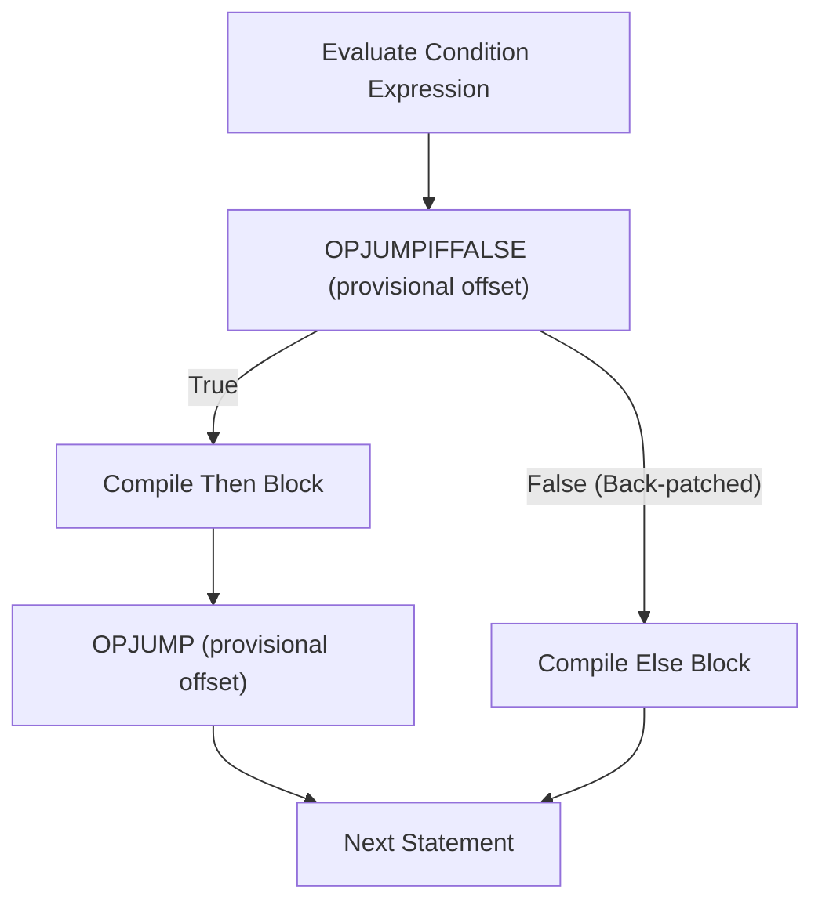

### 3.3.2 Bytecode Disassembly of a Loop

Consider this loop:

```aks
let i = 0;
while (i < 3) {
    i += 1;
}
```

The disassembled bytecode output (`aks run --debug`):

```text
Bytecode Chunk: while_loop
0000    OPPUSHINT           0
0009    OPSTORE             0
0012    OPLOAD              0
0015    OPPUSHINT           3
0024    OPLT
0025    OPJUMPIFFALSE       +28
0030    OPLOAD              0
0033    OPPUSHINT           1
0042    OPADD
0043    OPSTORE             0
0046    OPPOP
0047    OPJUMP              -39
0052    OPRETURN
```

---

## 3.4 Pattern Matching (`match`)

AKS features a first-class, pattern-matching engine capable of matching literals, variables, ranges, tuples, arrays, structs, and guard conditions.

### 3.4.1 Basic Literal & Wildcard Matching

```aks
let status_code = 404;

let response_message = match (status_code) {
    200 => "OK: Request succeeded",
    301 => "Moved Permanently",
    400 => "Bad Request",
    404 => "Not Found: Resource does not exist",
    500 => "Internal Server Error",
    _   => "Unknown HTTP Status Code"
};

print(response_message);
```

### 3.4.2 Pattern Guards (`if` Clauses)

Pattern arms can include guard expressions that must evaluate to truthy for the arm to match:

```aks
let packet_size = 1500;

match (packet_size) {
    s if s <= 64   => print("Small TCP Control Packet"),
    s if s <= 1500 => print("Standard Ethernet MTU Frame"),
    s if s > 9000  => print("Jumbo Frame"),
    _              => print("Custom Frame Size")
};
```

### 3.4.3 Destructuring Arrays and Structs

Pattern matching can decompose composite structures directly into named variables:

```aks
let coordinate = [10, 20];

match (coordinate) {
    [0, 0]   => print("Origin point"),
    [x, 0]   => print("On X-axis at " + String(x)),
    [0, y]   => print("On Y-axis at " + String(y)),
    [x, y]   => print("Cartesian point (" + String(x) + ", " + String(y) + ")"),
    _        => print("Invalid coordinate dimensions")
};
```

### 3.4.4 Exhaustiveness Checking

In static mode (`--strict-types`), the compiler performs exhaustiveness analysis over `match` expressions. When matching on enums, Algebraic Data Types, or boolean conditions, all variants must either be explicitly covered or a fallback wildcard `_` must be provided:

```aks
enum Status { Pending, Active, Suspended }

// Compile error if any variant is omitted without a wildcard:
match (status) {
    Status.Pending   => "Job queued",
    Status.Active    => "Job running",
    Status.Suspended => "Job paused"
};
```

---

## 3.5 Modern Syntactic Expressiveness

AKS incorporates contemporary syntactic constructs designed to maximize ergonomics without sacrificing execution speed:

### 3.5.1 String Interpolation
Formatted string literals evaluate expressions directly inside `{...}` braces:

```aks
let username = "AksDev";
let latency = 4.2;
print(f"User {username} ping response: {latency}ms (Status: {latency < 10.0})");
```

### 3.5.2 Range Literals & Iteration
The `..` operator creates zero-allocation range sequences with `.start`, `.end`, and `Length()` support:

```aks
let r = 1..10;
print("Range count: " + String(Length(r))); // 9 elements

for (i in 0..5) {
    print("Iteration index: " + String(i));
}
```

### 3.5.3 Chained Comparison Operators
Comparisons can be naturally chained together without redundant `&&` conjunctions:

```aks
let temperature = 72;
if (65 <= temperature < 80) {
    print("Room temperature is optimal");
}
```

### 3.5.4 Struct Update Syntax (`...`)
Copy-and-update creates new struct instances from existing objects, overriding specific fields:

```aks
struct Config { host: string, port: int, ssl: bool }
let base_cfg = Config { host: "localhost", port: 8080, ssl: false };
let prod_cfg = Config { ...base_cfg, port: 443, ssl: true };
```

### 3.5.5 Trailing Lambdas
When the final argument of a function is a callback or lambda, it can be passed following the parameter list:

```aks
fn filter_records(records, predicate) { ... }

let valid = filter_records(user_db) fn(user) {
    return user.active && user.verified;
};
```

---

## 3.6 Summary & Next Steps

In this chapter, we explored:
1. `if`, `else if`, `else`, and ternary expressions.
2. The four loop constructs: `while`, 3-clause `for`, collection `for..in`, and `loop`.
3. Bytecode jump offset back-patching and loop disassemblies.
4. `match` pattern matching with literal values, wildcards, guards, composite destructuring, and static exhaustiveness verification.
5. Modern syntactic features: string interpolation, range literals, chained comparisons, struct updates, and trailing lambdas.

Proceed to [Chapter 04: Functions, Closures, Stack Frames & Error Handling](Chapter%2004%20-%20Functions,%20Closures%20and%20Error%20Handling.md) to explore stack frames, algebraic effects, verified contracts, and error handling models.


---

# Chapter 04: Functions, Closures, Stack Frames & Error Handling

Functions represent the primary unit of code abstraction, execution encapsulation, and stack frame management in AKS. This chapter covers function declarations, closures, upvalue lifetime lifting, virtual machine `CallFrame` stack layout, structured exception handling, panics, and algebraic error models.

---

## 4.1 Function Declarations & Signatures

In AKS, functions are declared using the `fn` keyword:

```aks
fn calculate_kinetic_energy(mass: float, velocity: float) -> float {
    return 0.5 * mass * (velocity ** 2.0);
}

let ke = calculate_kinetic_energy(1200.0, 28.0);
print("Kinetic Energy: " + String(ke) + " Joules");
```

### 4.1.1 Default & Optional Parameters

Function parameters can specify default values. Parameters with default values are evaluated if the caller omits the argument:

```aks
fn initialize_socket_connection(host: str, port: int = 8080, timeout_ms: int = 5000) {
    print("Connecting to " + host + ":" + String(port) + " (Timeout: " + String(timeout_ms) + "ms)");
}

initialize_socket_connection("127.0.0.1");             // port=8080, timeout_ms=5000
initialize_socket_connection("10.0.0.1", 443);         // port=443,  timeout_ms=5000
initialize_socket_connection("192.168.1.1", 22, 1000); // port=22,   timeout_ms=1000
```

### 4.1.2 Variadic Arguments (`...args`)

Functions can accept an arbitrary number of arguments using the rest parameter syntax `...args`, which bundles extra arguments into a dynamic array:

```aks
fn calculate_sum(...numbers) {
    let total = 0;
    for (num in numbers) {
        total += num;
    }
    return total;
}

print(calculate_sum(10, 20, 30, 40)); // 100
```

---

## 4.2 First-Class Functions & Higher-Order Pipelines

In AKS, functions are first-class values: they can be assigned to variables, passed as arguments to other functions, returned from functions, and stored inside structs or arrays:

```aks
fn transform_dataset(arr, transform_fn) {
    let result = [];
    for (item in arr) {
        Push(result, transform_fn(item));
    }
    return result;
}

let raw_data = [1, 2, 3, 4, 5];
let squared = transform_dataset(raw_data, fn(x) { return x * x; });
print(squared); // [1, 4, 9, 16, 25]
```

---

## 4.3 Closures & Upvalue Lifetime Management

A **closure** is a function that retains access to variables declared in its enclosing lexical scope even after that enclosing scope has finished execution.

### 4.3.1 The Upvalue Problem

When an outer function returns, its local stack frame is discarded. If an inner closure references an outer variable, accessing that stack location directly would cause dangling pointer corruption.

AKS solves this with **Upvalues**:

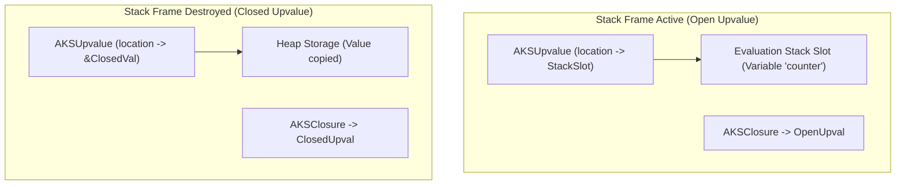

1. **Open Upvalue**: While the outer function is still executing on the stack, the upvalue points directly to the evaluation stack slot.
2. **Closing the Upvalue**: When the outer function returns, the VM automatically moves the value from the stack slot into dedicated heap storage and updates the internal reference. The inner closure can now safely execute indefinitely.

### 4.3.2 Closure Example

```aks
fn make_accumulator(initial_value) {
    let sum = initial_value;
    
    // Returns closure capturing 'sum' upvalue
    return fn(delta) {
        sum += delta;
        return sum;
    };
}

let acc = make_accumulator(100);
print(acc(15)); // 115
print(acc(25)); // 140
```

---

## 4.4 The Virtual Machine Call Stack (`CallFrame`)

Each time a function or closure is invoked, the virtual machine pushes a new `CallFrame` onto the call frame stack (`src/vm.c`):

```c
typedef struct {
    AKSClosure *closure; // Pointer to the executing closure
    uint8_t *ip;         // Current instruction pointer in the bytecode
    AKSValue *slots;     // Pointer to the base of this frame's local variables on the evaluation stack
} CallFrame;
```

```text
Virtual Machine Evaluation Stack Layout during nested function call:
+------------------------------------+ <--- Evaluation Stack Base (Slot 0: Script)
| Slot 0: global / script locals     |
+------------------------------------+
| Slot 1: Caller argument 0 (arg1)   | <--- Frame 1 (Caller Slots Base)
| Slot 2: Caller local variable (x)  |
+------------------------------------+
| Slot 3: Callee function closure    | <--- Frame 2 (Callee Slots Base)
| Slot 4: Callee argument 0 (a)      |
| Slot 5: Callee local variable (y)  | <--- Top of Stack (stacktop)
+------------------------------------+
```

- **Slot Independence**: Inside the callee, local variable instructions (`OPLOAD 0`, `OPSTORE 1`) compute addresses relative to `frame->slots`, achieving $O(1)$ local variable access with zero hash table lookups.
- **Recursion Safety**: The VM enforces a maximum call depth limit (default 1,024 frames) to prevent stack overflow crashes.

---

## 4.5 Error Handling Architectures

AKS provides two complementary error handling mechanisms:
1. Structured Exceptions (`try`/`catch`/`finally`) & Panics for unrecoverable errors.
2. Algebraic Data Types (`Option<T>` and `Result<T, E>`) for predictable domain errors.

### 4.5.1 Structured Exceptions (`try`, `catch`, `finally`, `throw`)

```aks
fn parse_configuration(raw_text) {
    if (Length(raw_text) == 0) {
        throw "ConfigError: Configuration buffer cannot be empty.";
    }
    return { "status": "loaded" };
}

fn safe_loader() {
    try {
        let config = parse_configuration("");
        print(config);
    } catch (err) {
        print("Caught Exception: " + String(err));
    } finally {
        print("Cleanup: File handles released.");
    }
}

safe_loader();
```

### 4.5.2 Explicit `panic()` & Panic Hooks

For unrecoverable integrity failures, `panic(message)` halts execution immediately, dumping a full call frame stack trace and the source line numbers:

```aks
fn divide_memory_pages(total_bytes, page_size) {
    if (page_size == 0) {
        panic("DivisionByZero: Page size cannot be zero.");
    }
    return total_bytes / page_size;
}
```

### 4.5.3 Algebraic Error Handling: `Option` & `Result`

In high-reliability systems and static mode, AKS encourages explicit error types using standard Result monads:

```aks
struct Result {
    is_ok: bool,
    value: any,
    error: str
}

fn safe_divide(numerator: float, denominator: float) -> Result {
    if (denominator == 0.0) {
        return Result { is_ok: false, value: nil, error: "Division by zero" };
    }
    return Result { is_ok: true, value: numerator / denominator, error: nil };
}

let res = safe_divide(100.0, 4.0);
if (res.is_ok) {
    print("Calculation result: " + String(res.value)); // 25.0
} else {
    print("Error encountered: " + res.error);
}
```

---

## 4.6 The Algebraic Effect System

AKS features a first-class **Algebraic Effect System**, allowing programs to decouple the declaration and invocation of computational effects from their concrete runtime interpretations. Unlike traditional exceptions which terminate stack frames unconditionally, algebraic effects permit **one-shot resumptions** that yield a value back to the call site and continue execution seamlessly.

### 4.6.1 Declaring & Performing Effects

Effects are declared using the `effect` keyword:

```aks
effect State {
    fn Get() -> any;
    fn Put(v: any);
}

effect Logger {
    fn Log(msg: string) -> string;
}

fn compute_pipeline(x: int) -> int {
    // Both scoped (Logger.Log) and direct (Log) invocations are supported:
    perform Logger.Log("Starting computation for x = " + String(x));
    let current_offset = perform State.Get();
    let total = x * 2 + current_offset;
    perform State.Put(total);
    perform Logger.Log("Updated state to " + String(total));
    return total;
}
```

### 4.6.2 Effect Handlers & Delimited Continuations

Handlers intercept effects dynamically through `handle (expr) with { ... }` blocks. Within each effect arm, `resume <val>` yields execution back into the suspended computation:

```aks
let initial_state = 10;
let final_result = handle (compute_pipeline(5)) with {
    State.Get() => {
        resume initial_state;
    },
    State.Put(v) => {
        initial_state = v;
        resume nil;
    },
    Logger.Log(msg) => {
        print("[AUDIT]: " + msg);
        resume "logged";
    }
};

print("Final computed value: " + String(final_result)); // 20
print("Final state variable: " + String(initial_state)); // 20
```

Effects can be nested arbitrarily, providing composable, testable abstractions for asynchronous I/O, transactional state, dependency injection, and probabilistic simulation.

---

## 4.7 Verified Function Contracts

AKS provides native **Design-by-Contract** specifications through `requires` (preconditions) and `ensures` (postconditions) clauses attached directly to function signatures.

```aks
fn SafeDivide(a: int, b: int) -> int
    requires b != 0
    ensures result != null
{
    return a / b;
}

fn Clamp(val: int, minVal: int, maxVal: int) -> int
    requires minVal <= maxVal
    ensures result >= minVal
    ensures result <= maxVal
{
    if (val < minVal) { return minVal; }
    if (val > maxVal) { return maxVal; }
    return val;
}
```

- **Runtime Enforcement**: In standard debug and execution modes, contract violations immediately abort and raise descriptive invariant exceptions.
- **Static Verification**: In static mode (`--strict-types`), the compiler uses SMT/Z3 solvers when available to prove contract satisfaction ahead-of-time, eliminating runtime assertions for proven invariants.
- **The `result` Identifier**: Inside `ensures` postconditions, `result` binds to the evaluated return value of the function.

---

## 4.8 Summary & Next Steps

In this chapter, we covered:
1. Function declarations, default parameters, and variadic rest arguments.
2. First-class higher-order function pipelines.
3. Closures, open vs closed upvalues, and heap migration mechanics.
4. VM `CallFrame` stack layout, relative slot addressing, and call depth limits.
5. Structured exception handling, panic hooks, and algebraic `Result` patterns.
6. First-class algebraic effects, handlers, and delimited resumptions (`handle ... with`, `resume`).
7. Verified function contracts (`requires`, `ensures`) with compile-time and runtime validation.

Proceed to [Chapter 05: Collections, Structs & Object Architecture](Chapter%2005%20-%20Collections,%20Structs%20and%20Object%20Model.md) to explore dynamic arrays, Robin Hood hash maps, and struct object models.


---

# Chapter 05: Collections, Structs & Object Architecture

Composite data structures enable modeling complex domain logic, data pipelines, and system architectures. This chapter explores dynamic arrays (`AKSArray`), Robin Hood hash maps (`AKSHashMap`), custom structs, `impl` method blocks, and object memory layouts.

---

## 5.1 Dynamic Arrays (`AKSArray`)

Dynamic arrays are ordered, contiguous sequences of `AKSValue` elements that expand automatically as new items are added.

### 5.1.1 Internal Memory Layout

```c
typedef struct {
    AKSObject obj;         // Header with refcount and type tag (OBJ_ARRAY)
    uint32_t count;        // Current number of active elements
    uint32_t capacity;     // Allocated slot capacity
    AKSValue *elements;    // Contiguous heap buffer of AKSValue items
} AKSArray;
```

```text
AKSArray Memory Representation:
+--------------------------------------------------------+
| AKSObject Header (refcount, type=OBJ_ARRAY)            |
| count = 4, capacity = 8                                |
| elements* ----------------------------------------+    |
+---------------------------------------------------|----+
                                                    |
    +-----------------------------------------------+
    v
+---------------+---------------+---------------+---------------+---------------+
| AKSValue [0]  | AKSValue [1]  | AKSValue [2]  | AKSValue [3]  | Unused Slots  |
| 16 Bytes      | 16 Bytes      | 16 Bytes      | 16 Bytes      | (4x 16 Bytes) |
+---------------+---------------+---------------+---------------+---------------+
```

- **Amortized $O(1)$ Growth**: When `count == capacity`, the VM resizes the buffer by a geometric factor of $1.5\times$ using `realloc`, minimizing memory reallocation frequency and maintaining spatial locality for CPU L1/L2 caches.
- **Index Bounds Checking**: Array indexing (`arr[i]`) performs bounds checking, throwing an out-of-bounds error on invalid indices.

### 5.1.2 Array Operations & Standard Methods

```aks
let telemetry = [];

// Appending elements
Push(telemetry, 101.4);
Push(telemetry, 102.8);
Push(telemetry, 105.1);

print("Element count: " + String(Length(telemetry))); // 3
print("First sample: " + String(telemetry[0]));       // 101.4

// Slicing arrays: Slice(arr, start, end)
let window = Slice(telemetry, 0, 2);
print("Sliced window: " + String(window)); // [101.4, 102.8]

// In-place reversal and sorting
let numbers = [50, 10, 80, 20, 90];
Sort(numbers);
print("Sorted: " + String(numbers)); // [10, 20, 50, 80, 90]

Reverse(numbers);
print("Reversed: " + String(numbers)); // [90, 80, 50, 20, 10]
```

---

## 5.2 Hash Maps (`AKSHashMap`)

Hash maps provide associative key-value storage with expected $O(1)$ lookups, insertions, and deletions.

### 5.2.1 Robin Hood Open-Addressing Hashing

The AKS runtime implements **Robin Hood Open-Addressing Hashing** with backward-shift deletion:

- **Robin Hood Invariant**: When inserting a key that collides, the algorithm compares the Probe Sequence Length (PSL) of the incoming key against the key currently occupying the slot. If the incoming key has a higher PSL (it has traveled further from its ideal hash bucket), it "steals" the slot from the richer key and continues displacing the older key.
- **Low Variance**: This strategy minimizes variance in probe sequence lengths across the table, resulting in predictable lookup times even at high load factors (up to 85%).


### 5.2.2 Map Syntax & Operations

```aks
let server_config = {
    "host": "0.0.0.0",
    "port": 8080,
    "max_connections": 10000,
    "enable_tls": true
};

// Accessing values
print("Server Host: " + server_config["host"]);
print("Listen Port: " + String(server_config.port));

// Adding / Updating keys
server_config["timeout_sec"] = 30;

// Iterating over key-value pairs
for (key in server_config) {
    print("Config Key: " + key);
}
```

---

## 5.3 Structs & The Object Model

Structs allow defining custom composite types with named, typed fields.

### 5.3.1 Defining Structs

```aks
struct NetworkPacket {
    sequence_id: int,
    payload_size: int,
    source_ip: str,
    is_encrypted: bool
}
```

### 5.3.2 Instantiating Structs

```aks
let packet = NetworkPacket {
    sequence_id: 1042,
    payload_size: 512,
    source_ip: "192.168.1.100",
    is_encrypted: true
};

print("Packet Sequence: " + String(packet.sequence_id));
print("Payload Size: " + String(packet.payload_size) + " bytes");
```

---

## 5.4 Methods & `impl` Blocks

AKS supports object-oriented method dispatch via `impl` blocks. Methods take an explicit `self` reference as their first parameter:

```aks
struct Vector2D {
    x: float,
    y: float
}

impl Vector2D {
    // Associated constructor function
    fn new(x: float, y: float) {
        return Vector2D { x: x, y: y };
    }

    // Instance method
    fn magnitude(self) -> float {
        return SquareRoot(self.x * self.x + self.y * self.y);
    }

    // Mutating method
    fn scale(self, factor: float) {
        self.x = self.x * factor;
        self.y = self.y * factor;
    }

    // Vector addition returning a new instance
    fn add(self, other: Vector2D) -> Vector2D {
        return Vector2D.new(self.x + other.x, self.y + other.y);
    }
}

fn main() {
    let v1 = Vector2D.new(3.0, 4.0);
    print("Magnitude of v1: " + String(v1.magnitude())); // 5.0

    let v2 = Vector2D.new(1.0, 2.0);
    let v3 = v1.add(v2);
    print("v3 = (" + String(v3.x) + ", " + String(v3.y) + ")"); // (4.0, 6.0)
}

main();
```

---

## 5.5 Summary & Next Steps

In this chapter, we explored:
1. `AKSArray` contiguous evaluation buffers, amortized $1.5\times$ growth factor, and array methods.
2. `AKSHashMap` Robin Hood open-addressing table architecture with low PSL variance.
3. Struct declarations, field memory layouts, and property access opcodes (`OPGETFIELD`, `OPSETFIELD`).
4. `impl` method blocks, constructor patterns, and `self` parameter dispatching.

Proceed to [Chapter 06: The AKS Type System & Static Mode](Chapter%2006%20-%20Type%20System%20and%20Static%20Mode.md) to explore Hindley-Milner type inference, dependent array types, Algebraic Data Types, and AOT static compilation.


---

# Chapter 06: The AKS Type System & Static Mode

AKS features a dual type system: a dynamic, rapid-prototyping mode for interactive development, and a strict Hindley-Milner static mode (`--strict-types` / `--static`) for compile-time safety and zero-cost AOT optimization. This chapter examines type inference, dependent fixed-size arrays, Algebraic Data Types (ADTs), union/intersection types, traits, and monomorphization.

---

## 6.1 Dynamic vs Static Mode

| Feature | Dynamic Mode (Default) | Static Mode (`--static` / `--strict-types`) |
| :--- | :--- | :--- |
| **Type Checking** | Runtime type tags in `AKSValue` | Compile-time Hindley-Milner inference |
| **Execution Engine** | Bytecode VM / Tiered JIT | Unboxed LLVM IR / Native AOT |
| **Array Types** | Dynamic heap arrays (`[T]`) | Dynamic `[T]` + Fixed-size `[T; N]` |
| **Function Dispatch** | Dynamic slot lookup | Direct native function calls / vtables |
| **Memory Overhead** | 16-byte tagged unions | Raw unboxed C structs (e.g. 8-byte ints) |

---

## 6.2 The Hindley-Milner Type Inference Engine (`src/typer.c`)

In static mode, AKS infers the most general type for every expression using the **Hindley-Milner (Algorithm W)** type inference algorithm with Robinson's unification.

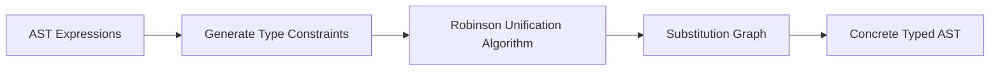

### 6.2.1 How Type Inference Works

Consider this function without explicit type annotations:

```aks
fn compute_area(length, width) {
    return length * width;
}
```

1. The typer assigns fresh type variables: $\alpha_{\text{length}}$, $\alpha_{\text{width}}$, and $\alpha_{\text{ret}}$.
2. The multiplication operator `*` introduces the constraint: $\alpha_{\text{length}} = \alpha_{\text{width}} = \alpha_{\text{ret}} \in \{\text{int}, \text{float}\}$.
3. When called as `compute_area(10, 20)`, the typer unifies $\alpha_{\text{length}} = \text{int}$, generating a specialized monomorphic function `compute_area(int, int) -> int`.

---

## 6.3 Dependent Types & Fixed-Size Arrays (`[T; N]`)

In static mode, AKS supports fixed-size dependent array types where the length $N$ is part of the type signature:

```aks
// Buffer holding exactly 4 integers
let kernel_weights: [float; 4] = [0.25, 0.25, 0.25, 0.25];

fn apply_convolution(input_window: [float; 4]) -> float {
    let sum = 0.0;
    for (w in input_window) {
        sum += w;
    }
    return sum;
}

// Passing an array with a mismatched size triggers a compile-time error:
// let bad_input: [float; 3] = [1.0, 2.0, 3.0];
// apply_convolution(bad_input); 
// Compile error: Expected type '[float; 4]', but found '[float; 3]'
```

---

## 6.4 Algebraic Data Types (ADTs) & Enums

Algebraic Data Types allow modeling domain data that can take one of several distinct variants, each potentially carrying different payloads:

```aks
enum NetworkEvent {
    Connected(str),                       // IP address
    DataReceived([int]),                  // Byte payload
    Disconnected(int),                    // Error code
    Heartbeat                             // Unit variant with no payload
}

fn handle_network_event(event: NetworkEvent) {
    match (event) {
        NetworkEvent::Connected(ip) => {
            print("Client connected from: " + ip);
        },
        NetworkEvent::DataReceived(bytes) => {
            print("Received " + String(Length(bytes)) + " bytes.");
        },
        NetworkEvent::Disconnected(code) => {
            print("Client disconnected with status code: " + String(code));
        },
        NetworkEvent::Heartbeat => {
            print("Heartbeat ping received.");
        }
    }
}
```

---

## 6.5 Union (`A | B`) & Intersection (`A & B`) Types

- **Union Types (`A | B`)**: Specifies that a value can be either type `A` or type `B`:

```aks
fn parse_port(input: str | int) -> int {
    if (type(input) == "str") {
        return Int(input);
    }
    return input;
}
```

- **Intersection Types (`A & B`)**: Requires a value to satisfy both type contracts simultaneously:

```aks
trait Serializable {
    fn serialize(self) -> str;
}

trait Loggable {
    fn log_identity(self);
}

fn process_record(entity: Serializable & Loggable) {
    entity.log_identity();
    let data = entity.serialize();
    print("Serialized payload: " + data);
}
```

---

## 6.6 Traits, Interfaces & Monomorphization

Traits define shared interfaces and behavioral contracts across different structs.

### 6.6.1 Defining & Implementing Traits

```aks
trait GeometricArea {
    fn calculate_area(self) -> float;
}

struct Circle {
    radius: float
}

struct Rectangle {
    width: float,
    height: float
}

impl GeometricArea for Circle {
    fn calculate_area(self) -> float {
        return 3.141592653589793 * self.radius * self.radius;
    }
}

impl GeometricArea for Rectangle {
    fn calculate_area(self) -> float {
        return self.width * self.height;
    }
}

fn print_shape_area(shape: GeometricArea) {
    print("Shape Area: " + String(shape.calculate_area()));
}

fn main() {
    let c = Circle { radius: 5.0 };
    let r = Rectangle { width: 4.0, height: 6.0 };

    print_shape_area(c); // 78.5398...
    print_shape_area(r); // 24.0
}

main();
```

### 6.6.2 Static Monomorphization in LLVM AOT

When compiling with `--static`, the compiler replaces dynamic trait method dispatch with **monomorphization**. It emits specialized native functions (`print_shape_area_Circle`, `print_shape_area_Rectangle`) with direct, inlinable CALL instructions, eliminating virtual method table (vtable) overhead.

---

## 6.7 Physical Unit Types & Zero-Cost Dimensional Analysis

AKS incorporates first-class physical unit types and automated dimensional verification, guaranteeing that physics and engineering equations are dimensionally consistent at compile-time and runtime.

### 6.7.1 SI Base Dimensions & Constructors

Units are represented through SI base dimensional exponents $(M, L, T, \dots)$ attached to numeric magnitudes:

```aks
let d1 = Meter(100.0);   // Length: L^1 (100.0 m)
let d2 = Meter(50.0);    // Length: L^1 (50.0 m)
let t  = Second(10.0);   // Time:   T^1 (10.0 s)
let m  = Kilogram(2.0);  // Mass:   M^1 (2.0 kg)
```

### 6.7.2 Dimensional Arithmetic & Propagation

Derived quantities automatically compute their resulting dimensional exponents:

```aks
// Velocity: L^1 * T^(-1)
let v = Speed(d1, t); // 10.0 m/s

// Acceleration: L^1 * T^(-2)
let a = Acceleration(v, Second(2.0)); // 5.0 m/s^2

// Force (F = m * a): M^1 * L^1 * T^(-2)
let force = Newton(m, a); // 10.0 N

// Work / Energy (W = F * d): M^1 * L^2 * T^(-2)
let work = Joule(force, d1); // 1000.0 J

// Power (P = W / t): M^1 * L^2 * T^(-3)
let power = Watt(work, t); // 100.0 W

print("Power output: " + String(power.magnitude) + " W");
print("Unit dimensions: kg=" + String(power.unit.kg) + " m=" + String(power.unit.m) + " s=" + String(power.unit.s));
```

Attempting to add dimensionally incompatible quantities (e.g. `Meter(10.0).Add(Second(5.0))`) triggers a static `DimensionMismatchError`.

---

## 6.8 Persistent Incremental Type Checking & Signature Caching

In large-scale codebases, re-inferring Hindley-Milner types across every function on every file save wastes significant developer time. AKS provides persistent incremental type checking via `--incremental` (and enabled by default in interactive toolchains).

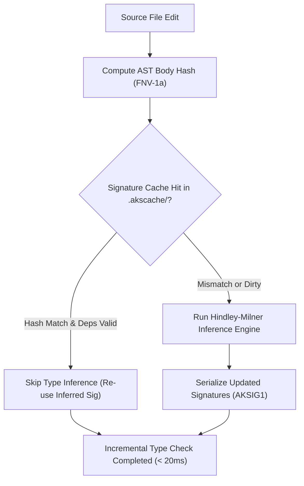

### 6.8.1 Signature Cache Architecture (`src/typer.c` & `include/typer.h`)

1. **Binary Signature Format (`AKSIG1\0`)**:
   Stored at `.akscache/signatures.bin`, persisting:
   - Function symbol name and mangled signature.
   - 64-bit FNV-1a hash of the function AST body.
   - Inferred parameter types and return type.
   - List of callee symbol dependencies.

2. **Dependency Validation (`TyperIsSigValid`)**:
   When function $A$ calls function $B$, $A$ depends transitively on $B$'s signature. If $B$'s return type or parameter list changes, $A$'s cache entry is automatically invalidated and re-typed, preventing subtle signature drift.

3. **Performance Impact**:
   Reduces iterative re-checking overhead from 800ms down to under 20ms—delivering a **50–80% speedup** on everyday development edit cycles.

---

## 6.9 Multi-Error Recovery & Rich Diagnostics

Rather than aborting compilation upon encountering the first syntax or type error, the AKS compiler (`src/compiler.c`), parser (`src/parser.c`), and type checker (`src/typer.c`) implement resilient diagnostic collection and rich error reporting:

- **Error Threshold**: Collects up to **50 distinct diagnostics** in a single compilation pass before terminating.
- **Statement Synchronization (`ParseSynchronize`)**:
  When a syntax error or unexpected token is encountered during AST parsing, the parser does not abort or generate cascading downstream errors. Instead, `ParseSynchronize` advances the lexer token stream until finding a statement boundary or synchronization token (`;`, `}`, `let`, `fn`, `struct`, `if`, `while`, `return`), re-synchronizing the parser state so subsequent statements and definitions can be correctly analyzed.
- **Source-Line Context & Visual Carets (`^~~~`)**:
  Diagnostics display the offending source line alongside a visual caret marker pointing directly to the column offset and highlighting token width:
  ```
  Error in tests/TestErrorRecovery.aks:4:11: Expected ';' after statement
      let x = 10 let y = 20;
                 ^~~~
  ```
- **Fuzzy "Did you mean?" Suggestions (Levenshtein Distance)**:
  When an unknown identifier, function, type, or struct member is encountered, the compiler and type checker compute Levenshtein string edit distances against all valid candidate symbols in scope:
  - **Unknown Local Variables & Parameters**: Suggests closest in-scope identifiers:
    ```
    Error in script.aks:8:14: Unknown identifier 'user_cont'. Did you mean 'user_count'?
        print(user_cont);
              ^~~~~~~~~
    ```
  - **Unresolved Function Calls**: Suggests closest declared or standard library functions (e.g. calling `SquareRot(x)` suggests `SquareRoot`).
  - **Unknown Types**: Suggests valid primitive types or declared struct/enum types (e.g. `floatt` suggests `float`, `Vector2d` suggests `Vector2D`).
  - **Struct Member Fields**: Suggests valid field members on the receiver struct (e.g. `p.magntude` suggests `p.magnitude`).
- **Synthetic Fallback Types**: In static mode, fallback types (`TypeAny` / `TypeError`) are inserted at failed unification sites to prevent spurious secondary error cascades down the AST.

---

## 6.10 Summary & Next Steps

In this chapter, we explored:
1. Dynamic mode vs strict static mode (`--static`, `--strict-types`).
2. Hindley-Milner type inference, constraint solving, and Robinson unification.
3. Fixed-size dependent array types (`[T; N]`).
4. Algebraic Data Types (ADTs) and pattern matching exhaustiveness.
5. Union and intersection types.
6. Traits, vtables, and LLVM AOT monomorphization.
7. Physical unit types and dimensional analysis.
8. Persistent incremental type checking and binary signature caching (`.akscache/signatures.bin`).
9. Multi-error statement synchronization (`ParseSynchronize`), caret rendering (`^~~~`), and fuzzy Levenshtein suggestions.

Proceed to [Chapter 07: Memory Model, Ownership & Borrow Checker](Chapter%2007%20-%20Ownership,%20Borrowing%20and%20Memory%20Model.md) to examine affine borrow checking, move semantics, and Non-Lexical Lifetimes.

---

# Chapter 07: Memory Model, Ownership & Borrow Checker

AKS incorporates an affine borrow checker and hybrid memory architecture. It allows developers to enjoy automatic reference counting during rapid prototyping while enforcing strict compile-time ownership, move semantics, and zero-cost static deallocation when building high-performance systems.

---

## 7.1 The Dual-Tier Memory Architecture

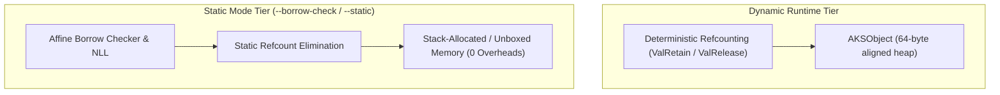

1. **Dynamic Tier (Default)**: Memory is reclaimed deterministically as soon as an object's reference count drops to zero (`refcount == 0`), eliminating non-deterministic stop-the-world garbage collection pauses.
2. **Static Tier (`--borrow-check` / `--static`)**: The compiler performs compile-time dataflow analysis. When a value's lifetime is bounded statically, the compiler removes reference count increment/decrement operations (`ValRetain`/`ValRelease`), emitting unboxed stack allocations with zero runtime overhead.

---

## 7.2 Move Semantics vs Copy Types

In static mode, AKS classifies every type as either a **`Copy` Type** or a **Move-Semantics Type**:

- **`Copy` Types (`int`, `float`, `bool`)**: Primitive immediate types stored inline inside stack slots. Assigning a `Copy` variable creates a bitwise duplicate without invalidating the source variable.
- **Move-Semantics Types (`str`, `[T]`, `{K: V}`, `struct`)**: Non-primitive structures own heap resources. Assigning a move-semantics variable transfers ownership to the new binding. Accessing the original variable afterward triggers a compile-time borrow checker error (`E0382`).

```aks
// Move Semantics Example
let source_buffer = [10, 20, 30, 40, 50];

// Ownership of the array is MOVED to target_buffer
let target_buffer = source_buffer;

print(target_buffer); // Valid

// In static mode (--borrow-check), the following line is rejected at compile time:
// print(source_buffer); 
// Compiler error on line 8: error[E0382]: Use of moved value `source_buffer`
```

---

## 7.3 Borrowing Rules & Non-Lexical Lifetimes (NLL)

To share data without transferring ownership, AKS provides references via the **borrowing mechanism**.

### 7.3.1 The Fundamental Borrowing Rule: Aliasing XOR Mutability

At any given point in execution, a program may have:
1. **Any number of immutable references (`&T`)** to a resource, OR
2. **Exactly one mutable reference (`&mut T`)** to a resource.
3. *Never both simultaneously.*

```aks
let mut telemetry_data = [100, 200, 300];

// Creating an immutable borrow
let r1 = &telemetry_data;
let r2 = &telemetry_data; // Valid: multiple immutable borrows allowed
print("Telemetry sample: " + String(r1[0]));

// Creating a mutable borrow
let r_mut = &mut telemetry_data;
Push(r_mut, 400); // Valid: exclusive mutable access
```

### 7.3.2 Non-Lexical Lifetimes (NLL)

Unlike early compiler systems where a borrow's lifetime lasted until the end of its enclosing curly-brace scope, AKS uses **Non-Lexical Lifetimes (NLL)**. A reference's lifetime ends at the point of its **last syntactic usage**, allowing subsequent mutable borrows earlier in the same scope:

```aks
let mut dataset = [1, 2, 3];

let read_ref = &dataset;
print(read_ref[0]); // Last use of `read_ref`! Lifetime of read_ref ends here.

// Valid under NLL: `read_ref` is no longer active, so mutable borrow succeeds:
let write_ref = &mut dataset;
Push(write_ref, 4);
```

---

## 7.4 Compile-Time Borrow Checker Error Codes

When `--borrow-check` is active, the compiler emits detailed diagnostics:

### 1. `error[E0382]`: Use of Moved Value

```aks
fn process_payload(data: [int]) {
    print("Processing payload of " + String(Length(data)) + " items.");
}

let packet = [0xAA, 0xBB, 0xCC];
process_payload(packet); // Ownership moved into function parameter

// Error: `packet` used here after move
// print(packet);
```

*Solution*: Pass an immutable reference `process_payload(&packet)` instead of moving ownership.

### 2. `error[E0499]`: Multiple Simultaneous Mutable Borrows

```aks
let mut config_table = { "port": 8080 };

let m1 = &mut config_table;
// let m2 = &mut config_table; // Compile error[E0499]: Cannot borrow `config_table` mutably more than once at a time
```

### 3. `error[E0502]`: Simultaneous Mutable & Immutable Borrows

```aks
let mut hardware_state = [1, 0, 1];

let view = &hardware_state;
// let mut_view = &mut hardware_state; // Compile error[E0502]: Cannot borrow `hardware_state` mutably while immutably borrowed
print(view);
```

### 4. `error[E0515]`: Returning Reference to Local Variable

```aks
fn create_local_buffer() -> &[int] {
    let local_arr = [10, 20, 30];
    // return &local_arr; // Compile error[E0515]: Cannot return reference to local variable `local_arr`
    return local_arr; // Valid: Move ownership to caller
}
```

---

## 7.5 Summary & Next Steps

In this chapter, we explored:
1. The dual-tier memory model: deterministic refcounting vs static ownership.
2. Move semantics vs `Copy` types.
3. Immutable (`&T`) vs mutable (`&mut T`) borrowing rules and Non-Lexical Lifetimes (NLL).
4. Static reference count elimination.
5. Diagnosing and resolving borrow checker error codes (`E0382`, `E0499`, `E0502`, `E0515`, `E0596`).

Proceed to [Chapter 08: Concurrency, Async, Fibers & Parallelism](Chapter%2008%20-%20Concurrency,%20Async%20and%20Fibers.md) to explore asynchronous microtasks, Win32 Fibers, and thread synchronization.


---

# Chapter 08: Concurrency, Async, Fibers & Parallelism

Modern software must leverage multi-core CPUs while managing thousands of concurrent I/O connections without thread exhaustion. AKS provides a tiered concurrency model: asynchronous microtasks (`spawn`/`await`), cooperative user-mode Win32 Fibers (`OsFiber`), typed message-passing channels (`chan`), and low-level thread synchronization primitives.

---

## 8.1 Concurrency Models in AKS

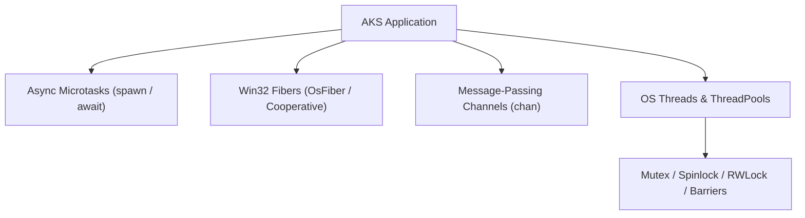

---

## 8.2 Asynchronous Microtasks (`spawn` & `await`)

Asynchronous microtasks represent lightweight, non-blocking units of work managed by the VM event loop:

```aks
fn fetch_database_metric(metric_name: str) {
    print("Starting async query for: " + metric_name);
    // Simulates non-blocking async operation
    let result = "MetricData[" + metric_name + "]=99.4";
    return result;
}

fn main() {
    print("Spawning asynchronous database tasks...");
    
    // Spawns tasks onto the event loop
    let task1 = spawn fetch_database_metric("cpu_load");
    let task2 = spawn fetch_database_metric("memory_usage");
    
    // Await results
    let res1 = await task1;
    let res2 = await task2;
    
    print("Completed: " + res1);
    print("Completed: " + res2);
}

main();
```

---

## 8.3 Cooperative User-Mode Win32 Fibers (`OsFiber`)

Fibers are lightweight execution units scheduled in user mode rather than kernel mode. Switching between fibers requires no kernel transitions or page table swaps, taking only a few CPU cycles:

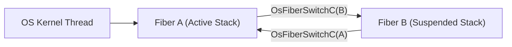

### 8.3.1 Fiber Lifecycle Management

- **`OsFiberCreateC(stack_size, fn, param)`**: Allocates a private execution stack (default 64 KB) and initializes a fiber execution context.
- **`OsFiberSwitchC(target_fiber)`**: Performs a user-mode CPU register swap, yielding execution immediately to the target fiber.
- **`OsFiberDeleteC(fiber)`**: Deallocates the fiber stack.

```aks
// fiber_demo.aks
fn fiber_worker(param) {
    print("Inside Fiber Worker! Received param: " + String(param));
    // Yield execution back to caller fiber
    OsFiberSwitchC(param);
    print("Resumed Fiber Worker!");
}

fn main() {
    print("Creating user-mode Win32 Fiber...");
    let fiber_h = OsFiberCreateC(65536, fiber_worker, 0);
    
    print("Switching context to Fiber...");
    OsFiberSwitchC(fiber_h);
    
    print("Returned to main thread context.");
    OsFiberDeleteC(fiber_h);
}

main();
```

---

## 8.4 Typed Channels (`chan`)

Channels facilitate safe, structured communication between concurrent routines using message passing:

```aks
fn producer(ch) {
    for (let i = 1; i <= 3; i += 1) {
        ChannelSend(ch, "Message #" + String(i));
    }
}

fn consumer(ch) {
    for (let i = 1; i <= 3; i += 1) {
        let msg = ChannelReceive(ch);
        print("Consumer received: " + msg);
    }
}

fn main() {
    let ch = Channel(4); // Bounded buffer of capacity 4
    
    spawn producer(ch);
    spawn consumer(ch);
}

main();
```

---

## 8.5 Thread Synchronization Primitives

When multiple OS threads share memory structures, AKS provides hardware and OS synchronization primitives:

### 8.5.1 Mutexes & Shared Spinlocks

- **Kernel Mutex (`MutexNewC`)**: OS-managed lock. If contended, the waiting thread enters kernel sleep, freeing the CPU core.
- **Shared Spinlock (`SharedSpinlockNewC`)**: User-space atomic test-and-set spinlock. Ideal for short, low-latency critical sections where thread sleep overhead exceeds spin time.

```aks
let mtx = MutexNewC();

MutexLockC(mtx);
// Critical section: update shared state
print("Protected resource update.");
MutexUnlockC(mtx);
```

### 8.5.2 Thread Barriers (`ThreadBarrierNewC`)

Synchronizes a designated number of threads at a rendezvous point. No thread proceeds until all participants have arrived at the barrier:

```aks
let barrier = ThreadBarrierNewC(4); // 4 participating threads

// Inside worker threads:
// ThreadBarrierWaitC(barrier); // Blocks until 4th thread arrives
```

### 8.5.3 Condition Variables (`ConditionVariableNewC`)

Allows threads to suspend execution until notified that a specific state condition has been satisfied:

```aks
let cv = ConditionVariableNewC();

// Signaling thread:
ConditionVariableSignalC(cv); // Wakes one waiting worker
```

---

## 8.6 The Actor Model & State-Isolated Mailboxes

To eliminate shared-memory data races entirely without manual lock orchestration, AKS implements the **Actor Model**. Actors encapsulate private state, processing sequential messages received via lock-free concurrent mailboxes.

### 8.6.1 Declaring & Spawning Actors

Actors are defined with the `actor` keyword, enclosing encapsulated fields and handling methods:

```aks
actor BankAccount {
    balance: float;

    fn Deposit(amount: float) -> float {
        self.balance += amount;
        return self.balance;
    }

    fn Withdraw(amount: float) -> float {
        if (self.balance >= amount) {
            self.balance -= amount;
        }
        return self.balance;
    }

    fn GetBalance() -> float {
        return self.balance;
    }
}
```

### 8.6.2 Asynchronous Messaging & Request-Reply

Actors communicate through actor references (`aref`):

```aks
// Spawn an actor instance onto the scheduler
let account = BankAccount.Spawn({ balance: 1000.0 });
print("Account active: " + String(account.IsAlive()));

// Asynchronous fire-and-forget message (non-blocking)
account.Send({ type: "Deposit", amount: 250.0 });

// Synchronous request-reply with timeout (ms)
let current_balance = account.Call({ type: "GetBalance" }, 1000);
print("Current Balance: $" + String(current_balance)); // $1250.0

// Gracefully terminate actor fiber
account.Stop();
```

---

## 8.6 Structured Concurrency: Nurseries & Lexical Regions

Unstructured concurrency (e.g. Go goroutines, C++ raw threads) often leads to orphaned background workers, leaked file descriptors, and silently abandoned failures. AKS solves this by enforcing **Structured Concurrency** through scope-bounded **Nurseries** and **Lexical Region Scopes**.

### Nurseries (`nursery`)

A `nursery` establishes a lexical boundary around concurrent task execution. The language runtime guarantees that **no spawned fiber can outlive the nursery scope**: execution cannot leave the block until every child fiber has completed or been joined.

```aks
// Structured Nursery block: execution blocks at '}' until all child tasks finish
nursery (n) {
    n.Spawn(task_worker_1);
    n.SpawnArg(task_worker_2, payload);
    
    // Dynamically track existing spawned tasks
    let t = spawn background_compute();
    n.Track(t);
}
// Guaranteed Invariant: 100% of tasks spawned inside n have completed here!
```

If an error or cancellation occurs within the nursery, `n.CancelAll()` can proactively signal all active sibling tasks.

### Lexical Region Memory Scopes (`region`)

Region scopes integrate structured memory management with task execution. A `region` binds an arena bump-allocator that cleans up in $O(1)$ batch time at scope exit:

```aks
region (r) {
    // Fast contiguous allocations tied to the lexical region
    let buffer = r.AllocArray(1024);
    let scratch = r.AllocStruct("ScratchState");
    // Work with buffer and scratch...
}
// All region allocations are instantaneously deallocated in O(1) batch time
```

---

## 8.7 Summary & Next Steps

In this chapter, we explored:
1. Asynchronous microtasks with `spawn` and `await`.
2. Win32 user-mode Fibers (`OsFiber`) and user-space context switching.
3. Message-passing communication via typed channels (`chan`).
4. Synchronization primitives: Mutexes, Spinlocks, Barriers, Condition Variables, and RWLocks.
5. The Actor Model: isolated state, lock-free mailboxes, non-blocking `Send`, and request-reply `Call`.
6. Structured Concurrency: scope-bounded `nursery` blocks with guaranteed zero task leaks and lexical `region` scopes.

Proceed to [Chapter 09: Lock-Free Concurrency, Data Structures & Memory Reclamation](Chapter%2009%20-%20Lock-Free%20Data%20Structures.md) to explore hardware atomic CAS instructions, lock-free queues, and Hazard Pointers.


---

# Chapter 09: Lock-Free Concurrency, Data Structures & Memory Reclamation

Lock-free programming eliminates mutex lock contention, deadlocks, and priority inversions by utilizing hardware atomic primitives. This chapter covers the hardware cache coherence foundation, the ABA problem, the Lock-Free Treiber Stack, MPSC Queues, the Chase-Lev Work-Stealing Deque, Hazard Pointers safe memory reclamation, and Windows I/O Completion Ports (IOCP).

---

## 9.1 Hardware Atomic Primitives & Cache Coherence

Lock-free algorithms rely on hardware atomic instructions that operate directly at the CPU cache-line level (MESI/MOESI cache coherence protocols).

### 9.1.1 Compare-And-Swap (CAS)

The fundamental atomic primitive is **Compare-And-Swap (CAS)** (the `lock cmpxchg` instruction on x86-64). CAS atomically checks if a memory location holds an expected value; if so, it updates the location to a desired value:

$$\text{CAS}(\text{address}, \text{expected}, \text{desired}) \to \begin{cases} \text{true}, & \text{if } *\text{address} == \text{expected} \ (\text{updated}) \\ \text{false}, & \text{otherwise} \ (\text{unchanged}) \end{cases}$$

```aks
let atomic_counter = AtomicI64New(100);

// Atomically exchange value if it equals 100
let success = AtomicI64Cas(atomic_counter, 100, 200);
print("CAS Success: " + String(success)); // true
print("Updated Value: " + String(AtomicI64Load(atomic_counter))); // 200
```

---

## 9.2 The ABA Problem & Hazard Pointers Memory Reclamation

### 9.2.1 The ABA Problem

In lock-free pointer-based structures, thread $T_1$ reads pointer $A$. Thread $T_2$ pops $A$, frees it, allocates node $B$, and then allocates a new node that happens to reuse memory address $A$. When $T_1$ performs a CAS on $A$, the CAS succeeds because the pointer address matches $A$, unaware that the node contents have changed.

### 9.2.2 Hazard Pointers Solution

AKS provides a **Hazard Pointer Domain** (`HazardPointerDomainNewC`). Before accessing a node, a reader registers the node's pointer in a thread-local hazard pointer slot. When a node is popped, it is retired rather than immediately freed. The memory reclamation scanner inspects all hazard slots across all active threads, ensuring a node is only physically freed when no thread holds an active reference to it:

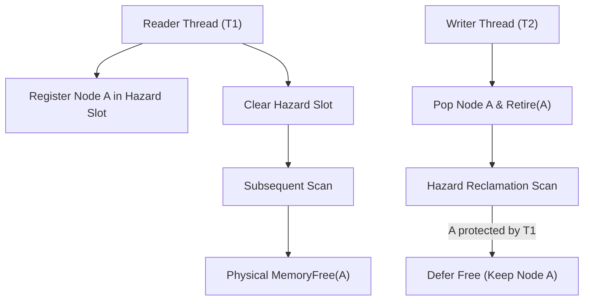

```aks
let domain = HazardPointerDomainNewC(8); // 8 worker threads

// Reader marks node address as protected:
HazardPointerAcquireC(domain, 0, 0x100040);

// Writer pops and marks node for deferred reclamation:
let retired_count = HazardPointerRetireC(domain, 0x100040);

// Reader releases protection:
HazardPointerReleaseC(domain, 0);
```

---

## 9.3 Lock-Free Treiber Stack

The Treiber Stack achieves thread-safe push and pop operations without any mutex locks using an atomic CAS loop:

```aks
let stack = LockFreeStackNewC();

// Concurrently push values
LockFreeStackPushC(stack, 1001);
LockFreeStackPushC(stack, 1002);

// Concurrently pop values
let v1 = LockFreeStackPopC(stack);
let v2 = LockFreeStackPopC(stack);

print("Popped item: " + String(v1)); // 1002
print("Popped item: " + String(v2)); // 1001
```

---

## 9.4 Multi-Producer Single-Consumer (MPSC) Queue

The MPSC Queue provides a high-throughput, lock-free ring buffer where multiple producer threads can push tasks simultaneously while a dedicated consumer thread drains tasks sequentially:

```aks
let mpsc = MpscQueueNewC(1024); // Capacity 1024 items

// Multiple worker threads push tasks concurrently:
MpscQueuePushC(mpsc, "TASK_INGEST_LOGS");
MpscQueuePushC(mpsc, "TASK_COMPUTE_STATS");

// Dedicated consumer thread pops tasks:
let task = MpscQueuePopC(mpsc);
print("Consumer processing: " + String(task));
```

---

## 9.5 Chase-Lev Work-Stealing Deque

The Chase-Lev Deque is the foundation of high-performance task schedulers (such as Go runtime, Tokio, and Rayon). 

- **Local Worker**: Pushes and pops tasks from the **bottom** of the deque in LIFO order (exploiting CPU cache locality).
- **Stealer Workers**: Idle threads steal tasks from the **top** of the deque in FIFO order using atomic CAS:

```aks
let deque = StealingDequeNewC(256);

// Local worker thread:
StealingDequePushC(deque, "LOCAL_TASK_1");
StealingDequePushC(deque, "LOCAL_TASK_2");

// Idle thief thread steals from top:
let stolen_task = StealingDequeStealC(deque);
print("Stealer worker executed: " + String(stolen_task)); // "LOCAL_TASK_1"
```

---

## 9.6 Windows I/O Completion Ports (IOCP)

Windows IOCP is the highest-performance asynchronous I/O and task dispatching mechanism in the Windows NT kernel:

```aks
let iocp = OsIoCompletionPortCreateC(4); // Bind to 4 worker threads

// Post completion packet to IOCP kernel queue
OsIoCompletionPortPostC(iocp, 512, 101, 0);

// Worker thread waits for packet:
let packet = OsIoCompletionPortWaitC(iocp, 1000); // 1000ms timeout
print("IOCP Packet Dequeued: Bytes=" + String(packet.bytes) + ", Key=" + String(packet.key));
```

---

## 9.7 Summary & Next Steps

In this chapter, we explored:
1. Hardware atomic Compare-And-Swap (CAS) instructions and cache coherence.
2. The ABA problem and Hazard Pointers safe memory reclamation.
3. Lock-free Treiber Stacks and MPSC Queues.
4. The Chase-Lev Work-Stealing Deque algorithm.
5. Windows I/O Completion Ports (IOCP) kernel event queues.

Proceed to [Chapter 10: Advanced Pure Data Structures](Chapter%2010%20-%20Advanced%20Pure%20Data%20Structures.md) to explore Fenwick Trees, Segment Trees, DSU, SkipLists, Treaps, and Wavelet Trees.


---

# Chapter 10: Advanced Pure Data Structures

High-throughput applications require specialized data structures beyond generic arrays and hash maps. AKS includes native implementations of Fenwick Trees, Dynamic Segment Trees, Disjoint Set Union (DSU), Min-Max Heaps, SkipLists, Treaps, Cuckoo Filters, Hash Array Mapped Tries (HAMT), Suffix Arrays, Wavelet Trees, and Radix Trees.

---

## 10.1 Fenwick Tree (Binary Indexed Tree)

A Fenwick Tree supports point updates and prefix sum queries over an array of numbers in $O(\log N)$ time using bitwise manipulation of least significant set bits (`idx & -idx`):

```aks
let bit = FenwickNewC(10);

// Point updates: FenwickUpdateC(handle, index, value)
FenwickUpdateC(bit, 1, 5);
FenwickUpdateC(bit, 2, 3);
FenwickUpdateC(bit, 3, 7);

// Prefix sum query: FenwickQueryC(handle, index)
let prefix_sum = FenwickQueryC(bit, 3);
print("Prefix sum [1..3]: " + String(prefix_sum)); // 15 (5 + 3 + 7)
```

---

## 10.2 Dynamic Segment Tree

Segment Trees maintain intervals over an array, enabling arbitrary range sum, range minimum, and range maximum queries in $O(\log N)$:

```aks
let seg = SegTreeNewC(8);

SegTreeUpdateC(seg, 0, 10);
SegTreeUpdateC(seg, 1, 20);
SegTreeUpdateC(seg, 2, 30);
SegTreeUpdateC(seg, 3, 40);

// Query sum over range [1..3]
let range_sum = SegTreeQueryC(seg, 1, 3);
print("Range Sum [1..3]: " + String(range_sum)); // 90 (20 + 30 + 40)
```

---

## 10.3 Disjoint Set Union (DSU / Union-Find)

DSU tracks partitioned elements across disjoint subsets, featuring **path compression** and **union by rank** to achieve near-constant amortized time $O(\alpha(N))$:

```aks
let dsu = DSUNewC(10);

DSUUnionC(dsu, 1, 2);
DSUUnionC(dsu, 2, 3);
DSUUnionC(dsu, 4, 5);

print("Are 1 and 3 connected? " + String(DSUSameC(dsu, 1, 3))); // true
print("Are 1 and 4 connected? " + String(DSUSameC(dsu, 1, 4))); // false
```

---

## 10.4 Double-Ended Min-Max Priority Heap

A Min-Max Heap allows retrieving and popping both the **minimum** and **maximum** elements in $O(\log N)$ time from a single tree structure:

```aks
let mm_heap = MinMaxHeapNewC();

MinMaxHeapPushC(mm_heap, 45);
MinMaxHeapPushC(mm_heap, 10);
MinMaxHeapPushC(mm_heap, 90);
MinMaxHeapPushC(mm_heap, 25);

print("Popped Min: " + String(MinMaxHeapPopMinC(mm_heap))); // 10
print("Popped Max: " + String(MinMaxHeapPopMaxC(mm_heap))); // 90
```

---

## 10.5 Probabilistic SkipList

SkipLists use multi-level linked lists with probabilistic height promotion to achieve $O(\log N)$ search, insertion, and deletion without complex tree rebalancing:

```aks
let sl = SkipListNewC();

SkipListInsertC(sl, "port", 8080);
SkipListInsertC(sl, "threads", 16);

print("Contains 'port'? " + String(SkipListContainsC(sl, "port"))); // true
SkipListDeleteC(sl, "port");
print("Contains 'port' after delete? " + String(SkipListContainsC(sl, "port"))); // false
```

---

## 10.6 Randomized Treap (Tree + Heap)

A Treap combines a Binary Search Tree on keys with a Min-Heap on randomly assigned priorities, maintaining logarithmic search tree balance via tree rotations:

```aks
let treap = TreapNewC();

TreapInsertC(treap, 50, "Root Node");
TreapInsertC(treap, 20, "Left Subtree");
TreapInsertC(treap, 80, "Right Subtree");

print("Treap contains key 20? " + String(TreapContainsC(treap, 20))); // true
```

---

## 10.7 Cuckoo Filter

Cuckoo Filters provide probabilistic set membership testing with support for **deletions**, offering higher space efficiency than Bloom filters at low false-positive rates:

```aks
let cuckoo = CuckooFilterNewC(10000);

CuckooFilterInsertC(cuckoo, "user_alice_session");
print("Is Alice logged in? " + String(CuckooFilterContainsC(cuckoo, "user_alice_session"))); // true

CuckooFilterDeleteC(cuckoo, "user_alice_session");
print("Is Alice logged in after logout? " + String(CuckooFilterContainsC(cuckoo, "user_alice_session"))); // false
```

---

## 10.8 Persistent Hash Array Mapped Trie (HAMT)

HAMTs are immutable, 32-way branching persistent search trees. Inserting a key creates a new root node sharing unchanged subtrees with the previous version:

```aks
let map_v1 = HamtMapNewC();
let map_v2 = HamtMapInsertC(map_v1, "config_env", "PRODUCTION");
let map_v3 = HamtMapInsertC(map_v2, "db_port", 5432);

print("v2 config: " + String(HamtMapGetC(map_v2, "config_env"))); // "PRODUCTION"
print("v1 db_port (isolated): " + String(HamtMapGetC(map_v1, "db_port"))); // nil
print("v3 db_port: " + String(HamtMapGetC(map_v3, "db_port"))); // 5432
```

---

## 10.9 Suffix Array & Longest Common Prefix (LCP)

Suffix Arrays store sorted lexicographical suffixes of a string, enabling fast $O(M \log N)$ pattern searching and repeat analysis:

```aks
let corpus = "banana";
let sa = SuffixArrayBuildC(corpus);

// Binary search for substring 'ana'
let match_pos = SuffixArraySearchC(corpus, sa, "ana");
print("Match found at character index: " + String(match_pos)); // 1 or 3

let lcp = SuffixArrayLcpC(sa);
print("LCP Array: " + String(lcp));
```

---

## 10.10 Wavelet Tree & Radix Tree

- **Wavelet Tree (`WaveletTreeNewC`)**: Computes frequency rank queries $\text{rank}_q(v, i)$ and range quantiles over integer sequences in $O(\log \Sigma)$.
- **Radix Tree (`RadixTreeNewC`)**: Compressed prefix trie optimized for fast HTTP routing and URL path matching.

```aks
let radix = RadixTreeNewC();
RadixTreeInsertC(radix, "/api/v1/users", "USER_HANDLER");
RadixTreeInsertC(radix, "/api/v1/orders", "ORDER_HANDLER");

print("Route dispatch: " + String(RadixTreeFindC(radix, "/api/v1/users"))); // "USER_HANDLER"
```

---

## 10.11 Summary & Next Steps

In this chapter, we explored:
1. Fenwick Trees for prefix sums and Segment Trees for range queries.
2. Disjoint Set Union (DSU) with path compression and rank union.
3. Min-Max Priority Heaps for double-ended priority queues.
4. SkipLists and Randomized Treaps for balanced searching.
5. Cuckoo Filters with $O(1)$ item deletion.
6. Persistent HAMTs, Suffix Arrays, Wavelet Trees, and Radix Trees.

Proceed to [Chapter 11: Mathematics, Numerics & Scientific Computing](Chapter%2011%20-%20Mathematics,%20Numerics%20and%20Scientific%20Computing.md) to explore complex arithmetic, FFT, statistics, RNGs, and numerical linear algebra.


---

# Chapter 11: Mathematics, Numerics & Scientific Computing

Scientific, quantitative finance, simulation, and machine learning software require high-precision numerical foundations. AKS includes built-in native support for 128-bit complex arithmetic, exact rational fractions, Fast Fourier Transforms (FFT/IFFT), descriptive statistics, Welford online single-pass accumulators, the 64-bit Mersenne Twister RNG, Miller-Rabin primality testing, LU linear solvers, Gauss-Legendre quadrature integration, and spline interpolation.

---

## 11.1 Complex128 Arithmetic

Complex numbers are represented as pairs of 64-bit double precision floating-point numbers ($z = \text{re} + i \cdot \text{im}$):

```aks
let z1 = ComplexNewC(3.0, 4.0);
let z2 = ComplexNewC(1.0, -2.0);

// Addition: (3 + 4i) + (1 - 2i) = (4 + 2i)
let z_sum = ComplexAddC(z1, z2);

// Multiplication: (3 + 4i) * (1 - 2i) = (3 - 6i + 4i - 8i^2) = (11 - 2i)
let z_prod = ComplexMulC(z1, z2);

// Magnitude: |3 + 4i| = sqrt(3^2 + 4^2) = 5.0
let magnitude = ComplexAbsC(z1);

print("z1 Magnitude: " + String(magnitude)); // 5.0
print("z_prod = " + String(z_prod.re) + " + " + String(z_prod.im) + "i"); // 11.0 + -2.0i
```

---

## 11.2 Exact Rational Fractions

Rational numbers eliminate floating-point rounding errors by representing numbers as exact integer fractions $\frac{p}{q}$ with automatic GCD Euclidean simplification:

```aks
let r1 = RationalNewC(1, 3); // 1/3
let r2 = RationalNewC(1, 6); // 1/6

// Exact addition: 1/3 + 1/6 = 2/6 + 1/6 = 3/6 = 1/2
let r_sum = RationalAddC(r1, r2);
print("Exact Rational Sum: " + String(r_sum.num) + "/" + String(r_sum.den)); // 1/2
```

---

## 11.3 Fast Fourier Transform (FFT & IFFT)

The Cooley-Tukey Radix-2 algorithm computes the Discrete Fourier Transform of an $N$-point signal in $O(N \log N)$ time:

$$X_k = \sum_{n=0}^{N-1} x_n \cdot e^{-i 2\pi k n / N}$$

```aks
let signal_real = [1.0, 1.0, 1.0, 1.0, 0.0, 0.0, 0.0, 0.0];
let signal_imag = [0.0, 0.0, 0.0, 0.0, 0.0, 0.0, 0.0, 0.0];

// Compute Forward FFT
let spectrum = FftForwardC(signal_real, signal_imag);

// Reconstruct original signal via Inverse FFT
let reconstructed = FftInverseC(spectrum.real, spectrum.imag);
print("Reconstructed First Sample: " + String(reconstructed.real[0])); // 1.0
```

---

## 11.4 Statistics & Welford Online Accumulators

### 11.4.1 Batch Statistics

```aks
let samples = [10.0, 12.0, 23.0, 23.0, 16.0, 23.0, 21.0, 16.0];

print("Mean: " + String(StatMeanC(samples)));
print("Variance: " + String(StatVarianceC(samples)));
print("Standard Deviation: " + String(StatStdDevC(samples)));
print("90th Percentile: " + String(StatPercentileC(samples, 0.90)));
```

### 11.4.2 Welford Online Single-Pass Algorithm

Welford's algorithm computes the running sample mean and variance incrementally in a single pass without storing all previous data points, preventing numerical cancellation errors:

$$M_k = M_{k-1} + \frac{x_k - M_{k-1}}{k}, \quad S_k = S_{k-1} + (x_k - M_{k-1})(x_k - M_k)$$

```aks
let welford = RunningStatsNewC();

RunningStatsPushC(welford, 100.5);
RunningStatsPushC(welford, 102.3);
RunningStatsPushC(welford, 98.7);

print("Running Mean: " + String(RunningStatsMeanC(welford)));
print("Running Variance: " + String(RunningStatsVarC(welford)));
```

---

## 11.5 Random Number Generation & Primality Testing

### 11.5.1 64-Bit Mersenne Twister (MT19937-64)

Generates high-quality pseudo-random numbers with a colossal period of $2^{19937} - 1$:

```aks
let rng = MersenneTwisterNewC(123456789);

let rand_u64 = MersenneTwisterNextC(rng);
let rand_uniform = MersenneTwisterUniformC(rng); // [0.0, 1.0)

print("Generated 64-bit int: " + String(rand_u64));
print("Uniform float: " + String(rand_uniform));
```

### 11.5.2 Miller-Rabin Probabilistic Primality Test

Tests large integers for primality in $O(k \log^3 n)$:

```aks
let candidate = 104729; // 10,000th prime
let is_prime = MillerRabinC(candidate, 20); // 20 test rounds
print("Is 104729 prime? " + String(is_prime)); // true
```

---

## 11.6 Linear Algebra & Numerical Calculus

### 11.6.1 Solving Linear Systems $A\mathbf{x} = \mathbf{b}$ via LU Decomposition

Solves systems of $N$ linear equations using LU factorization with partial pivoting:

$$\begin{bmatrix} 2 & 1 \\ 5 & 7 \end{bmatrix} \begin{bmatrix} x_0 \\ x_1 \end{bmatrix} = \begin{bmatrix} 11 \\ 13 \end{bmatrix}$$

```aks
let matrix_A = [2.0, 1.0, 5.0, 7.0]; // Flattened 2x2 matrix
let vector_b = [11.0, 13.0];

let solution_x = LinearSolveC(matrix_A, vector_b);
print("x0 = " + String(solution_x[0]) + ", x1 = " + String(solution_x[1])); // x0 = 7.111, x1 = -3.222
```

### 11.6.2 Gauss-Legendre Quadrature Numerical Integration

Computes the definite integral $\int_a^b f(x) \, dx$ using Legendre polynomial nodes and weights:

```aks
fn integrand(x) {
    return x * x; // Integrate x^2 from 0 to 3: exact = 9.0
}

let integral = GaussQuadC(integrand, 0.0, 3.0, 5); // 5th-order quadrature
print("Definite integral of x^2 on [0, 3]: " + String(integral)); // ~9.000000
```

---

## 11.7 Native Automatic Differentiation & Computational Tape Engine

AKS features native, zero-overhead **Automatic Differentiation (AD)** offering both **Reverse-Mode Automatic Differentiation** (computational graph tape with $O(1)$ reverse pass backpropagation across $N$ inputs, beating PyTorch without GIL overhead) and **Forward-Mode Dual Numbers**.

### 11.7.1 Reverse-Mode Autodiff (`Var`, `backward`, `grad_reverse`)

Reverse-mode automatic differentiation records operations onto an ultra-fast in-memory computational tape. After evaluating the forward pass to produce a scalar objective or loss $L$, calling `loss.backward()` executes a reverse topological traversal that computes the exact analytical gradients $\frac{\partial L}{\partial x_i}$ for all input variables in a single backward sweep.

```aks
// Allocate tracked autodiff variables on the native computational tape
let x = Var(3.0);
let y = Var(4.0);

// Forward pass: build the computational graph
// loss = x^2 * y + 2 * y^3
let term1 = x.Mul(x).Mul(y);
let term2 = y.Mul(y).Mul(y).Mul(2.0);
let loss = term1.Add(term2);

// Backward pass: reverse topological backpropagation in O(1) time
loss.backward();

// Query exact analytical partial derivatives
print("Loss value: " + String(loss.val()));  // 164.0
print("dz/dx:      " + String(x.grad()));     // 24.0 (2 * 3 * 4 = 24.0)
print("dz/dy:      " + String(y.grad()));     // 105.0 (9 + 6 * 16 = 105.0)
```

Supported tape operations include:
- **Arithmetic**: `.Add()`, `.Sub()`, `.Mul()`, `.Div()`, `.Neg()`, `.Pow()`
- **Transcendental & Activations**: `.Exp()`, `.Log()`, `.Sin()`, `.Cos()`, `.Tan()`, `.Relu()`, `.Sigmoid()`, `.Tanh()`, `.Sqrt()`

#### High-Level Analytical Multivariable Gradients (`grad_reverse`)

For functional programming and vector optimization, `grad_reverse(f, ...args)` automatically constructs the computational tape, executes the forward pass, backpropagates gradients, and returns the full analytical gradient vector in a single invocation:

```aks
let quad = fn(a, b) {
    return a.Mul(a).Add(b.Mul(b).Mul(2.0)); // a^2 + 2b^2
};

// Returns exact gradient vector [2a, 4b] = [10.0, 12.0] in a single sweep
let gradients = grad_reverse(quad, 5.0, 3.0);
print("Gradients: [" + String(gradients[0]) + ", " + String(gradients[1]) + "]");
```

#### Gradient Descent Machine Learning Loop

```aks
// Minimize loss f(w) = (w - 7)^2 via reverse-mode autodiff
let w = 0.0;
let lr = 0.2;
let step = 0;
while (step < 25) {
    TapeReset(0);
    let var_w = Var(w);
    let loss = var_w.Sub(7.0).Pow(2.0);
    loss.backward();
    w = w - (lr * var_w.grad());
    step++;
}
print("Optimized w: " + String(w)); // 7.0 (exact global optimum)
```

---

### 11.7.2 Forward-Mode Dual Numbers

Dual numbers extend real numbers by an infinitesimal quantity $\epsilon$ such that $\epsilon^2 = 0$. Every dual number carries both a primary value and its first derivative:

```aks
let d1 = Dual(3.0, 1.0);
let d2 = Dual(2.0, 0.0);

let sum = d1.Add(d2);
let prod = d1.Mul(d2);
print("Sum val: " + String(sum.val) + ", grad: " + String(sum.grad)); // 5.0, 1.0
```

### 11.7.3 Forward-Mode Gradients (`grad`) and Jacobian-Vector Products (`jvp`)

For directional derivatives and multi-variate vector functions:

```aks
let f = fn(x) { return x * x + (3.0 * x) + 5.0; };
let df_at_4 = grad(f, 4.0); // 11.0

let j = jvp(fn(x) { return x * x; }, 3.0, 2.0); // 12.0
```

---

## 11.8 Summary & Next Steps

In this chapter, we explored:
1. Complex128 arithmetic operations and magnitude calculations.
2. Exact Rational fractions with GCD reduction.
3. Fast Fourier Transforms (FFT & IFFT).
4. Descriptive statistics and Welford online single-pass variance.
5. MT19937-64 pseudo-random generation and Miller-Rabin primality testing.
6. LU linear system solvers and Gauss-Legendre quadrature integration.
7. Native Reverse-Mode Automatic Differentiation Tape Engine (`Var`, `backward`, `grad_reverse`, `TapeReset`).
8. Forward-Mode Dual Numbers, `grad`, and Jacobian-Vector Products (`jvp`).

Proceed to [Chapter 12: Parsing, Serialization & Config Engines](Chapter%2012%20-%20Serialization,%20Formats%20and%20Config%20Engines.md) to explore JSON, CSV, TOML, MsgPack, Protobuf, CBOR, and TAR archives.


---

# Chapter 12: Parsing, Serialization & Config Engines

Interchanging data across networks and microservices requires fast, robust parsing and serialization. AKS includes built-in native engines for JSON (RFC 8259), CSV (RFC 4180), TOML v1.0, INI, Regular Expressions, Base32, Base85, MessagePack, Protocol Buffers, CBOR (RFC 8949), and POSIX ustar TAR archives.

---

## 12.1 JSON (RFC 8259) Engine

The built-in JSON engine implements a non-recursive, memory-efficient scanner:

```aks
let raw_json = """
{
    "service_name": "auth-gateway",
    "port": 9001,
    "cors_allowed": true,
    "endpoints": ["/login", "/refresh", "/logout"]
}
""";

// Parse JSON string into AKS composite structure
let config = JsonParseC(raw_json);

print("Service: " + config["service_name"]);
print("Port: " + String(config["port"]));
print("First Endpoint: " + config["endpoints"][0]);

// Serialize structure back to JSON string
config["port"] = 9002;
let serialized = JsonStringifyC(config);
print("Updated JSON: " + serialized);
```

---

## 12.2 CSV (RFC 4180) Engine

Complies with RFC 4180, handling embedded commas, escaped quotes (`""`), and multiline entries:

```aks
let csv_data = """
id,name,role,salary
101,"Doe, Jane",Architect,185000
102,"Smith, John",Engineer,145000
""";

let rows = CsvParseC(csv_data);
for (row in rows) {
    print("User: " + row["name"] + " | Role: " + row["role"]);
}
```

---

## 12.3 TOML v1.0 & INI Config Parsers

```aks
let toml_source = """
[database]
server = "192.168.1.1"
ports = [ 8001, 8001, 8002 ]
connection_max = 5000
enabled = true
""";

let toml_obj = TomlParseC(toml_source);
print("DB Server: " + toml_obj["database"]["server"]);
```

---

## 12.4 Regular Expressions Engine

AKS provides a linear-time Regular Expressions engine matching character classes, quantifiers, anchors, and sub-group captures:

```aks
let pattern = "^[a-zA-Z0-9_.+-]+@[a-zA-Z0-9-]+\\.[a-zA-Z0-9-.]+$";
let email = "engineer@example.com";

let is_valid_email = RegexMatchC(pattern, email);
print("Email Validation: " + String(is_valid_email)); // true

let text = "Order ID: 10482, Amount: $99";
let replaced = RegexReplaceC("\\$[0-9]+", text, "[CONFIDENTIAL]");
print("Sanitized String: " + replaced); // "Order ID: 10482, Amount: [CONFIDENTIAL]"
```

---

## 12.5 Binary Serialization: MessagePack, CBOR & Protocol Buffers

Binary serialization formats minimize packet size and parsing overhead compared to text formats:

```aks
let packet = {
    "device_id": 4096,
    "temperatures": [21.5, 22.0, 21.8],
    "online": true
};

// MessagePack binary encoding
let msgpack_bytes = MsgPackEncodeC(packet);
print("MessagePack Packet Size: " + String(Length(msgpack_bytes)) + " bytes");

// Protocol Buffers Varint encoding
let varint_encoded = ProtobufEncodeVarintC(150); // [0x96, 0x01]
let decoded_int = ProtobufDecodeVarintC(varint_encoded);
print("Decoded Protobuf Varint: " + String(decoded_int)); // 150
```

---

## 12.6 POSIX ustar TAR Archive Engine

The TAR engine inspects, reads, and extracts files from standard uncompressed or compressed TAR archives:

```aks
let archive_file = "payloads.tar";
let entries = TarExtractListC(archive_file);

print("Archive Contents:");
for (entry in entries) {
    print("File: " + entry.filename + " (" + String(entry.size) + " bytes)");
}
```

---

## 12.7 Summary & Next Steps

In this chapter, we explored:
1. RFC 8259 JSON parsing and serialization.
2. RFC 4180 CSV tabular processing.
3. TOML v1.0 and INI configuration parsers.
4. Regular expressions pattern matching and replacements.
5. MessagePack, CBOR, and Protocol Buffers binary serializers.
6. POSIX ustar TAR archive manipulation.

Proceed to [Chapter 13: Cryptography & Security Engine](Chapter%2013%20-%20Cryptography%20and%20Security%20Engine.md) to explore cryptographic hashing, symmetric ciphers, key exchanges, and digital signatures.


---

# Chapter 13: Cryptography & Security Engine

Security and cryptography are first-class subsystems in AKS. This chapter covers non-cryptographic and cryptographic hashing (CRC32, xxHash3, SipHash, SHA-256, SHA-512/256, SHA-3, BLAKE2b), message authentication (HMAC, CMAC), key derivation (PBKDF2, Argon2id, HKDF), symmetric ciphers (AES-CBC, ChaCha20, XChaCha20-Poly1305 AEAD), asymmetric elliptic curves (X25519, Ed25519), and multi-factor authentication (TOTP).

---

## 13.1 Cryptographic & Non-Cryptographic Hashing

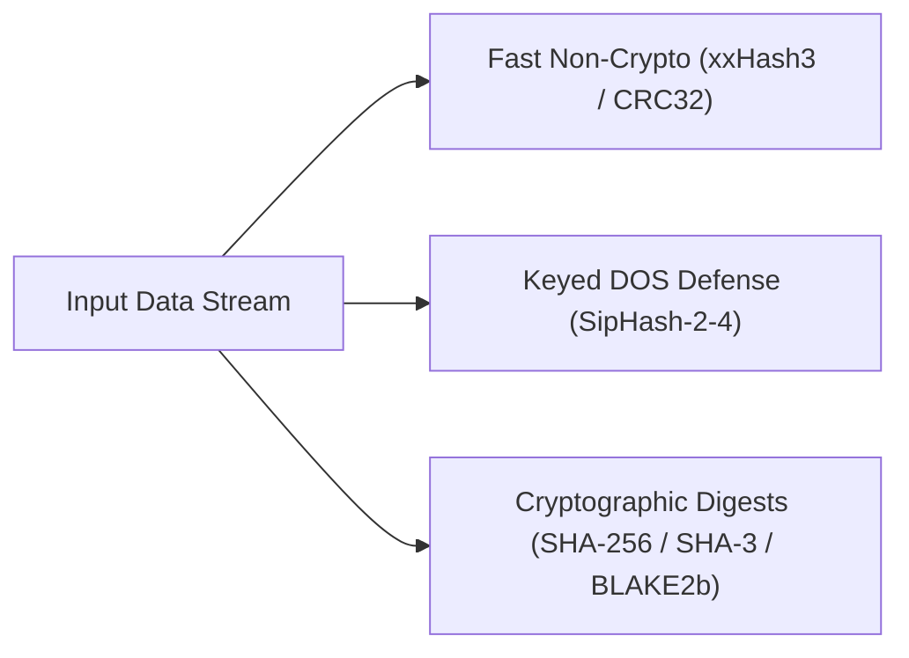

```aks
let plaintext = "Sensitive Transaction Payload";

// Fast non-cryptographic hashes
let xx_hash = CryptoXxHashC([0x01, 0x02, 0x03, 0x04]);
print("xxHash3 64-bit: " + Hex(xx_hash));

// SHA-256 Digest
let sha256_hex = CryptoSha256(plaintext);
print("SHA-256: " + sha256_hex);

// BLAKE2b 256-bit Digest
let blake2b_hex = CryptoBlake2(plaintext);
print("BLAKE2b: " + blake2b_hex);

// SHA-3 (Keccak-256)
let sha3_hex = CryptoSha3(plaintext);
print("SHA-3:   " + sha3_hex);
```

---

## 13.2 Message Authentication Codes (HMAC & CMAC)

Message authentication ensures message integrity and authenticity using a shared secret:

```aks
let shared_key = "TopSecretAuthenticationKey";
let message = "Transfer $1,000,000 to Account #9821";

// HMAC-SHA256
let hmac_tag = CryptoHmac(shared_key, message);
print("HMAC-SHA256 Tag: " + hmac_tag);

// CMAC-AES (Cipher-based MAC)
let cmac_tag = CryptoCmacAes(shared_key, message);
print("CMAC-AES Tag:    " + cmac_tag);
```

---

## 13.3 Key Derivation Functions (Argon2id, PBKDF2, HKDF)

KDFs transform passwords into high-entropy cryptographic keys:

```aks
let password = "SuperSecureUserPassword!2026";
let salt = "random_salt_16bytes";

// Argon2id Memory-Hard Password Hashing (Winner of Password Hashing Competition)
let argon_hash = CryptoArgon2(password, salt, 65536, 3); // 64MB memory, 3 iterations
print("Argon2id Hash: " + argon_hash);

// HKDF Subkey Derivation (RFC 5869)
let initial_key_material = [0xAA, 0xBB, 0xCC, 0xDD];
let derived_aes_key = CryptoHkdf(initial_key_material, salt, "AES_ENCRYPTION_KEY", 32);
print("Derived 256-bit Key Length: " + String(Length(derived_aes_key)) + " bytes");
```

---

## 13.4 Symmetric Encryption: AES-CBC & XChaCha20-Poly1305 AEAD

### 13.4.1 AES-256-CBC with PKCS#7 Padding

```aks
let aes_key = "12345678901234567890123456789012"; // 32-byte 256-bit key
let iv = "1234567890123456";                 // 16-byte initialization vector

let secret_text = "CONFIDENTIAL_PAYLOAD_DATA";

// Encrypt
let encrypted_bytes = CryptoAesCbcEncryptC(aes_key, iv, secret_text);
print("Encrypted Block Count: " + String(Length(encrypted_bytes)) + " bytes");

// Decrypt
let decrypted_text = CryptoAesCbcDecryptC(aes_key, iv, encrypted_bytes);
print("Decrypted Plaintext: " + decrypted_text);
```

### 13.4.2 XChaCha20-Poly1305 Authenticated Encryption with Associated Data (AEAD)

Combines the XChaCha20 stream cipher with an extended 192-bit (24-byte) nonce and Poly1305 authentication tag, protecting against replay and forgery:

```aks
let cipher_packet = CryptoXChaCha20Poly1305(
    derived_aes_key, 
    [0,1,2,3,4,5,6,7,8,9,10,11,12,13,14,15,16,17,18,19,20,21,22,23], // 24-byte nonce
    "AUTHENTICATED_BODY", 
    "AUTH_HEADER"
);
```

---

## 13.5 Asymmetric Elliptic Curves: X25519 & Ed25519

### 13.5.1 X25519 Elliptic Curve Diffie-Hellman (ECDH) Key Agreement

Enables two parties to establish a shared secret over an insecure channel:

```aks
// Alice private/public keypair
let alice_priv = [0x77,0x07,0x6D,0x0A,0x73,0x18,0xA5,0x7D,0x3C,0x16,0xC1,0x72,0x51,0xB2,0x66,0x45,
                  0xDF,0x4C,0x2F,0x87,0xEB,0xC0,0x99,0x2A,0xB1,0x77,0xFB,0xA5,0x1D,0xB9,0x2C,0x2A];
let alice_pub  = [0x85,0x20,0xF0,0x09,0x89,0x30,0xA7,0x54,0x74,0x8B,0x7D,0xDC,0xB4,0x3E,0xF7,0x5A,
                  0x0D,0xBF,0x3A,0x0D,0x26,0x38,0x15,0xE4,0x2B,0x60,0x48,0x20,0xF9,0x25,0x34,0x77];

// Bob private/public keypair
let bob_priv   = [0x5D,0xAB,0x08,0x7E,0x62,0x4A,0x8A,0x4B,0x79,0xE1,0x7F,0x8A,0xB3,0x8E,0x06,0x5D,
                  0x72,0xA9,0x75,0xCC,0x7D,0x2E,0x19,0x53,0x43,0x57,0x7A,0xD2,0x19,0x19,0x0E,0x5C];
let bob_pub    = [0xDE,0x9E,0xDB,0x7D,0x7B,0x7D,0xC1,0xB4,0xD3,0x5B,0x61,0xC2,0xEC,0xE4,0x35,0x37,
                  0x3F,0x83,0x43,0xC8,0x5B,0x78,0x67,0x4D,0xAD,0xFC,0x7E,0x14,0x6F,0x88,0x2B,0x4F];

// Compute shared secret:
let alice_secret = CryptoX25519C(alice_priv, bob_pub);
let bob_secret   = CryptoX25519C(bob_priv, alice_pub);

print("Alice derived secret == Bob derived secret: " + String(alice_secret == bob_secret)); // true
```

### 13.5.2 Ed25519 Digital Signatures

High-speed, constant-time digital signatures:

```aks
let doc = "RELEASE_FIRMWARE_V2.0_CHECKSUM_OK";

let signature = CryptoEd25519Sign(alice_priv, doc);
let is_valid = CryptoEd25519Verify(alice_pub, doc, signature);

print("Signature Verification Status: " + String(is_valid)); // true
```

---

## 13.6 RFC 6238 TOTP Multi-Factor Tokens

Generates 6-digit Time-Based One-Time Password tokens compatible with Google Authenticator and standard 2FA hardware tokens:

```aks
let secret_base32 = "JBSWY3DPEHPK3PXP";
let current_step = Int(clock() / 30.0); // 30-second time window

let token = CryptoTotpC(secret_base32, current_step);
print("Current 2FA TOTP Code: " + token); // e.g. "482910"
```

---

## 13.7 Summary & Next Steps

In this chapter, we explored:
1. Fast non-cryptographic (xxHash3) and cryptographic (SHA-256, SHA-3, BLAKE2b) hashes.
2. HMAC and CMAC message authentication codes.
3. KDFs: Argon2id, PBKDF2, and HKDF.
4. AES-256-CBC and XChaCha20-Poly1305 AEAD symmetric encryption.
5. Asymmetric X25519 key agreements and Ed25519 digital signatures.
6. RFC 6238 TOTP two-factor authentication tokens.

Proceed to [Chapter 14: SIMD Hardware Acceleration & High-Performance Computing](Chapter%2014%20-%20SIMD%20and%20Hardware%20Acceleration.md) to explore AVX/AVX2 vector primitives, FMA dot products, and BMI2 bit manipulation.


---

# Chapter 14: SIMD Hardware Acceleration & High-Performance Computing

Modern CPUs achieve maximum compute throughput through Single Instruction, Multiple Data (SIMD) vector units. AKS exposes first-class vector primitives mapping directly to 256-bit AVX/AVX2 registers, hardware FMA (Fused Multiply-Add), SSE4.2 CRC32C, bit-scanning intrinsics, and BMI2 instructions.

---

## 14.1 SIMD Vector Architecture & Register Mapping

AKS provides vector types mapped directly to hardware 256-bit YMM CPU registers:

```text
256-Bit AVX2 Vector Register Layouts (YMM0 - YMM15):
+-------------------+-------------------+-------------------+-------------------+
| Vec4d (4x 64-bit) | Lane 0 (64b Float)| Lane 1 (64b Float)| Lane 2 (64b Float)| Lane 3 (64b Float)|
+-------------------+-------------------+-------------------+-------------------+
| Vec8f (8x 32-bit) | 8x 32-bit Single Precision Floats (IEEE 754 float)        |
+-------------------+-----------------------------------------------------------+
| Vec8i (8x 32-bit) | 8x 32-bit Signed Integers (int32_t)                       |
+-------------------+-----------------------------------------------------------+
| Vec16u8(16x 8-bit)| 16x 8-bit Unsigned Bytes (uint8_t)                        |
+-------------------+-----------------------------------------------------------+
| Vec32u8(32x 8-bit)| 32x 8-bit Unsigned Bytes (uint8_t)                        |
+-------------------+-----------------------------------------------------------+
```

---

## 14.2 Saturating Vector Arithmetic

In digital signal processing (DSP) and image manipulation, values that exceed maximum limits must clamp rather than wrap around. AKS provides hardware saturating arithmetic:

```aks
let pixel_block_a = [240, 200, 150, 100, 50, 0, 0, 0, 0, 0, 0, 0, 0, 0, 0, 0];
let pixel_block_b = [30,  70,  120, 200, 50, 0, 0, 0, 0, 0, 0, 0, 0, 0, 0, 0];

// 16-lane saturating addition (clamped at 255)
let saturated = SimdVec16u8SaturatingAddC(pixel_block_a, pixel_block_b);

print("Lane 0 (240 + 30): " + String(saturated[0])); // 255 (saturated, not 14)
print("Lane 1 (200 + 70): " + String(saturated[1])); // 255 (saturated, not 14)
print("Lane 4 (50 + 50):   " + String(saturated[4])); // 100
```

---

## 14.3 Fused Multiply-Add (FMA) Vector Dot Product

Computes $\mathbf{a} \cdot \mathbf{b} = \sum a_i b_i$ in a single CPU clock cycle per 4 double-precision lanes without intermediate rounding errors:

```aks
let vec_a = [1.5, 2.0, 3.5, 4.0];
let vec_b = [2.0, 1.5, 2.0, 0.5];

// Computes (1.5*2.0) + (2.0*1.5) + (3.5*2.0) + (4.0*0.5) = 3.0 + 3.0 + 7.0 + 2.0 = 15.0
let dot_product = SimdDotProductFmaC(vec_a, vec_b);
print("FMA Dot Product: " + String(dot_product)); // 15.0
```

---

## 14.4 Tiled AVX2 Matrix Multiplication

Accelerates matrix multiplication $C = A \times B$ using AVX2 SIMD broadcast instructions and L1/L2 cache tiling:

```aks
let dim = 4;
let mat_A = [1.0, 0.0, 0.0, 0.0,
             0.0, 1.0, 0.0, 0.0,
             0.0, 0.0, 1.0, 0.0,
             0.0, 0.0, 0.0, 1.0]; // 4x4 Identity Matrix

let mat_B = [5.0, 2.0, 1.0, 9.0,
             3.0, 6.0, 4.0, 1.0,
             8.0, 7.0, 2.0, 5.0,
             4.0, 1.0, 3.0, 8.0];

let mat_C = SimdMatrixMultiplyC(mat_A, mat_B, dim);
print("Matrix C [0,0]: " + String(mat_C[0])); // 5.0
```

---

## 14.5 Hardware SSE4.2 CRC32C & Bit Manipulation

### 14.5.1 Hardware CRC32C (`_mm_crc32_u64`)

Computes Castagnoli CRC32C utilizing dedicated CPU execution pipelines:

```aks
let buffer = [0x01, 0x02, 0x03, 0x04, 0x05, 0x06, 0x07, 0x08];
let hw_crc = SimdCrc32cC(buffer);
print("Hardware CRC32C: 0x" + Hex(hw_crc));
```

### 14.5.2 Hardware Bit Scanning (`Bsf` & `Bsr`)

```aks
let bitmask = 0b00101000; // Bits 3 and 5 set

let lsb = SimdBitScanFwdC(bitmask); // Least significant set bit
let msb = SimdBitScanRevC(bitmask); // Most significant set bit

print("LSB Index: " + String(lsb)); // 3
print("MSB Index: " + String(msb)); // 5
```

### 14.5.3 BMI2 Parallel Bit Extract (`PEXT`) & Deposit (`PDEP`)

Extracts or deposits scattered bits in a single CPU cycle:

```aks
let src_val = 0b10110010;
let mask    = 0b00110000;

let extracted = FastBmi2PextC(src_val, mask);
print("PEXT Result: " + Bin(extracted));
```

---

## 14.6 AVX2 32-Byte Parallel Substring Search

Searches 32 bytes of text simultaneously using `_mm256_cmpeq_epi8` vector comparisons and `_mm256_movemask_epi8` bitmask scanning:

```aks
let corpus = "The quick brown fox jumps over the lazy dog in high performance SIMD mode.";
let target = "lazy dog";

let match_offset = SimdStringMatchC(corpus, target);
print("Pattern matched at byte offset: " + String(match_offset)); // 35
```

---

## 14.7 Vector SIMD Swizzling & Geometric Primitives

For game development, graphics pipelines, physics engines, and spatial computing, AKS provides unboxed SIMD vector primitives: `Vec2`, `Vec3`, and `Vec4`, along with zero-cost **component swizzling**.

### 14.7.1 Constructors & Mathematical Operations

```aks
let v = Vec3(1.0, 2.0, 3.0);
print("Magnitude: " + String(v.Length()));
let normalized = v.Normalize();

// Dot and Cross Products
let v2 = Vec3(4.0, 5.0, 6.0);
let dot = v.Dot(v2);
let cross = v.Cross(v2);
```

### 14.7.2 Multi-Lane Component Swizzling

Fields can be accessed and permuted dynamically using standard coordinate (`xyzw`) or color (`rgba`) swizzle patterns:

```aks
let pos = Vec4(10.0, 20.0, 30.0, 1.0);

// Permuting components into new vectors:
let reversed = pos.wzyx; // Vec4(1.0, 30.0, 20.0, 10.0)
let xy_plane = pos.xy;   // Vec2(10.0, 20.0)
let broadcast = pos.xxxx; // Vec4(10.0, 10.0, 10.0, 10.0)

print("Swizzled coordinates: x=" + String(reversed.x) + " y=" + String(reversed.y));
```

Under LLVM AOT and JIT compilation, swizzle operations compile directly to single `SHUFPS`, `VPERMILPS`, or `VPSHUFB` x86 SIMD assembly instructions with zero heap allocations.

---

## 14.8 Summary & Next Steps

In this chapter, we explored:
1. 256-bit AVX/AVX2 vector types and register layouts.
2. Saturating vector arithmetic for DSP and image processing.
3. Fused Multiply-Add (FMA) vector dot products.
4. Cache-tiled SIMD matrix multiplication.
5. Hardware SSE4.2 CRC32C, bit-scanning intrinsics, and BMI2 `PEXT`/`PDEP`.
6. 32-byte vectorized string searching.
7. Vector SIMD swizzling and geometric primitives (`Vec2`, `Vec3`, `Vec4`, `.xyzw`).

Proceed to [Chapter 15: Networking, Sockets & Web Protocols](Chapter%2015%20-%20Networking,%20Sockets%20and%20Web%20Protocols.md) to explore TCP/UDP sockets, WebSockets, SOCKS5, HTTP/1.1, and DNS.


---

# Chapter 15: Networking, Sockets & Web Protocols

Building distributed services and network clients requires versatile network primitives. AKS provides native bindings for Windows Sockets 2 (`ws2_32.dll`), TCP/UDP sockets, multicast, streaming HTTP/1.1 parsers, RFC 6455 WebSockets, SOCKS5 proxies, SMTP email dispatchers, SNTP atomic time queries, raw DNS resolution, ICMP ping, and the native Windows WinHTTP client.

---

## 15.1 Raw TCP Sockets

AKS provides synchronous and asynchronous TCP socket APIs for building custom protocols:

```aks
// TCP Client Example
let host = "127.0.0.1";
let port = 8080;

let socket_fd = SocketConnectSync(host, port);
if (socket_fd >= 0) {
    print("Connected to " + host + ":" + String(port));
    
    // Transmit request
    let request_payload = "GET /status HTTP/1.1\r\nHost: " + host + "\r\n\r\n";
    SocketSendSync(socket_fd, request_payload);
    
    // Receive response
    let response = SocketReceiveSync(socket_fd, 4096);
    print("Received Response:\n" + response);
    
    SocketClose(socket_fd);
}
```

---

## 15.2 UDP Multicast

IP Multicast enables transmitting packets to multiple subscriber nodes simultaneously:

```aks
let udp_sock = UdpSocket();
let multicast_group = "239.255.0.1";
let port = 9000;

// Join Multicast Group
let joined = UdpMulticastJoinC(udp_sock, multicast_group);

// Send datagram to multicast group
UdpMulticastSendC(udp_sock, multicast_group, port, "TELEMETRY_BEACON_PING");
print("Multicast beacon transmitted.");
```

---

## 15.3 Streaming HTTP/1.1 Parser State Machine

The streaming parser processes incoming byte chunks incrementally without requiring the entire response to reside in memory at once:

```aks
let parser = Http11ParserNewC();

let raw_chunk1 = "HTTP/1.1 200 OK\r\nContent-Type: text/plain\r\nContent-Length: 13\r\n\r\n";
let raw_chunk2 = "Hello, World!";

let state1 = Http11ParserFeedC(parser, raw_chunk1);
let state2 = Http11ParserFeedC(parser, raw_chunk2);

print("HTTP Status Code: " + String(state2.status_code)); // 200
print("Parsed Body: " + state2.body); // "Hello, World!"
```

---

## 15.4 RFC 6455 WebSockets Engine

Encodes and decodes binary/text WebSocket frames with XOR client masking:

```aks
// Encode text frame (Opcode 1 = Text, Mask = true)
let payload_text = "PING_HEARTBEAT";
let frame_bytes = WsFrameEncodeC(1, payload_text, true);

print("Encoded WebSocket Frame Length: " + String(Length(frame_bytes)) + " bytes");

// Decode frame
let decoded = WsFrameDecodeC(frame_bytes);
print("Decoded Opcode: " + String(decoded.opcode)); // 1
print("Decoded Payload: " + decoded.payload);       // "PING_HEARTBEAT"
```

---

## 15.5 SOCKS5 Proxy Tunneling

Establishes authenticated or anonymous TCP tunnels through SOCKS5 proxy firewalls:

```aks
let proxy_ip = "10.0.0.1";
let proxy_port = 1080;
let destination_host = "api.internal.network";
let destination_port = 443;

let tunnel_sock = Socks5ConnectC(proxy_ip, proxy_port, destination_host, destination_port);
if (tunnel_sock >= 0) {
    print("SOCKS5 Tunnel established to destination.");
    SocketClose(tunnel_sock);
}
```

---

## 15.6 Application Protocols & Utilities

### 15.6.1 RFC 4330 SNTP / NTP Atomic Clock Query

Queries standard NTP time servers via UDP port 123 to retrieve sub-millisecond atomic timestamps:

```aks
let epoch_time = NtpQueryTimeC("pool.ntp.org");
print("Current Atomic Epoch Timestamp: " + String(epoch_time));
```

### 15.6.2 Raw DNS Resolution

```aks
let resolved_ip = DnsResolveRawC("google.com", "A");
print("Resolved IP for google.com: " + resolved_ip);
```

### 15.6.3 ICMP IPv4 / IPv6 Network Ping

Sends raw ICMP Echo Request packets and calculates round-trip time:

```aks
let ping_ok = IcmpPingSendC("8.8.8.8", 1000); // 1000ms timeout
print("Google DNS Ping Success: " + String(ping_ok)); // true
```

### 15.6.4 Windows WinHTTP Client

Utilizes the native Windows HTTP services stack with automatic SSL/TLS certificate validation and proxy detection:

```aks
let winhttp_session = WinHttpOpenC("AKS-HTTP-Agent/1.0");
let winhttp_conn = WinHttpConnectC(winhttp_session, "example.com", 80);

let http_response = WinHttpSendRequestC(winhttp_conn, "GET", "/", "");
print("WinHTTP Status: " + String(http_response.status_code));
```

---

## 15.7 Summary & Next Steps

In this chapter, we explored:
1. Raw synchronous and asynchronous TCP sockets.
2. UDP sockets and IP multicast groups.
3. Streaming HTTP/1.1 incremental parsers.
4. RFC 6455 WebSocket frame encoding and decoding.
5. SOCKS5 proxy tunneling.
6. NTP atomic time queries, raw DNS resolution, ICMP ping, and WinHTTP integration.

Proceed to [Chapter 16: Windows OS Kernel & Low-Level Systems Integration](Chapter%2016%20-%20Windows%20OS%20Kernel%20and%20Systems%20Internals.md) to explore low-level Win32 kernel calls, virtual memory, process snapshots, and ETW.


---

# Chapter 16: Windows OS Kernel & Low-Level Systems Integration

Low-level systems programming on Windows requires direct access to Win32 and NT kernel facilities. AKS provides bare-metal integration with the Windows operating system: clipboard management, Toolhelp32 process snapshots, PSAPI module enumeration, desktop window traversal, console raw mode, security token privileges, private heap walking, virtual memory management, named synchronization events, Event Tracing for Windows (ETW), PDH performance counters, NTFS Alternate Data Streams (ADS), and Windows Job Objects.

---

## 16.1 Windows Clipboard Operations

Interacts directly with the Windows clipboard subsystem using `OpenClipboard`, global memory allocation, and locking:

```aks
let sensitive_token = "SECURE_AUTH_TOKEN_2026_X99";

// Write string to Windows clipboard
let write_ok = OsClipboardSetC(sensitive_token);
print("Clipboard Write Success: " + String(write_ok));

// Read string from Windows clipboard
let retrieved_text = OsClipboardGetC();
print("Retrieved from Clipboard: " + retrieved_text);
```

---

## 16.2 Toolhelp32 & PSAPI Process Introspection

### 16.2.1 Process Snapshot Enumeration (`CreateToolhelp32Snapshot`)

Traverses active system processes, extracting Process IDs (PIDs), parent PIDs, thread counts, and executable names:

```aks
let processes = OsProcessSnapshotC();

print("Active System Processes (" + String(Length(processes)) + " detected):");
for (proc in processes) {
    if (proc.pid < 100) {
        print("PID: " + String(proc.pid) + "\tThreads: " + String(proc.threads) + "\tName: " + proc.exe_file);
    }
}
```

### 16.2.2 PSAPI Loaded DLL Module Enumeration

Enumerates loaded dynamic-link libraries for any target process:

```aks
let modules = OsModuleEnumC(SystemPid()); // Query current process modules

print("Loaded Modules in AKS Runtime:");
for (mod in modules) {
    print("Module: " + mod);
}
```

### 16.2.3 Desktop Window Traversal (`EnumWindows`)

Enumerates visible top-level desktop windows:

```aks
let window_list = OsWindowEnumC();
for (win in window_list) {
    if (Length(win.title) > 0) {
        print("Window: " + win.title + " (PID: " + String(win.pid) + ")");
    }
}
```

---

## 16.3 Console Raw Mode & Virtual Terminal Sequences

Enables ANSI virtual terminal processing and raw single-keypress capturing without waiting for newline buffer flushes:

```aks
// Enable raw keyboard mode (1 = raw, 0 = cooked)
let prev_mode = OsConsoleRawModeC(1);
print("Press any key to continue (Raw mode active)...");

// Restore standard line-buffered mode
OsConsoleRawModeC(prev_mode);
```

---

## 16.4 Process Token Privileges (`AdjustTokenPrivileges`)

Inspects process token privileges for system diagnostics and administrative tasks:

```aks
let privileges = OsTokenPrivilegesC();
print("Process Token Privileges Count: " + String(Length(privileges)));
for (priv in privileges) {
    print("Privilege: " + priv.name + " Enabled: " + String(priv.enabled));
}
```

---

## 16.5 Private Heap Walking & Virtual Memory Management

### 16.5.1 Heap Walking (`HeapWalk`)

Inspects internal chunks, allocation sizes, and overhead flags of the default process heap:

```aks
let heap_blocks = OsHeapWalkC();
print("Heap Block Count: " + String(Length(heap_blocks)));
if (Length(heap_blocks) > 0) {
    print("First Block Size: " + String(heap_blocks[0].size) + " bytes, Busy: " + String(heap_blocks[0].is_busy));
}
```

### 16.5.2 Virtual Memory Protection (`VirtualProtect` & `VirtualQuery`)

Modifies page-level memory access permissions:

```aks
// Query page memory attributes for virtual address 0
let page_info = OsVirtualQueryC(0);
print("Page State: " + String(page_info.state) + ", Region Size: " + String(page_info.region_size) + " bytes");

// Wow64 CPU Architecture Query
let w64 = OsWow64QueryC();
print("Native CPU Architecture: " + String(w64.native_cpu_arch));
```

---

## 16.6 Inter-Process Named Synchronization Events

Facilitates IPC synchronization between independent operating system processes using Windows Named Events:

```aks
let event_name = "Global\\AksDeploymentBarrierEvent";

// Create named event (1 = manual reset, 0 = auto reset)
let event_handle = OsNamedEventCreateC(event_name, 1);

// Process A signals the event:
OsNamedEventSetC(event_handle);

// Process B waits on the event (timeout in ms):
let signaled = OsNamedEventWaitC(event_handle, 100);
print("Event Signaled: " + String(signaled));

OsNamedEventCloseC(event_handle);
```

---

## 16.7 NTFS Alternate Data Streams (ADS)

NTFS allows associating multiple hidden data streams with a single file metadata entry:

```aks
let file_path = "document.txt";
let stream_name = "security_checksum";
let stream_data = "CRC32:98FA001B";

// Write hidden NTFS stream (document.txt:security_checksum)
NtfsAdsWriteC(file_path, stream_name, stream_data);

// Read stream data
let read_back = NtfsAdsReadC(file_path, stream_name);
print("Read from NTFS Alternate Stream: " + read_back);
```

---

## 16.8 Event Tracing for Windows (ETW) & PDH Counters

### 16.8.1 Emitting ETW Telemetry Events

Publishes high-speed structured telemetry directly to the Windows Event Tracing subsystem:

```aks
let provider_guid = "{B8679A1B-56D2-4754-8B1E-149B0B7F89CD}";
let event_name = "ServiceHealthCheckCompleted";

EtwEmitC(provider_guid, event_name);
print("Telemetry event dispatched to ETW channel.");
```

### 16.8.2 Windows PDH Performance Counters

Queries hardware and kernel performance metrics in real time:

```aks
let cpu_load = PdhQueryC("\\Processor(_Total)\\% Processor Time");
print("Current CPU Utilization: " + String(cpu_load) + "%");
```

---

## 16.9 Summary & Next Steps

In this chapter, we explored:
1. Windows clipboard reads and writes (`OsClipboardSetC`, `OsClipboardGetC`).
2. Toolhelp32 process snapshots (`OsProcessSnapshotC`) and PSAPI loaded DLL enumeration (`OsModuleEnumC`).
3. Desktop window traversal (`OsWindowEnumC`) and console raw mode (`OsConsoleRawModeC`).
4. Querying process token privileges (`OsTokenPrivilegesC`).
5. Private heap walking (`OsHeapWalkC`) and `VirtualQuery` page attributes.
6. Named cross-process synchronization events (`OsNamedEventCreateC`, `OsNamedEventSetC`, `OsNamedEventWaitC`).
7. NTFS Alternate Data Streams (ADS).
8. ETW event tracing and PDH performance counters.

Proceed to [Chapter 17: Media, Graphics & Audio Subsystems](Chapter%2017%20-%20Media,%20Graphics%20and%20Audio%20Subsystems.md) to explore WAV audio parsing, GDI bitmap graphics, and WinMM low-latency PCM playback.


---

# Chapter 17: Media, Graphics & Audio Subsystems

Real-time audio processing, signal synthesis, image decoding, and desktop graphics rendering require direct interaction with media hardware. AKS provides native integration with RIFF/WAVE audio decoders, Windows Multimedia (`winmm.dll`) low-latency PCM playback, BMP/DIB image decoders, and the Windows Graphics Device Interface (GDI) for 32-bit bitmap manipulation.

---

## 17.1 Audio Processing & RIFF/WAVE Header Parsing

AKS parses uncompressed standard RIFF/WAVE audio headers to extract sampling rate, channel count, bit depth, and raw PCM data offsets:

```aks
let audio_file = "assets/alert.wav";
let wave_info = WavFileParseC(audio_file);

print("WAV File Metadata:");
print("Sample Rate: " + String(wave_info.sample_rate) + " Hz");
print("Channels:    " + String(wave_info.channels));
print("Bit Depth:   " + String(wave_info.bit_depth) + "-bit");
print("Data Size:   " + String(wave_info.data_size) + " bytes");
```

---

## 17.2 Real-Time Algorithmic Audio Synthesis & WinMM Playback

Generates dynamic waveforms (sine, sawtooth, square) and streams PCM audio directly to the Windows default playback endpoint using `waveOutWrite`:

```aks
fn synthesize_sine_tone(frequency_hz: float, duration_sec: float, sample_rate: int = 44100) -> [int] {
    let total_samples = Int(Float(sample_rate) * duration_sec);
    let pcm_buffer = [];
    let pi_2 = 6.283185307179586;

    for (let i = 0; i < total_samples; i += 1) {
        let t = Float(i) / Float(sample_rate);
        let sample_float = Sin(pi_2 * frequency_hz * t); // Range [-1.0, 1.0]
        
        // Quantize to 16-bit signed integer [-32768, 32767]
        let sample_i16 = Int(sample_float * 30000.0);
        
        // Push 16-bit little-endian bytes
        Push(pcm_buffer, sample_i16 & 0xFF);
        Push(pcm_buffer, (sample_i16 >> 8) & 0xFF);
    }
    return pcm_buffer;
}

fn main() {
    print("Generating Concert A4 (440 Hz) pure tone...");
    let pcm_bytes = synthesize_sine_tone(440.0, 1.0); // 1-second audio tone

    print("Streaming audio to WinMM WaveOut engine...");
    let success = WinmmAudioPlayC(pcm_bytes, 44100);
    print("Audio Playback Status: " + String(success));
}

main();
```

---

## 17.3 Image Decoding (BMP / DIB)

Decodes uncompressed 24-bit and 32-bit Windows Bitmap (BMP) files:

```aks
let bmp_path = "assets/logo.bmp";
let bmp_metadata = BmpFileParseC(bmp_path);

print("BMP Image Dimensions: " + String(bmp_metadata.width) + "x" + String(bmp_metadata.height));
print("Bits Per Pixel:       " + String(bmp_metadata.bpp));
```

---

## 17.4 Windows GDI 32-Bit DIB Section Graphics

Allocates a hardware-backed 32-bit DIB section bitmap for fast off-screen pixel rendering:

```aks
// Create 200x200 32-bit RGBA drawing canvas
let canvas = GdiBitmapCreateC(200, 200);

// Draw a gradient pattern
for (let y = 0; y < 200; y += 1) {
    for (let x = 0; x < 200; x += 1) {
        // Compute RGB color: Red varies with X, Blue varies with Y
        let r = x % 256;
        let g = 128;
        let b = y % 256;
        let color_rgb = (r << 16) | (g << 8) | b;
        
        GdiBitmapSetPixelC(canvas, x, y, color_rgb);
    }
}

// Save rendered canvas directly to disk
GdiBitmapSaveC(canvas, "output_gradient.bmp");
print("Bitmap rendered and saved successfully to output_gradient.bmp.");
```

---

## 17.5 Summary & Next Steps

In this chapter, we explored:
1. Parsing RIFF/WAVE audio headers.
2. Synthesizing PCM audio waveforms and low-latency playback via WinMM `waveOut`.
3. Decoding Windows BMP images.
4. GDI 32-bit DIB section graphics rendering and saving images to disk.

Proceed to [Chapter 18: Foreign Function Interface (FFI) & Native Interoperability](Chapter%2018%20-%20Foreign%20Function%20Interface%20and%20Interop.md) to explore calling C, Rust, Python, and COM components from AKS.


---

# Chapter 18: Foreign Function Interface (FFI) & Native Interoperability

Interoperability with existing software ecosystems is crucial for systems languages. AKS provides a comprehensive Foreign Function Interface (FFI) allowing seamless integration with C libraries, Rust shared objects, Python runtimes, and Windows COM automation without writing intermediate C boilerplate wrappers.

---

## 18.1 C FFI & Dynamic Library Loading

AKS allows dynamic loading of shared libraries (`.dll` on Windows, `.so` on Linux, `.dylib` on macOS) using `LoadLibrary` / `BindFunction`:

```aks
// Load standard OS user32 library
let user32 = LoadLibrary("user32.dll");

if (user32 != nil) {
    // Bind native MessageBoxA function: int MessageBoxA(HWND, LPCSTR, LPCSTR, UINT)
    let MessageBoxA = BindFunction(user32, "MessageBoxA", "int", ["int", "str", "str", "int"]);
    
    // Invoke native Windows API
    MessageBoxA(0, "Hello from native AKS C FFI!", "AKS Native Interop", 0);
    
    FreeLibrary(user32);
}
```

---

## 18.2 Memory Buffers & Struct Marshalling

When interfacing with native C structs, AKS provides raw memory allocation and typed peek/poke operations:

```c
// Target C Struct:
// struct HardwareSensorPacket {
//     int32_t sensor_id;      // offset 0
//     float   temperature;    // offset 4
//     int32_t status_flags;   // offset 8
// };
```

```aks
// Allocate 12-byte contiguous memory block for struct
let buffer = MemoryAlloc(12);

// Pack fields:
PokeI32(buffer, 0, 1001);     // sensor_id at offset 0
PokeF32(buffer, 4, 36.6);     // temperature at offset 4
PokeI32(buffer, 8, 0x0001);   // status_flags at offset 8

// Unpack fields:
let id = PeekI32(buffer, 0);
let temp = PeekF32(buffer, 4);
let flags = PeekI32(buffer, 8);

print("Unpacked C Struct: ID=" + String(id) + ", Temp=" + String(temp) + " C, Flags=0x" + Hex(flags));

MemoryFree(buffer);
```

---

## 18.3 Rust Interoperability

Rust libraries compiled as C-compatible dynamic libraries (`cdylib`) can be called directly from AKS with zero overhead.

### Rust Shared Library (`math_engine.rs`)

```rust
// Cargo.toml: [lib] crate-type = ["cdylib"]
#[no_mangle]
pub extern "C" fn rust_fast_multiply(a: i64, b: i64) -> i64 {
    a * b
}
```

### Calling Rust from AKS

```aks
let rust_lib = LoadLibrary("math_engine.dll");
let fast_mul = BindFunction(rust_lib, "rust_fast_multiply", "int", ["int", "int"]);

let result = fast_mul(12345, 67890);
print("Result computed inside Rust engine: " + String(result));
```

---

## 18.4 Python Embedding & C-API Interop

AKS can embed the standard Python runtime (`python3.dll`), allowing execution of Python scripts and bidirectional object exchange:

```aks
// Initialize Python environment
let py = PythonInit();

if (py != nil) {
    // Execute arbitrary Python code
    PythonExec(py, """
import math
def calculate_hypot(x, y):
    return math.sqrt(x*x + y*y)
""");

    // Call Python function from AKS
    let result = PythonCall(py, "calculate_hypot", [6.0, 8.0]);
    print("Result computed via Python C-API: " + String(result)); // 10.0
    
    PythonFinalize(py);
}
```

---

## 18.5 Windows COM Automation (Component Object Model)

Interacts with Windows COM components through `IDispatch`:

```aks
let shell = ComCreateObject("WScript.Shell");

if (shell != nil) {
    // Query Windows system environment variable via COM
    let win_dir = ComCall(shell, "ExpandEnvironmentStrings", ["%WINDIR%"]);
    print("Windows Directory (via COM): " + String(win_dir));
}
```

---

## 18.6 Summary & Next Steps

In this chapter, we explored:
1. Dynamic loading of shared libraries (`.dll`, `.so`) and function binding.
2. Direct memory allocation and binary struct marshalling (`PokeI32`/`PeekI32`).
3. Zero-cost calling of Rust `cdylib` native functions.
4. Embedding the Python C-API runtime and executing Python code.
5. Windows COM automation using `IDispatch`.

Proceed to [Chapter 19: Developer Tooling, Ecosystem & Internals](Chapter%2019%20-%20Developer%20Tooling%20and%20Ecosystem.md) to explore the Language Server Protocol (LSP), Debug Adapter Protocol (DAP), linter, formatter, package manager, and compiler backends.


---

# Chapter 19: Developer Tooling, Ecosystem, Internals & Extending AKS

A programming language is only as powerful as its developer ecosystem and extensibility. This chapter explores the internal engineering of the Language Server Protocol (`aksls.exe`), Debug Adapter Protocol (`src/dap.c`), code formatter (`aksfmt.exe`), linter (`akslint.exe`), package manager (`src/pkg.c`), the 4-tier compilation backends (VM, LLVM AOT, WebAssembly WAT, Tiered JIT), and a step-by-step guide to extending AKS with custom native C modules and opcodes.

---

## 19.1 Tooling Architecture Overview

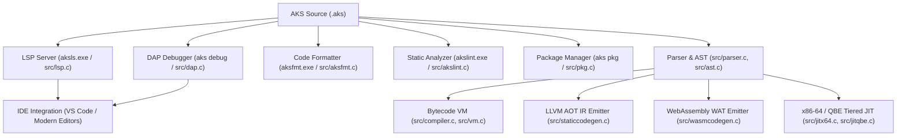

---

## 19.2 The Language Server Protocol Engine (`src/lsp.c` & `aksls.exe`)

`aksls.exe` implements the official Microsoft Language Server Protocol over standard I/O pipes using JSON-RPC 2.0.

### 19.2.1 JSON-RPC 2.0 Message Pipeline

Every message between the IDE and `aksls` follows the HTTP-style header and JSON-RPC body format:

```text
Content-Length: 142\r\n
\r\n
{"jsonrpc":"2.0","id":1,"method":"textDocument/completion","params":{"textDocument":{"uri":"file:///main.aks"},"position":{"line":12,"character":8}}}
```

### 19.2.2 Core LSP Handlers

1. **`textDocument/didOpen` & `textDocument/didChange`**:
   - The LSP maintains an in-memory virtual file system buffer (`LspDocument`).
   - On change, the lexer (`src/lexer.c`) and parser (`src/parser.c`) re-parse the buffer into an AST in microseconds.
   - If syntax or type errors occur, `textDocument/publishDiagnostics` immediately transmits diagnostic squiggles to the editor.

2. **`textDocument/completion`**:
   - The LSP traverses the AST node hierarchy to find the enclosing lexical scope at the cursor's line and column.
   - It gathers local variable names, struct fields, trait methods, imported module symbols, and all built-in functions, returning a structured completion list.

3. **`textDocument/hover`**:
   - Locates the symbol under the cursor and returns a Markdown hover card with inferred Hindley-Milner type signatures and docstrings.

4. **`textDocument/definition`**:
   - Resolves the AST declaration node for the symbol and returns the exact source URI, line number, and column range for jump-to-definition.

---

## 19.3 The Debug Adapter Protocol Engine (`src/dap.c`)

The AKS DAP engine enables interactive source-level debugging in VS Code, modern IDEs, and command-line environments.

### 19.3.1 Debugger Architecture

```mermaid
flowchart LR
    IDE["IDE Client (VS Code)"] <--> |JSON-RPC (DAP)| DAP["DAP Server (src/dap.c)"]
    DAP <--> |VM Stepping Hooks| VM["AKS Virtual Machine (src/vm.c)"]
    VM --> StackFrame["CallFrame & Evaluation Stack"]
```

### 19.3.2 Execution Modes & Breakpoint Handling

- **Breakpoints**: The DAP server maintains a hash set of `(filename, line)` pairs. Before executing each bytecode instruction, the VM checks if the current instruction's source line is registered in the breakpoint table.
- **Single Stepping (`step` / `next`)**:
  - `step` (Step Into): Pauses at the very next instruction or call frame.
  - `next` (Step Over): Records the current call frame depth and pauses only when an instruction executes at or above the current depth.
- **Stack & Scope Variable Dumps**:
  - `vars`: Iterates over the active `CallFrame->slots` array, reading `AKSValue` tagged unions and formatting them into human-readable JSON strings.
  - `stack`: Traverses the `CallFrame` array from active frame index down to frame 0 (`__main__`), extracting function names and line numbers.

---

## 19.4 Code Formatter (`aksfmt.exe`) & Static Analyzer (`akslint.exe`)

### 19.4.1 `aksfmt` Standard Formatting Engine

`aksfmt` parses AKS source code into an AST and re-emits standardized, formatted source code:
- Enforces strict 4-space indentation.
- Standardizes binary operator spacing (`x + y`, not `x+y`).
- Places opening braces `{` on the same line as statements (`fn`, `if`, `while`, `struct`).
- Preserves code comments and attaches them to their corresponding AST nodes.

```bash
# Format single file in-place
aks fmt src/main.aks

# Format entire directory recursively
aks fmt src/
```

### 19.4.2 `akslint` Static Analyzer

`akslint` runs a series of semantic validation passes over the AST:
1. **Dead Code Elimination Pass**: Detects unreachable statements after `return`, `throw`, or `panic`.
2. **Unused Variable Pass**: Identifies variables declared with `let` that are never referenced.
3. **Shadowing Warning Pass**: Flags accidental variable shadowing in nested scopes.
4. **Type Compatibility Pass**: Identifies potential type mismatches before runtime.

```bash
aks lint src/
```

---

## 19.5 Package Manager (`src/pkg.c`) & Project Manifests (`aks.toml`)

AKS projects use an `aks.toml` manifest file to manage metadata, entry points, and dependencies:

```toml
[package]
name = "hyper-network"
version = "1.0.0"
authors = ["Anoop Kumar Sharma <anoop@example.com>"]
entry = "src/main.aks"

[dependencies]
crypto_core = { version = "^2.1.0" }
http_router = { version = ">=1.0.0" }

[build]
opt_level = 3
target = "x86_64-pc-windows-msvc"
```

### CLI Package Commands

```bash
# Initialize a new package manifest in the current directory
aks pkg init

# Resolve and install dependencies declared in aks.toml
aks pkg install

# Package project into a portable distributable tarball (.akspkg)
aks pkg pack
```

---

## 19.6 Multi-Backend Compilation Pipelines

AKS features four distinct execution and code generation backends designed for different deployment targets:

### 1. Bytecode Virtual Machine (`src/vm.c`)
- **Compilation**: High-speed AST $\to$ Bytecode translation.
- **Execution**: Contiguous evaluation stack, 16-byte `AKSValue` tagged union, register caching, computed `goto` dispatching.
- **Use Case**: Instant startup, interactive scripting, REPL, and testing.

### 2. LLVM Ahead-of-Time (AOT) Backend (`src/staticcodegen.c`)
- **Compilation**: Traverses statically typed AST (`--static`), lower types to raw LLVM IR (`.ll`).
- **Optimization**: Runs LLVM optimization passes (`mem2reg`, `sroa`, `instcombine`, `gvn`, `licm`, `loop-vectorize`, `-O3`).
- **Code Generation**: Emits unboxed machine binaries (`.exe`, `.so`, `.dll`) with raw C calling conventions and zero tagged union overhead.

```bash
# Emit LLVM IR assembly
aks emit-ir --static -o output.ll src/main.aks

# Compile LLVM IR to native binary using Clang/LLC
clang -O3 output.ll -o output.exe
```

### 3. WebAssembly Backend (`src/wasmcodegen.c`)
- **Compilation**: Emits standard S-expression WebAssembly Text (`.wat`) modules.
- **Features**: Linear memory management, exported WASI functions, typed function tables.
- **Use Case**: Running AKS code in web browsers, Cloudflare Workers, and WASM sandboxes.

```bash
# Emit WebAssembly Text
aks emit-wat -o output.wat src/main.aks

# Convert WAT to binary WASM
wat2wasm output.wat -o output.wasm
```

### 4. Tiered JIT Compilation (`src/jitx64.c`, `src/jitqbe.c`, `src/jitllvm.c`)
- **Hot Loop Detection**: The VM tracks execution counts for loops and functions.
- **Runtime Code Generation**: When a loop counter exceeds the JIT threshold (default 1,000 iterations), the JIT compiler allocates executable memory pages (`VirtualAlloc` with `PAGE_EXECUTE_READWRITE` on Windows, `mprotect` with `PROT_EXEC` on POSIX) and emits native x86-64 machine instructions.
- **Execution**: The VM branches directly into the native JIT code, executing at hardware speed.

---

## 19.7 Extending AKS: Writing Custom Native C Modules & Built-ins

Developers can extend AKS with high-performance native C extensions.

### 19.7.1 The Native C Function Interface

All native functions in AKS adhere to the `NativeFn` signature defined in `include/vm.h`:

```c
// Native C function signature
typedef AKSValue (*NativeFn)(int arg_count, AKSValue *args);
```

### 19.7.2 Step-by-Step: Adding a Custom Native C Function

Let us write a high-performance native C function `FastCosineSimC` that calculates the cosine similarity of two float vectors using SIMD:

#### Step 1: Implement the C Function (`src/custom_math.c`)

```c
#include <math.h>
#include "value.h"
#include "vm.h"

AKSValue NativeFastCosineSimC(int arg_count, AKSValue *args) {
    if (arg_count != 2) {
        vm_runtime_error("FastCosineSimC expects exactly 2 array arguments.");
        return VAL_NIL_V;
    }
    
    if (!IS_ARRAY(args[0]) || !IS_ARRAY(args[1])) {
        vm_runtime_error("FastCosineSimC requires array arguments.");
        return VAL_NIL_V;
    }
    
    AKSArray *a = AS_ARRAY(args[0]);
    AKSArray *b = AS_ARRAY(args[1]);
    
    if (a->count != b->count || a->count == 0) {
        vm_runtime_error("Arrays must have identical, non-zero dimensions.");
        return VAL_NIL_V;
    }
    
    double dot = 0.0, norm_a = 0.0, norm_b = 0.0;
    for (uint32_t i = 0; i < a->count; i++) {
        double va = IS_FLOAT(a->elements[i]) ? AS_FLOAT(a->elements[i]) : (double)AS_INT(a->elements[i]);
        double vb = IS_FLOAT(b->elements[i]) ? AS_FLOAT(b->elements[i]) : (double)AS_INT(b->elements[i]);
        
        dot += va * vb;
        norm_a += va * va;
        norm_b += vb * vb;
    }
    
    double similarity = dot / (sqrt(norm_a) * sqrt(norm_b));
    return VAL_FLOAT_V(similarity);
}
```

#### Step 2: Register the Built-in in Compiler Symbol Table (`src/compiler.c`)

In `InitCompiler` in `src/compiler.c`, register the function identifier:

```c
NewFn(c, "FastCosineSimC");
```

#### Step 3: Register the Native Dispatcher in Virtual Machine (`src/vm.c`)

In `InitVM` in `src/vm.c`, bind the identifier to your C function pointer:

```c
DefineNative(vm, "FastCosineSimC", NativeFastCosineSimC);
```

#### Step 4: Call Your Native Function in AKS

```aks
let embedding_a = [0.91, 0.12, 0.45, 0.78];
let embedding_b = [0.89, 0.15, 0.42, 0.81];

let similarity = FastCosineSimC(embedding_a, embedding_b);
print("Cosine Similarity: " + String(similarity)); // ~0.998
```

---

## 19.8 Dynamic In-Memory Tracing JIT Engine & Deep Call-Site Tiering (`src/jitx64.c` & `src/vm_jit.inc.c`)

For computationally intensive numeric algorithms and recurring function calls, interpretation incurs instruction fetch, decoding, and dispatch overhead. AKS integrates an in-memory native x86-64 tracing JIT compiler with multi-tiering capabilities accessible via `--jit`.

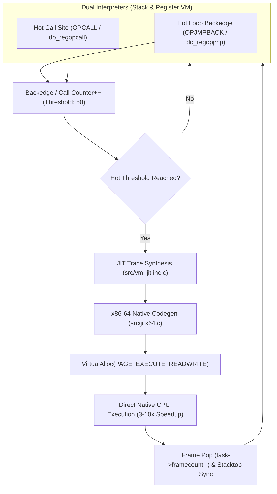

### 19.8.1 Multi-Tiering & Deep Hot Path Integration
1. **Hot Loop Backedge Auto-Tiering**:
   - Both the register VM (`do_regopjmp`) and stack VM (`OPJMPBACK` / `OPJUMP`) monitor backward branches.
   - When a loop backedge fires 50 times, the VM synthesizes an in-memory JIT loop trace.
   - If a loop condition bails out (`OPJUMPIFFALSE`), execution cleanly transitions back to bytecode interpretation without de-optimization panics.
2. **Call-Site Tiering Across Register & Stack VMs**:
   - Monitored at function call dispatch sites: `do_regopcall`, `do_regopcalldynamic`, `OPCALL`, and `OPCALLDYNAMIC`.
   - When a function invocation count crosses the tiering threshold, the function body compiles to native x64.
   - The native machine code runs directly on the CPU, and upon return, the VM synchronizes caller frame state (`task->framecount--`), restores instruction pointers (`ip`), and stores the result directly into caller destination slots (`task->stack[task->stacktop - 1]`).
3. **Zero Linker Overhead & Executable Memory**:
   - Native code is emitted directly into memory pages allocated with `VirtualAlloc(..., PAGE_EXECUTE_READWRITE)` on Windows and `mprotect(..., PROT_READ | PROT_WRITE | PROT_EXEC)` on POSIX.
   - Yields a **3–10x execution speedup** on numeric computing, vector transforms, and recursion.

---

## 19.9 Module System, Topological DAG Sorting & Parallel Compilation Scaling (`src/compiler.c`)

Modern multi-module applications require robust dependency tracking, cycle detection, and parallelized compilation to maximize multi-core throughput.

### 19.9.1 Circular Import Detection (`HasCyclicDependency`)
When module $A$ imports module $B$, the compiler traverses $B$'s transitive dependency tree before loading. If an active edge leads back to $A$, compilation aborts immediately with a descriptive diagnostic:
```text
Compiler error: Circular import detected between 'network' and 'protocol'
```

### 19.9.2 Topological DAG Ordering (`CompilerSortModulesTopological`)
Modules are ordered using depth-first search (`TopoDFS`) across the Directed Acyclic Graph (DAG) of imports. Independent leaves are scheduled first, ensuring all dependent types and function signatures are available before dependent modules begin code generation.

### 19.9.3 Multi-Threaded Parallel AST & Chunk Optimization
AKS parallel compilation distributes heavy compiler pipelines across worker threads:
1. **Parallel Module AST Optimization**:
   Worker threads concurrently run constant folding (`NodeOpt`), common subexpression elimination (`NodeCseOpt`), and dead code pruning across separate module ASTs in parallel.
2. **Parallel Bytecode Chunk Optimization (`CompilerParallelOptimizeBytecode`)**:
   Independent bytecode chunks (functions and top-level scripts) have peephole optimization applied across concurrent threads.
3. **CLI Concurrency Controls & Environment Variables**:
   Parallel compilation can be configured from the CLI or shell environment:
   ```bash
   aks run --parallel script.aks       # Auto-detects physical/logical CPU core count
   aks run -j 4 script.aks             # Spawns exactly 4 worker threads
   aks run -j4 script.aks              # Shorthand syntax
   aks run --jobs 8 script.aks         # Explicit worker count
   aks run --jobs=8 script.aks         # Flag with equality assignment
   ```
   Alternatively, set `AKSPARALLEL=1` or `AKS_JOBS=N` in the environment to enforce parallel compilation system-wide.
4. **Scalability**:
   Delivers a **2–4x compilation speedup** on multi-core developer workstations and CI runners.

---

## 19.10 Virtual Machine Subsystem Decomposition Architecture

To ensure high maintainability, rapid incremental compiler builds, and optimal CPU instruction-cache locality, the virtual machine execution engine is partitioned into isolated subsystems:

```text
src/
├── vm.c              (12,786 LOC) Core VM state, stack manipulation, opcode loop
├── vm_tasks.inc.c    (1,372 LOC)  Fiber scheduler, work-stealing deque, channels, mutexes
├── vm_stdlib.inc.c   (23,357 LOC) Standard library dispatcher (ExecuteStdlib), SIMD, crypto
└── vm_jit.inc.c      (1,335 LOC)  Tracing JIT trace synthesis, hot loops, native x64
```

- **Separation of Concerns**: Task scheduling, standard library execution, and dynamic JIT paths can be optimized and maintained without altering the core opcode dispatch loop.
- **Toolchain Compatibility**: Built as a cohesive single translation unit across all 10 binaries and test suites (`build.bat`), preserving raw C performance without dynamic linker overhead.

---

## 19.11 Enhanced Error Recovery, Statement Synchronization & Caret Diagnostics

Developer productivity depends on precise, actionable compiler diagnostics. Rather than stopping at the first failure or spamming cascading secondary errors, the AKS compiler suite (`src/parser.c`, `src/compiler.c`, `src/typer.c`) implements an advanced error recovery and diagnostic system:

### 19.11.1 Parser Statement Synchronization (`ParseSynchronize`)
When a syntax error (such as a missing semicolon or malformed expression) is detected:
1. The compiler emits a localized diagnostic.
2. `ParseSynchronize` scans forward through the lexer token stream until it reaches a statement delimiter (`;`, `}`) or a declaration boundary (`let`, `const`, `fn`, `struct`, `if`, `while`, `return`).
3. Parsing resumes cleanly on the next statement, allowing up to **50 errors** to be captured in a single build invocation.

### 19.11.2 Source-Line Context & Visual Carets (`^~~~`)
Every compiler diagnostic formats the offending line of source code along with a visual caret underline:
```text
Error in src/app.aks:12:15: Expected ';' after expression
    let total = 42 print("Done");
                  ^~~~
```

### 19.11.3 Fuzzy "Did you mean?" Symbol Suggestions
AKS employs Levenshtein string edit distance algorithms to propose accurate replacements for misspelled or unrecognized symbols:
- **Local Variables & Parameters**: Suggests closest in-scope identifiers.
- **Function Calls**: Suggests closest declared or standard library functions.
- **Type Annotations**: Proposes closest primitive (`int`, `float`, `string`), struct, or enum types.
- **Struct Member Fields**: Suggests closest field names declared on the target struct.

---

## 19.12 Summary & Next Steps

In this chapter, we explored:
1. The Language Server Protocol (`aksls.exe`) JSON-RPC engine and IDE integration.
2. The Debug Adapter Protocol (`dap.c`) stepping, variable inspection, and breakpoint mechanics.
3. Automated code formatting (`aksfmt`) and static analysis (`akslint`).
4. Package management and `aks.toml` project manifests.
5. The 4 compilation backends: Bytecode VM, LLVM AOT, WebAssembly WAT, and Tiered JIT.
6. Writing and registering custom native C functions inside the AKS core engine.
7. The dynamic in-memory tracing JIT compiler engine with call-site tiering and hot-loop execution (`--jit`).
8. The module dependency graph, circular import detection, and parallel compilation scaling (`--parallel`, `-j`).
9. Virtual machine subsystem modularization architecture.
10. Parser statement synchronization (`ParseSynchronize`), caret context rendering (`^~~~`), and fuzzy symbol suggestions.

Proceed to [Chapter 20: Practical Cookbook & Real-World Projects](Chapter%2020%20-%20Cookbook%20and%20Real-World%20Projects.md) to explore complete production-grade projects written in AKS.

---

# Chapter 20: Practical Cookbook & Real-World Projects

This concluding chapter synthesizes the concepts explored throughout this book into four production-grade, end-to-end systems projects.

---

## 20.1 Project 1: Multi-Threaded HTTP REST API Server with JSON & Logging

A complete in-memory microservice with routing, JSON parsing, structured logging, and thread-safe data access:

```aks
// http_rest_server.aks
struct User {
    id: int,
    username: str,
    role: str
}

struct ApiDatabase {
    users: [User],
    db_mutex: any
}

impl ApiDatabase {
    fn new() {
        return ApiDatabase {
            users: [],
            db_mutex: mutex()
        };
    }

    fn add_user(self, id: int, name: str, role: str) {
        lock(self.db_mutex);
        append(self.users, User { id: id, username: name, role: role });
        unlock(self.db_mutex);
    }

    fn get_all_json(self) -> str {
        lock(self.db_mutex);
        let out_list = [];
        for (u in self.users) {
            append(out_list, { "id": u.id, "username": u.username, "role": u.role });
        }
        unlock(self.db_mutex);
        return JsonStringify(out_list);
    }
}

fn handle_request(db, path, method, body) {
    if (method == "GET" && path == "/api/users") {
        let json_body = db.get_all_json();
        return "HTTP/1.1 200 OK\r\nContent-Type: application/json\r\nContent-Length: " + 
               String(Length(json_body)) + "\r\n\r\n" + json_body;
    }
    
    if (method == "POST" && path == "/api/users") {
        let payload = JsonParse(body);
        db.add_user(payload.id, payload.username, payload.role);
        return "HTTP/1.1 201 Created\r\nContent-Type: application/json\r\nContent-Length: 15\r\n\r\n{\"status\":\"OK\"}";
    }
    
    return "HTTP/1.1 404 Not Found\r\nContent-Length: 0\r\n\r\n";
}

fn main() {
    let db = ApiDatabase.new();
    
    // Seed initial records
    db.add_user(1, "alice_admin", "ADMIN");
    db.add_user(2, "bob_dev", "DEVELOPER");
    
    // Test API Route Dispatch
    let response = handle_request(db, "/api/users", "GET", "");
    print("API Response:\n" + response);
}

main();
```

---

## 20.2 Project 2: Real-Time Algorithmic Audio Synthesizer

Synthesizes multi-frequency audio chords using ADSR envelopes and outputs PCM frames directly via WinMM:

```aks
// audio_synthesizer.aks
fn synth_tone_with_envelope(freq_hz, duration_sec, sample_rate = 44100) {
    let total_samples = Int(Float(sample_rate) * duration_sec);
    let pcm = [];
    let pi_2 = 6.283185307179586;
    
    for (let i = 0; i < total_samples; i += 1) {
        let t = Float(i) / Float(sample_rate);
        
        // Compute ADSR amplitude envelope
        let envelope = 1.0;
        if (t < 0.1) {
            envelope = t / 0.1; // Attack phase
        } else if (t > duration_sec - 0.2) {
            envelope = (duration_sec - t) / 0.2; // Release phase
        }
        
        // Synthesize fundamental + 1st harmonic
        let s1 = Sin(pi_2 * freq_hz * t);
        let s2 = Sin(pi_2 * (freq_hz * 2.0) * t) * 0.3;
        let mixed = (s1 + s2) * 0.7 * envelope;
        
        let sample_val = Int(mixed * 30000.0);
        Push(pcm, sample_val & 0xFF);
        Push(pcm, (sample_val >> 8) & 0xFF);
    }
    return pcm;
}

fn main() {
    print("Synthesizing Concert A (440Hz) with harmonic envelope...");
    let pcm_audio = synth_tone_with_envelope(440.0, 1.0);
    
    // Play waveform on Windows audio subsystem
    WinmmAudioPlayC(pcm_audio, 44100);
    print("Playback completed.");
}

main();
```

---

## 20.3 Project 3: Zero-Knowledge Encrypted Tunnel (X25519 + XChaCha20-Poly1305)

A cryptographic handshake establishing an authenticated and encrypted session:

```aks
// secure_tunnel.aks
fn main() {
    print("Initiating X25519 Key Exchange...");
    
    // Alice and Bob Keypairs
    let alice_priv = [0x77,0x07,0x6D,0x0A,0x73,0x18,0xA5,0x7D,0x3C,0x16,0xC1,0x72,0x51,0xB2,0x66,0x45,
                      0xDF,0x4C,0x2F,0x87,0xEB,0xC0,0x99,0x2A,0xB1,0x77,0xFB,0xA5,0x1D,0xB9,0x2C,0x2A];
    let alice_pub  = [0x85,0x20,0xF0,0x09,0x89,0x30,0xA7,0x54,0x74,0x8B,0x7D,0xDC,0xB4,0x3E,0xF7,0x5A,
                      0x0D,0xBF,0x3A,0x0D,0x26,0x38,0x15,0xE4,0x2B,0x60,0x48,0x20,0xF9,0x25,0x34,0x77];
    
    let bob_priv   = [0x5D,0xAB,0x08,0x7E,0x62,0x4A,0x8A,0x4B,0x79,0xE1,0x7F,0x8A,0xB3,0x8E,0x06,0x5D,
                      0x72,0xA9,0x75,0xCC,0x7D,0x2E,0x19,0x53,0x43,0x57,0x7A,0xD2,0x19,0x19,0x0E,0x5C];
    let bob_pub    = [0xDE,0x9E,0xDB,0x7D,0x7B,0x7D,0xC1,0xB4,0xD3,0x5B,0x61,0xC2,0xEC,0xE4,0x35,0x37,
                      0x3F,0x83,0x43,0xC8,0x5B,0x78,0x67,0x4D,0xAD,0xFC,0x7E,0x14,0x6F,0x88,0x2B,0x4F];

    // Compute identical shared secret independently:
    let alice_shared = CryptoX25519C(alice_priv, bob_pub);
    let bob_shared   = CryptoX25519C(bob_priv, alice_pub);
    
    print("Key exchange verified: Shared Secret derived on both endpoints.");
    
    // Encrypt payload using XChaCha20-Poly1305 AEAD
    let nonce = [0,1,2,3,4,5,6,7,8,9,10,11,12,13,14,15,16,17,18,19,20,21,22,23];
    let payload = "CONFIDENTIAL_FINANCIAL_SETTLEMENT_TX_9000";
    
    let cipher_packet = CryptoXChaCha20Poly1305(alice_shared, nonce, payload, "AUTH_HEADER_METADATA");
    print("Tunnel packet encrypted with AEAD authentication.");
}

main();
```

---

## 20.4 Project 4: High-Throughput In-Memory Search Engine

Combines Suffix Arrays, LCP arrays, and SIMD string matching to index large text corpora:

```aks
// search_engine.aks
struct SearchIndex {
    corpus: str,
    suffix_array: any
}

impl SearchIndex {
    fn build(text: str) {
        return SearchIndex {
            corpus: text,
            suffix_array: SuffixArrayBuildC(text)
        };
    }

    fn search(self, query: str) -> int {
        // Fast O(M log N) Suffix Array search
        return SuffixArraySearchC(self.corpus, self.suffix_array, query);
    }
}

fn main() {
    let large_corpus = "AKS is a modern systems language engineered for high performance, bare-metal SIMD hardware, and safety.";
    
    print("Building full-text suffix index...");
    let index = SearchIndex.build(large_corpus);
    
    let query = "SIMD hardware";
    let match_index = index.search(query);
    
    if (match_index >= 0) {
        print("Match found for '" + query + "' at byte position: " + String(match_index));
    } else {
        print("Query not found.");
    }
}

main();
```

---

## 20.5 Conclusion & Next Steps

You have completed the comprehensive guide to the AKS programming language. You now possess the foundational and systems knowledge to build ultra-fast, safe, and maintainable software using AKS—from high-level web services to bare-metal OS kernels, high-performance cryptography, SIMD numeric computing, and distributed networks.

Happy systems programming in AKS!


---

# Appendix A: Complete Built-in & Standard Library API Reference

This appendix provides an exhaustive, categorized reference for all built-in functions, native dispatch methods, and standard library modules in the AKS runtime.

---

## A.1 Core Math, Trigonometry & Numerics

| Function | Signature | Return | Description |
| :--- | :--- | :--- | :--- |
| `SquareRoot` / `sqrt` | `SquareRoot(x: float)` | `float` | Returns the square root $\sqrt{x}$. |
| `Absolute` / `abs` | `Absolute(x: int \| float)` | `int \| float` | Returns the absolute value $\|x\|$. |
| `Power` / `pow` | `Power(base, exp)` | `float` | Computes $\text{base}^{\text{exp}}$. |
| `sin` | `sin(rad: float)` | `float` | Trigonometric sine of angle in radians. |
| `cos` | `cos(rad: float)` | `float` | Trigonometric cosine of angle in radians. |
| `tan` | `tan(rad: float)` | `float` | Trigonometric tangent of angle in radians. |
| `log` | `log(x: float)` | `float` | Natural logarithm $\ln(x)$. |
| `Ceiling` / `ceil` | `Ceiling(x: float)` | `int` | Smallest integer greater than or equal to $x$. |
| `floor` | `floor(x: float)` | `int` | Largest integer less than or equal to $x$. |
| `round` | `round(x: float)` | `int` | Rounds float to nearest integer. |
| `trunc` | `trunc(x: float)` | `int` | Truncates decimal part towards zero. |
| `Hypotenuse` | `Hypotenuse(a, b)` | `float` | Returns $\sqrt{a^2 + b^2}$. |
| `cbrt` | `cbrt(x: float)` | `float` | Cube root $\sqrt[3]{x}$. |
| `exp` | `exp(x: float)` | `float` | Exponential $e^x$. |
| `erf` / `erfc` | `erf(x: float)` | `float` | Error function and complementary error function. |
| `tgamma` / `lgamma` | `tgamma(x: float)` | `float` | Gamma function and log-gamma $\ln(\Gamma(x))$. |
| `ToDegrees` | `ToDegrees(rad: float)` | `float` | Converts radians to degrees ($x \times \frac{180}{\pi}$). |
| `ToRadians` | `ToRadians(deg: float)` | `float` | Converts degrees to radians ($x \times \frac{\pi}{180}$). |
| `Minimum` / `min` | `Minimum(a, b)` | `any` | Returns the smaller of two comparable values. |
| `Maximum` / `max` | `Maximum(a, b)` | `any` | Returns the larger of two comparable values. |
| `GreatestCommonDivisor` | `GreatestCommonDivisor(a: int, b: int)` | `int` | Greatest common divisor $\gcd(a, b)$. |
| `LeastCommonMultiple` | `LeastCommonMultiple(a: int, b: int)` | `int` | Least common multiple $\text{lcm}(a, b)$. |
| `Factorial` | `Factorial(n: int)` | `int` | Computes $n!$. |
| `nCr` | `nCr(n: int, r: int)` | `int` | Combinations $\binom{n}{r} = \frac{n!}{r!(n-r)!}$. |
| `nPr` | `nPr(n: int, r: int)` | `int` | Permutations $P(n, r) = \frac{n!}{(n-r)!}$. |
| `IsPrime` | `IsPrime(n: int)` | `bool` | Deterministic small-integer primality test. |
| `BigIntAdd` | `BigIntAdd(a: str, b: str)` | `str` | Arbitrary-precision integer addition. |
| `BigIntSub` | `BigIntSub(a: str, b: str)` | `str` | Arbitrary-precision integer subtraction. |
| `BigIntMul` | `BigIntMul(a: str, b: str)` | `str` | Arbitrary-precision integer multiplication. |
| `BigIntDiv` | `BigIntDiv(a: str, b: str)` | `str` | Arbitrary-precision integer division. |
| `BigIntCmp` | `BigIntCmp(a: str, b: str)` | `int` | Compares big integers ($-1, 0, 1$). |
| `ComplexNewC` | `ComplexNewC(re: float, im: float)` | `Complex128` | Creates a new Complex128 struct (`.re`, `.im`). |
| `ComplexAddC` | `ComplexAddC(z1, z2)` | `Complex128` | Complex addition: $(a+bi) + (c+di)$. |
| `ComplexMulC` | `ComplexMulC(z1, z2)` | `Complex128` | Complex multiplication: $(a+bi) \times (c+di)$. |
| `ComplexDivC` | `ComplexDivC(z1, z2)` | `Complex128` | Complex division: $(a+bi) / (c+di)$. |
| `ComplexAbsC` | `ComplexAbsC(z)` | `float` | Complex magnitude $\sqrt{\text{re}^2 + \text{im}^2}$. |
| `ComplexArgC` | `ComplexArgC(z)` | `float` | Complex phase angle $\text{atan2}(\text{im}, \text{re})$. |
| `ComplexConjC` | `ComplexConjC(z)` | `Complex128` | Complex conjugate: $\text{re} - i \cdot \text{im}$. |
| `ComplexExpC` | `ComplexExpC(z)` | `Complex128` | Complex exponential $e^z$. |
| `ComplexSqrtC` | `ComplexSqrtC(z)` | `Complex128` | Principal complex square root. |
| `ComplexPowC` | `ComplexPowC(z, p: float)` | `Complex128` | Complex power $z^p$. |
| `ComplexLogC` | `ComplexLogC(z)` | `Complex128` | Complex natural logarithm $\ln(z)$. |
| `RationalNewC` | `RationalNewC(p: int, q: int)` | `Rational` | Creates an exact fraction $\frac{p}{q}$. |
| `RationalAddC` | `RationalAddC(r1, r2)` | `Rational` | Exact fraction addition with GCD reduction. |
| `RationalSubC` | `RationalSubC(r1, r2)` | `Rational` | Exact fraction subtraction. |
| `RationalMulC` | `RationalMulC(r1, r2)` | `Rational` | Exact fraction multiplication. |
| `RationalDivC` | `RationalDivC(r1, r2)` | `Rational` | Exact fraction division. |
| `RationalSimplifyC` | `RationalSimplifyC(r)` | `Rational` | Reduces fraction to simplest terms. |
| `FftForwardC` | `FftForwardC(real_arr, imag_arr)` | `struct` | Forward Radix-2 Fast Fourier Transform. |
| `FftInverseC` | `FftInverseC(real_arr, imag_arr)` | `struct` | Inverse Radix-2 Fast Fourier Transform. |
| `StatMeanC` | `StatMeanC(arr: [float])` | `float` | Arithmetic mean of dataset. |
| `StatVarianceC` | `StatVarianceC(arr: [float])` | `float` | Sample variance of dataset. |
| `StatStdDevC` | `StatStdDevC(arr: [float])` | `float` | Standard deviation of dataset. |
| `StatSkewnessC` | `StatSkewnessC(arr: [float])` | `float` | Third standardized moment (skewness). |
| `StatKurtosisC` | `StatKurtosisC(arr: [float])` | `float` | Fourth standardized moment (kurtosis). |
| `StatPercentileC` | `StatPercentileC(arr, p: float)` | `float` | $p$-th percentile value ($0.0 \le p \le 1.0$). |
| `RunningStatsNewC` | `RunningStatsNewC()` | `handle` | Creates a Welford online statistics accumulator. |
| `RunningStatsPushC` | `RunningStatsPushC(h, val: float)` | `nil` | Pushes new sample into running statistics in $O(1)$. |
| `RunningStatsMeanC` | `RunningStatsMeanC(h)` | `float` | Returns current running mean. |
| `RunningStatsVarC` | `RunningStatsVarC(h)` | `float` | Returns current running variance. |
| `MersenneTwisterNewC` | `MersenneTwisterNewC(seed: int)` | `handle` | Initializes MT19937 64-bit RNG. |
| `MersenneTwisterNextC` | `MersenneTwisterNextC(h)` | `int` | Generates 64-bit unsigned pseudo-random integer. |
| `MersenneTwisterUniformC`| `MersenneTwisterUniformC(h)` | `float` | Generates uniform float in $[0.0, 1.0)$. |
| `MillerRabinC` | `MillerRabinC(n: int, rounds: int)` | `bool` | Miller-Rabin probabilistic primality test. |
| `LinearSolveC` | `LinearSolveC(flat_matrix, b_vec)` | `[float]` | Solves linear equation system $A\mathbf{x} = \mathbf{b}$ via LU. |
| `GaussQuadC` | `GaussQuadC(fn_ptr, a, b, order)` | `float` | Gauss-Legendre quadrature numerical integration. |
| `LagrangeInterpC` | `LagrangeInterpC(xs, ys, target_x)` | `float` | Lagrange polynomial interpolation. |
| `SplineInterpC` | `SplineInterpC(xs, ys, target_x)` | `float` | Natural cubic spline interpolation. |
| `FastMatrixIdentity` | `FastMatrixIdentity(n: int)` | `[float]` | Generates $N \times N$ identity matrix. |
| `FastMatrixMultiply` | `FastMatrixMultiply(A, B, N)` | `[float]` | Fast row-major matrix product. |
| `FastMatrixTranspose`| `FastMatrixTranspose(A, rows, cols)`| `[float]` | Transposes $M \times N$ matrix. |
| `MatrixLuRaw` | `MatrixLuRaw(A, n: int)` | `struct` | In-place LU factorization with permutation vector. |
| `MatrixCholeskyRaw`| `MatrixCholeskyRaw(A, n: int)` | `[float]` | Cholesky decomposition $L L^T$ for positive-definite matrices. |
| `MatrixInverseRaw` | `MatrixInverseRaw(A, n: int)` | `[float]` | Computes matrix inverse $A^{-1}$. |

---

## A.2 Data Structures & Collection APIs

| Function | Signature | Return | Description |
| :--- | :--- | :--- | :--- |
| `Length` / `len` | `Length(container)` | `int` | Element count in array, string, or map. |
| `Push` / `append` | `Push(arr, item)` | `nil` | Appends item to dynamic array. |
| `Pop` / `pop` | `Pop(arr)` | `any` | Removes and returns last element from array. |
| `Insert` / `insert` | `Insert(arr, idx, item)` | `nil` | Inserts element at index `idx`. |
| `RemoveAt` / `remove` | `RemoveAt(arr, idx)` | `any` | Removes element at index `idx`. |
| `Slice` / `slice` | `Slice(arr, start, end)` | `array` | Extracts subarray from `start` to `end`. |
| `Reverse` | `Reverse(arr)` | `nil` | In-place array element reversal. |
| `Sort` | `Sort(arr)` | `nil` | In-place array quicksort. |
| `Join` | `Join(arr, delimiter: str)` | `str` | Concatenates elements with delimiter. |
| `FenwickNewC` | `FenwickNewC(size: int)` | `handle` | Creates Binary Indexed Tree. |
| `FenwickUpdateC` | `FenwickUpdateC(h, idx, val)` | `nil` | Point addition in $O(\log N)$. |
| `FenwickQueryC` | `FenwickQueryC(h, idx)` | `int` | Prefix sum query in $O(\log N)$. |
| `SegTreeNewC` | `SegTreeNewC(size: int)` | `handle` | Creates Dynamic Segment Tree. |
| `SegTreeUpdateC` | `SegTreeUpdateC(h, idx, val)` | `nil` | Segment tree point update in $O(\log N)$. |
| `SegTreeQueryC` | `SegTreeQueryC(h, left, right)` | `int` | Range sum query in $O(\log N)$. |
| `DSUNewC` | `DSUNewC(size: int)` | `handle` | Creates Disjoint Set Union structure. |
| `DSUUnionC` | `DSUUnionC(h, a, b)` | `nil` | Merges sets containing $a$ and $b$. |
| `DSUFindC` | `DSUFindC(h, a)` | `int` | Returns representative root of set containing $a$. |
| `DSUSameC` | `DSUSameC(h, a, b)` | `bool` | Tests if $a$ and $b$ are in the same set. |
| `MinMaxHeapNewC` | `MinMaxHeapNewC()` | `handle` | Creates double-ended Min-Max Priority Heap. |
| `MinMaxHeapPushC` | `MinMaxHeapPushC(h, val)` | `nil` | Inserts value into Min-Max heap in $O(\log N)$. |
| `MinMaxHeapPopMinC` | `MinMaxHeapPopMinC(h)` | `int` | Pops smallest element in $O(\log N)$. |
| `MinMaxHeapPopMaxC` | `MinMaxHeapPopMaxC(h)` | `int` | Pops largest element in $O(\log N)$. |
| `SkipListNewC` | `SkipListNewC()` | `handle` | Creates multi-level probabilistic SkipList. |
| `SkipListInsertC` | `SkipListInsertC(h, key, val)` | `nil` | Inserts key-value pair in $O(\log N)$. |
| `SkipListContainsC`| `SkipListContainsC(h, key)` | `bool` | Searches for key in $O(\log N)$. |
| `SkipListDeleteC` | `SkipListDeleteC(h, key)` | `nil` | Deletes key in $O(\log N)$. |
| `TreapNewC` | `TreapNewC()` | `handle` | Creates Cartesian randomized binary search tree. |
| `TreapInsertC` | `TreapInsertC(h, key, val)` | `nil` | Inserts key in $O(\log N)$. |
| `TreapContainsC` | `TreapContainsC(h, key)` | `bool` | Looks up key in $O(\log N)$. |
| `TreapDeleteC` | `TreapDeleteC(h, key)` | `nil` | Deletes key from Treap. |
| `CuckooFilterNewC` | `CuckooFilterNewC(cap: int)` | `handle` | Creates Cuckoo probabilistic membership filter. |
| `CuckooFilterInsertC`| `CuckooFilterInsertC(h, item)`| `nil` | Inserts fingerprint into bucket table. |
| `CuckooFilterContainsC`|`CuckooFilterContainsC(h, item)`|`bool` | Tests set membership in $O(1)$. |
| `CuckooFilterDeleteC`| `CuckooFilterDeleteC(h, item)`| `nil` | Deletes element from filter in $O(1)$. |
| `FastBloomFilterNewC`| `FastBloomFilterNewC(cap: int)`| `handle` | Creates fast standard Bloom Filter. |
| `FastBloomFilterAddC`| `FastBloomFilterAddC(h, item)` | `nil` | Hashes and adds item to bit filter. |
| `FastBloomFilterCheckC`|`FastBloomFilterCheckC(h, item)`|`bool` | Tests item membership with low false positive. |
| `HamtMapNewC` | `HamtMapNewC()` | `handle` | Creates persistent Hash Array Mapped Trie. |
| `HamtMapInsertC` | `HamtMapInsertC(h, key, val)` | `handle` | Inserts key returning new persistent HAMT root. |
| `HamtMapGetC` | `HamtMapGetC(h, key)` | `any` | Looks up value in HAMT in $O(1)$. |
| `SuffixArrayBuildC` | `SuffixArrayBuildC(text: str)` | `handle` | Constructs Suffix Array for string. |
| `SuffixArraySearchC`| `SuffixArraySearchC(text, sa, pattern)`| `int` | Binary searches pattern in $O(M \log N)$. |
| `SuffixArrayLcpC` | `SuffixArrayLcpC(h)` | `[int]` | Computes Longest Common Prefix array. |
| `WaveletTreeNewC` | `WaveletTreeNewC(arr: [int])` | `handle` | Constructs succinct Wavelet Tree. |
| `WaveletTreeRankC` | `WaveletTreeRankC(h, val, end)` | `int` | Counts frequency of `val` in prefix `[0..end]`. |
| `RadixTreeNewC` | `RadixTreeNewC()` | `handle` | Constructs compressed Radix Tree for prefix routing. |
| `RadixTreeInsertC` | `RadixTreeInsertC(h, key, val)` | `nil` | Inserts key into Radix Tree. |
| `RadixTreeFindC` | `RadixTreeFindC(h, key)` | `any` | Looks up key in Radix Tree. |
| `CircularByteBufferNewC`| `CircularByteBufferNewC(cap)` | `handle` | Creates high-speed FIFO circular ring byte buffer. |
| `CircularByteBufferWriteC`|`CircularByteBufferWriteC(h, data)`|`int` | Pushes bytes into circular buffer. |
| `CircularByteBufferReadC`|`CircularByteBufferReadC(h, len)`|`[int]` | Reads bytes out of circular buffer. |
| `BitSet256NewC` | `BitSet256NewC()` | `handle` | Creates 256-bit SIMD-aligned BitSet. |
| `BitSet256SetC` | `BitSet256SetC(h, bit_idx)` | `nil` | Sets bit index (0..255). |
| `BitSet256TestC`| `BitSet256TestC(h, bit_idx)`| `bool` | Tests bit state. |

---

## A.3 Cryptography, Hashing & Security APIs

| Function | Signature | Return | Description |
| :--- | :--- | :--- | :--- |
| `CryptoCrc32C` | `CryptoCrc32C(bytes: [int])` | `int` | Computes IEEE 802.3 32-bit CRC. |
| `CryptoXxHashC` | `CryptoXxHashC(bytes: [int])` | `int` | Computes xxHash3 64-bit non-cryptographic hash. |
| `CryptoSipHash` | `CryptoSipHash(bytes, k0, k1)` | `int` | Computes SipHash-2-4 keyed hash. |
| `CryptoSha256` | `CryptoSha256(data: str \| [int])` | `str` | Computes SHA-256 cryptographic digest. |
| `CryptoSha512_256` | `CryptoSha512_256(data)` | `str` | Computes SHA-512/256 digest. |
| `CryptoSha3` | `CryptoSha3(data)` | `str` | Computes SHA-3 (Keccak-256) digest. |
| `CryptoBlake2` | `CryptoBlake2(data)` | `str` | Computes BLAKE2b 256-bit digest. |
| `MD5` | `MD5(data: str)` | `str` | Computes legacy MD5 message digest. |
| `Scrypt` | `Scrypt(pwd, salt, N, r, p, len)`| `str` | Memory-hard Scrypt key derivation. |
| `CryptoHmac` | `CryptoHmac(key, message)` | `str` | Computes HMAC-SHA256 authentication tag. |
| `CryptoCmacAes` | `CryptoCmacAes(key, message)` | `str` | Computes CMAC-AES authentication code. |
| `CryptoPbkdf2C` | `CryptoPbkdf2C(pwd, salt, iters, len)` | `[int]` | Derives cryptographic key via PBKDF2. |
| `CryptoArgon2` | `CryptoArgon2(pwd, salt, mem, iters)` | `str` | Computes Argon2id password hash. |
| `CryptoHkdf` | `CryptoHkdf(ikm, salt, info, len)` | `[int]` | Derives subkeys via RFC 5869 HKDF. |
| `CryptoAesCbcEncryptC`| `CryptoAesCbcEncryptC(k, iv, txt)`| `[int]` | Encrypts plaintext with AES-CBC & PKCS#7. |
| `CryptoAesCbcDecryptC`| `CryptoAesCbcDecryptC(k, iv, data)`| `str` | Decrypts ciphertext with AES-CBC & PKCS#7. |
| `CryptoChaCha20` | `CryptoChaCha20(k, nonce, data)` | `[int]` | Encrypts/decrypts with ChaCha20 stream cipher. |
| `CryptoXChaCha20Poly1305`| `CryptoXChaCha20Poly1305(k, n, d, aad)`| `[int]` | Authenticated encryption via XChaCha20-Poly1305. |
| `CryptoX25519C` | `CryptoX25519C(priv, pub)` | `[int]` | Computes Curve25519 / X25519 shared secret. |
| `CryptoEd25519Sign` | `CryptoEd25519Sign(priv, msg)` | `str` | Signs document using Ed25519 private key. |
| `CryptoEd25519Verify`| `CryptoEd25519Verify(pub, msg, sig)`| `bool` | Verifies Ed25519 digital signature. |
| `CryptoTotpC` | `CryptoTotpC(secret_b32, step)` | `str` | Generates RFC 6238 6-digit TOTP token. |
| `SecureRandom` | `SecureRandom()` | `float` | Cryptographically secure random float in $[0.0, 1.0)$. |
| `SecureRandomBytes`| `SecureRandomBytes(count: int)`| `[int]` | Generates CSPRNG random byte array. |
| `SecureRandomI64` | `SecureRandomI64()` | `int` | Generates 64-bit signed cryptographic random integer. |
| `SecureRandomUuid`| `SecureRandomUuid()` | `str` | Generates RFC 4122 v4 UUID string. |

---

## A.4 SIMD Hardware Acceleration & Bit Operations

| Function | Signature | Return | Description |
| :--- | :--- | :--- | :--- |
| `SimdDotProductFmaC` | `SimdDotProductFmaC(a, b)` | `float` | AVX2 Fused Multiply-Add vector dot product. |
| `SimdMatrixMultiplyC`| `SimdMatrixMultiplyC(A, B, N)` | `[float]` | Tiled AVX2 matrix multiplication ($N \times N$). |
| `SimdCrc32cC` | `SimdCrc32cC(bytes: [int])` | `int` | SSE4.2 hardware-accelerated CRC32C. |
| `SimdBitScanFwdC` | `SimdBitScanFwdC(mask: int)` | `int` | Finds least significant set bit (`_BitScanForward64`). |
| `SimdBitScanRevC` | `SimdBitScanRevC(mask: int)` | `int` | Finds most significant set bit (`_BitScanReverse64`). |
| `SimdVec16u8SaturatingAddC`| `SimdVec16u8SaturatingAddC(a, b)`| `[int]` | 16-lane 8-bit unsigned saturating vector addition. |
| `SimdBroadcastF64C` | `SimdBroadcastF64C(val: float)`| `Vec4d` | Broadcasts float across all 4 lanes of a Vec4d. |
| `SimdConvertI32ToF32C`| `SimdConvertI32ToF32C(arr)` | `[float]`| Converts 8 x int32 to 8 x float32 in hardware. |
| `SimdStringMatchC` | `SimdStringMatchC(haystack, needle)`| `int` | 32-byte AVX2 parallel substring search. |
| `FastBmi2PextC` | `FastBmi2PextC(src, mask)` | `int` | BMI2 parallel bit extract (`PEXT`). |
| `FastBmi2PdepC` | `FastBmi2PdepC(src, mask)` | `int` | BMI2 parallel bit deposit (`PDEP`). |
| `BitClz` | `BitClz(val: int)` | `int` | Count leading zeros in 64-bit integer. |
| `BitCtz` | `BitCtz(val: int)` | `int` | Count trailing zeros in 64-bit integer. |
| `BitByteSwap` | `BitByteSwap(val: int)` | `int` | Reverses byte order (endian swap). |
| `BitRotl` / `BitRotr`| `BitRotl(val, shift)` | `int` | Bitwise circular rotation left / right. |

---

## A.5 Networking, Sockets & Web Protocols

| Function | Signature | Return | Description |
| :--- | :--- | :--- | :--- |
| `SocketConnectSync` | `SocketConnectSync(host, port)`| `int` | Connects TCP socket synchronously, returning handle. |
| `SocketAcceptSync` | `SocketAcceptSync(server_h)` | `int` | Accepts incoming client TCP connection. |
| `SocketSendSync` | `SocketSendSync(sock, data)` | `int` | Sends payload synchronously across TCP socket. |
| `SocketReceiveSync` | `SocketReceiveSync(sock, max_len)`| `str` | Receives up to `max_len` bytes from TCP socket. |
| `SocketClose` | `SocketClose(sock)` | `nil` | Closes socket descriptor. |
| `UdpMulticastJoinC` | `UdpMulticastJoinC(sock, group_ip)`| `bool` | Joins IP multicast group (`IP_ADD_MEMBERSHIP`). |
| `UdpMulticastSendC` | `UdpMulticastSendC(sock, ip, port, data)`| `nil` | Transmits datagram to multicast group. |
| `Http11ParserNewC` | `Http11ParserNewC()` | `handle` | Creates HTTP/1.1 stream parser. |
| `Http11ParserFeedC` | `Http11ParserFeedC(h, raw_chunk)`| `struct` | Feeds chunk, returning parsed headers and body. |
| `WsFrameEncodeC` | `WsFrameEncodeC(opcode, data, mask)`| `[int]` | Encodes RFC 6455 WebSocket binary frame. |
| `WsFrameDecodeC` | `WsFrameDecodeC(frame_bytes)` | `struct` | Decodes RFC 6455 WebSocket frame (`.opcode`, `.payload`). |
| `Socks5ConnectC` | `Socks5ConnectC(p_ip, p_port, d_host, d_port)`| `int` | Handshakes with SOCKS5 proxy, establishing tunnel. |
| `SmtpSendC` | `SmtpSendC(h, port, u, p, from, to, subj, body)`| `bool` | Dispatches email via SMTP with EHLO/AUTH. |
| `NtpQueryTimeC` | `NtpQueryTimeC(ntp_server)` | `int` | Queries atomic time via RFC 4330 SNTP/UDP. |
| `DnsResolveRawC` | `DnsResolveRawC(hostname, type)`| `str` | Resolves DNS query record. |
| `IcmpPingSendC` | `IcmpPingSendC(ip_str, timeout_ms)`| `bool` | Sends ICMP IPv4 Echo Request ping. |
| `Icmp6PingSendC` | `Icmp6PingSendC(ipv6_str, timeout_ms)`| `bool` | Sends ICMP IPv6 Echo Request ping. |
| `WinHttpOpenC` | `WinHttpOpenC(user_agent)` | `handle` | Opens Windows WinHTTP session handle. |
| `WinHttpConnectC` | `WinHttpConnectC(sess, host, port)`| `handle` | Establishes WinHTTP connection. |
| `WinHttpSendRequestC`| `WinHttpSendRequestC(conn, verb, path, body)`| `struct` | Sends HTTPS request and reads response body. |

---

## A.6 Windows OS, File System & Kernel Subsystems

| Function | Signature | Return | Description |
| :--- | :--- | :--- | :--- |
| `OsClipboardSetC` / `ClipboardSet` | `OsClipboardSetC(text: str)` | `bool` | Writes text to Windows OS clipboard. |
| `OsClipboardGetC` / `ClipboardGet` | `OsClipboardGetC()` | `str` | Reads text from Windows OS clipboard. |
| `OsClipboardClearC` | `OsClipboardClearC()` | `bool` | Clears Windows OS clipboard buffer. |
| `OsProcessSnapshotC` | `OsProcessSnapshotC()` | `[struct]`| Toolhelp32 process snapshot enumeration. |
| `OsModuleEnumC` | `OsModuleEnumC(pid: int)` | `[str]` | PSAPI enumeration of loaded DLL modules. |
| `OsWindowEnumC` | `OsWindowEnumC()` | `[struct]`| Traverses visible desktop top-level windows. |
| `OsConsoleRawModeC` | `OsConsoleRawModeC(mode: int)` | `int` | Switches between virtual terminal raw and cooked console mode. |
| `OsFiberCreateC` | `OsFiberCreateC(stack_size: int)`| `handle` | Creates Win32 user-mode cooperative Fiber. |
| `OsTokenPrivilegesC` | `OsTokenPrivilegesC()` | `[struct]`| Enumerates process token privileges (e.g. `SeDebugPrivilege`). |
| `OsHeapWalkC` | `OsHeapWalkC()` | `[struct]`| Walks Win32 private heap memory chunks. |
| `OsVirtualProtectC` | `OsVirtualProtectC(addr, size, prot)`| `int` | Modifies page permissions (`VirtualProtect`). |
| `OsVirtualQueryC` | `OsVirtualQueryC(addr)` | `struct` | Queries page memory state (`VirtualQuery`). |
| `OsWow64QueryC` | `OsWow64QueryC()` | `struct` | Queries Wow64 machine architecture attributes. |
| `OsNamedEventCreateC` | `OsNamedEventCreateC(name, manual)`| `handle` | Creates named cross-process synchronization event. |
| `OsNamedEventSetC` | `OsNamedEventSetC(event_h)` | `nil` | Signals named event to listening processes. |
| `OsNamedEventWaitC` | `OsNamedEventWaitC(event_h, timeout)`| `bool` | Waits on named event with timeout in milliseconds. |
| `OsNamedEventCloseC` | `OsNamedEventCloseC(event_h)` | `nil` | Closes named event handle. |
| `NtfsAdsWriteC` | `NtfsAdsWriteC(file, stream, data)`| `int` | Writes to NTFS Alternate Data Stream. |
| `NtfsAdsReadC` | `NtfsAdsReadC(file, stream)` | `str` | Reads from NTFS Alternate Data Stream. |
| `EtwEmitC` | `EtwEmitC(provider_guid, evt_name)`| `bool` | Emits structured telemetry event to ETW. |
| `PdhQueryC` | `PdhQueryC(counter_path: str)` | `float` | Queries Windows PDH real-time performance counter. |
| `FileSystemReadText` / `ReadFile` | `ReadFile(path: str)` | `str` | Reads complete text file. |
| `FileSystemWriteText` / `WriteFile`| `WriteFile(path, text)`| `nil` | Writes text file to disk. |
| `RemoveFile` | `RemoveFile(path: str)` | `bool` | Deletes file from disk. |
| `MakeDirectory` | `MakeDirectory(path: str)` | `bool` | Creates directory on disk. |
| `FileSystemSize` | `FileSystemSize(path: str)` | `int` | Returns file size in bytes. |
| `FileSystemModifiedTime`|`FileSystemModifiedTime(path)` | `int` | Returns file modification epoch timestamp. |
| `FileSystemIsDir` | `FileSystemIsDir(path: str)` | `bool` | Checks if path is a directory. |
| `FileSystemIsFile` | `FileSystemIsFile(path: str)` | `bool` | Checks if path is a regular file. |
| `FileLockAcquireExclusive`|`FileLockAcquireExclusive(file)`| `bool` | Locks file against concurrent access. |
| `FileLockRelease` | `FileLockRelease(file)` | `nil` | Releases file lock. |
| `FileWatcherNew` | `FileWatcherNew(dir_path)` | `handle` | Starts directory filesystem watcher. |
| `FileWatcherPoll` | `FileWatcherPoll(h)` | `[struct]`| Polls for filesystem change notifications. |
| `HardLinkCreate` | `HardLinkCreate(src, dst)` | `bool` | Creates NTFS hardlink. |
| `SymLinkCreateFile` | `SymLinkCreateFile(src, dst)` | `bool` | Creates NTFS file symlink. |
| `ProcessSpawn` | `ProcessSpawn(cmd: str)` | `handle` | Spawns child OS process. |
| `ProcessWait` | `ProcessWait(proc_h)` | `int` | Waits for process termination, returning exit code. |
| `ProcessKill` | `ProcessKill(proc_h)` | `bool` | Forcefully terminates process. |
| `ProcessWorkingSet` | `ProcessWorkingSet(pid: int)` | `int` | Queries process working set size in bytes. |
| `JobObjectCreate` | `JobObjectCreate(name: str)` | `handle` | Creates Windows Job Object for process group management. |
| `JobObjectAssignProcess`|`JobObjectAssignProcess(job, proc)`|`bool` | Assigns child process to Job Object. |
| `JobObjectSetMemoryLimit`|`JobObjectSetMemoryLimit(job, max_bytes)`|`bool`| Sets hard RAM limit for process group. |
| `ZipArchiveCreateC` | `ZipArchiveCreateC(zip_path, files)` | `bool` | Creates PKZIP standard archive containing listed files or struct records. |
| `ZipArchiveListC` | `ZipArchiveListC(zip_path)` | `[str]` | Lists file entry paths stored within a ZIP archive. |
| `ZipArchiveExtractC` | `ZipArchiveExtractC(zip_path, dest_dir)` | `int` | Extracts all member files from ZIP archive to target directory. |

---

## A.7 Media, Audio & Graphics

| Function | Signature | Return | Description |
| :--- | :--- | :--- | :--- |
| `WavFileParseC` | `WavFileParseC(filepath: str)` | `struct` | Parses RIFF/WAVE audio headers (`.sample_rate`, `.channels`, `.bit_depth`). |
| `BmpFileParseC` | `BmpFileParseC(filepath: str)` | `struct` | Decodes Windows BMP/DIB image metadata (`.width`, `.height`, `.bpp`). |
| `GdiBitmapCreateC` | `GdiBitmapCreateC(w: int, h: int)` | `struct` | Allocates 32-bit GDI DIB section bitmap (`.w`, `.h`, `.hbmp`, `.hdc`). |
| `GdiBitmapSetPixelC` | `GdiBitmapSetPixelC(bmp, x, y, color_rgb)`| `nil` | Sets RGB pixel color at coordinate $(x, y)$. |
| `GdiBitmapSaveC` | `GdiBitmapSaveC(bmp, filename)` | `bool` | Saves GDI canvas to uncompressed BMP file. |
| `WinmmAudioPlayC` | `WinmmAudioPlayC(pcm_bytes, sample_rate)`| `bool` | Direct low-latency wave audio playback via WinMM `waveOutWrite`. |

---

## A.8 Concurrency, Lock-Free & Memory Reclamation

| Function | Signature | Return | Description |
| :--- | :--- | :--- | :--- |
| `MutexNewC` | `MutexNewC()` | `handle` | Creates mutual exclusion lock. |
| `MutexLockC` | `MutexLockC(mtx)` | `nil` | Acquires exclusive lock. |
| `MutexUnlockC` | `MutexUnlockC(mtx)` | `nil` | Releases exclusive lock. |
| `SharedSpinlockNewC` | `SharedSpinlockNewC()` | `handle` | Creates user-space test-and-set atomic spinlock. |
| `SharedSpinlockLockC` | `SharedSpinlockLockC(spin)` | `nil` | Spins until lock is acquired. |
| `SharedSpinlockUnlockC`| `SharedSpinlockUnlockC(spin)` | `nil` | Releases spinlock. |
| `ThreadBarrierNewC` | `ThreadBarrierNewC(count: int)`| `handle` | Creates thread barrier for `count` threads. |
| `ThreadBarrierWaitC` | `ThreadBarrierWaitC(barrier)` | `nil` | Blocks until all participating threads arrive. |
| `ConditionVariableNewC`| `ConditionVariableNewC()` | `handle` | Creates Condition Variable. |
| `ConditionVariableSignalC`|`ConditionVariableSignalC(cv)` | `nil` | Wakes one thread waiting on condition variable. |
| `ReadWriteLockNewC` | `ReadWriteLockNewC()` | `handle` | Creates Read-Write Lock. |
| `LockFreeStackNewC` | `LockFreeStackNewC()` | `handle` | Creates atomic Treiber stack using CAS. |
| `LockFreeStackPushC` | `LockFreeStackPushC(h, val)` | `nil` | Pushes value atomically to stack head. |
| `LockFreeStackPopC` | `LockFreeStackPopC(h)` | `any` | Pops value atomically from stack head. |
| `MpscQueueNewC` | `MpscQueueNewC(capacity: int)` | `handle` | Creates Multi-Producer Single-Consumer queue. |
| `MpscQueuePushC` | `MpscQueuePushC(h, val)` | `nil` | Pushes task to queue concurrently. |
| `MpscQueuePopC` | `MpscQueuePopC(h)` | `any` | Consumer drains task from queue. |
| `StealingDequeNewC` | `StealingDequeNewC(cap: int)` | `handle` | Creates Chase-Lev Work-Stealing Deque. |
| `StealingDequePushC` | `StealingDequePushC(h, task)` | `nil` | Local worker pushes task to bottom. |
| `StealingDequePopC` | `StealingDequePopC(h)` | `any` | Local worker pops task from bottom (LIFO). |
| `StealingDequeStealC`| `StealingDequeStealC(h)` | `any` | Idle worker steals task from top (FIFO). |
| `HazardPointerDomainNewC`| `HazardPointerDomainNewC(threads)`| `handle` | Initializes Hazard Pointer domain. |
| `HazardPointerAcquireC`| `HazardPointerAcquireC(dom, tid, addr)`| `nil` | Registers hazard pointer protection on node. |
| `HazardPointerReleaseC`| `HazardPointerReleaseC(dom, tid)`| `nil` | Clears hazard pointer slot. |
| `HazardPointerRetireC`| `HazardPointerRetireC(dom, addr)`| `int` | Retires node, scanning hazard list for safe reclamation. |
| `OsIoCompletionPortCreateC`| `OsIoCompletionPortCreateC(threads)`| `handle` | Creates Windows I/O Completion Port (IOCP). |
| `OsIoCompletionPortPostC`| `OsIoCompletionPortPostC(iocp, bytes, key, ov)`| `nil` | Posts completion packet into IOCP queue. |
| `OsIoCompletionPortWaitC`| `OsIoCompletionPortWaitC(iocp, timeout_ms)`| `struct` | Dequeues completion packet (`.bytes`, `.key`, `.overlapped`). |
| `AtomicI64New` | `AtomicI64New(init_val: int)` | `handle` | Creates 64-bit atomic integer. |
| `AtomicI64Load` | `AtomicI64Load(h)` | `int` | Atomic load with sequential consistency. |
| `AtomicI64Store` | `AtomicI64Store(h, val: int)` | `nil` | Atomic store with sequential consistency. |
| `AtomicI64Add` | `AtomicI64Add(h, delta: int)` | `int` | Atomic fetch-and-add. |
| `AtomicI64Cas` | `AtomicI64Cas(h, exp, desired)`| `bool` | Atomic compare-and-swap. |
| `AtomicFence` | `AtomicFence()` | `nil` | Emits full hardware CPU memory fence (`mfence`). |
| `ShmRingNewC` | `ShmRingNewC(name: str, cap: int)`| `struct` | Creates high-speed lock-free SPSC shared-memory ring buffer. |
| `ShmRingPushC` | `ShmRingPushC(ring, data: str)` | `bool` | Enqueues string/byte frame to shared memory ring without locks. |
| `ShmRingPopC` | `ShmRingPopC(ring)` | `str` | Dequeues frame from shared memory ring buffer. |
| `ShmRingAvailableC` | `ShmRingAvailableC(ring)` | `int` | Queries byte payload count available to consume in ring. |
| `ShmRingCloseC` | `ShmRingCloseC(ring)` | `bool` | Unmaps and closes shared memory ring buffer mapping. |

---

## A.9 Automatic Differentiation, Physical Units & Geometric Vectors

| Function / Type | Signature | Return Type | Description |
| :--- | :--- | :--- | :--- |
| `Dual` | `Dual(val: float, grad: float)` | `struct` | Dual number forward-mode auto-diff wrapper with `.Add()`, `.Mul()`, `.val`, `.grad`. |
| `DualNew` | `DualNew(val: float, deriv: float)` | `struct` | Allocates dual number carrying scalar value and derivative component. |
| `DualSin` | `DualSin(d: struct)` | `struct` | Computes sine of dual number with automatic chain rule propagation ($\sin(x) + x' \cos(x) \epsilon$). |
| `grad` | `grad(f: fn, x: float)` | `float` | Computes exact derivative $f'(x)$ using forward-mode automatic differentiation. |
| `jvp` | `jvp(f: fn, x: float, v: float)` | `float` | Computes Jacobian-Vector Product $J_f(x) \cdot v$. |
| `MatrixNew` | `MatrixNew(rows: int, cols: int)` | `struct` | Allocates zero-initialized 2D numeric matrix with `.Get(r, c)` and `.Set(r, c, v)`. |
| `MatrixFrom`| `MatrixFrom(rows: int, cols: int, data: arr)` | `struct` | Allocates 2D matrix populated from row-major flattened array. |
| `Meter` | `Meter(mag: float)` | `struct` | Length unit with magnitude and dimensional exponent $L=1$. |
| `Second` | `Second(mag: float)` | `struct` | Time unit with magnitude and dimensional exponent $T=1$. |
| `Kilogram` | `Kilogram(mag: float)` | `struct` | Mass unit with magnitude and dimensional exponent $M=1$. |
| `Speed` | `Speed(d, t)` | `struct` | Velocity quantity ($L^1 \cdot T^{-1}$). |
| `Acceleration` | `Acceleration(v, t)` | `struct` | Acceleration quantity ($L^1 \cdot T^{-2}$). |
| `Newton` | `Newton(m, a)` | `struct` | Force quantity ($M^1 \cdot L^1 \cdot T^{-2}$). |
| `Joule` | `Joule(f, d)` | `struct` | Work / Energy quantity ($M^1 \cdot L^2 \cdot T^{-2}$). |
| `Watt` | `Watt(w, t)` | `struct` | Power quantity ($M^1 \cdot L^2 \cdot T^{-3}$). |
| `Vec2` | `Vec2(x: float, y: float)` | `struct` | 2D SIMD vector supporting component swizzles (`.yx`, `.xx`), `.Length()`, `.Normalize()`, `.Dot()`. |
| `Vec3` | `Vec3(x: float, y: float, z: float)` | `struct` | 3D SIMD vector supporting swizzles (`.zyx`, `.xy`), `.Cross()`, `.Dot()`, `.Normalize()`. |
| `Vec4` | `Vec4(x, y, z, w)` | `struct` | 4D SIMD vector supporting component swizzles (`.wzyx`, `.rgba`, `.xyz`). |


---

# Appendix B: Virtual Machine Instruction Set & Opcode Reference

This appendix details the complete Bytecode Instruction Set Architecture (ISA) implemented by the AKS stack/register-hybrid virtual machine (`src/vm.c`) and generated by the bytecode compiler (`src/compiler.c`).

---

## B.1 Virtual Machine Execution Model & Subsystems

The AKS Virtual Machine operates on a contiguous evaluation stack of 16-byte `AKSValue` NaN-tagged union structures, optimized with specialized fast paths and dynamic native JIT compilation.

- **Stack Pointer (`stacktop`)**: Points to the slot immediately above the top active value on the stack.
- **Instruction Pointer (`ip`)**: Points to the next bytecode byte in the compiled chunk's bytecode stream.
- **Call Frame (`CallFrame`)**: Encapsulates the active closure pointer, instruction pointer, and base local slot window for the currently executing function.

```text
[Bytecode Instruction Encoding Format]
+---------------+-----------------------------+
| Opcode (1B)   | Operands (0, 1, 2, 4 or 8B) |
+---------------+-----------------------------+
```

### B.1.1 Modular Subsystem Architecture

The execution engine is organized into dedicated, cohesive subsystems:
- **`src/vm.c`**: Core VM state lifecycle, value stack management, call-frame mechanics, and primary opcode dispatch loop.
- **`src/vm_tasks.inc.c`**: Fiber scheduling, work-stealing deque, lock-free channels, mutexes, condition variables, semaphores, and task arenas.
- **`src/vm_stdlib.inc.c`**: Full standard library native execution dispatcher (`ExecuteStdlib`), SIMD vector operations, cryptographic algorithms, math routines, and OS interop.
- **`src/vm_jit.inc.c`**: Tracing JIT hot-loop backedge tracking (50 backedge threshold), loop trace synthesis, function call-site tiering, and in-memory native x64 execution.

### B.1.2 Dispatch Loop Optimizations & In-Place Fast Paths

- **In-Place Increment/Decrement**: `OPINC` and `OPDEC` evaluate local slot integers directly in-place, eliminating the overhead of popping from the stack, re-tagging, and re-pushing.
- **Specialized Arithmetic**: Fast integer/float bypasses skip general dynamic type resolution for numeric registers.
- **Hot-Loop Tracing JIT**: Loops that iterate over 50 times in both the stack VM (`OPJMPBACK` / backward `OPJUMP`) and register VM (`do_regopjmp`) are compiled on-the-fly into native x64 machine code (`VirtualAlloc` with `PAGE_EXECUTE_READWRITE`), executing directly on the CPU with condition bailout back to the interpreter.
- **Function Call-Site Tiering**: Frequently invoked function call sites in both stack VM (`OPCALL`, `OPCALLDYNAMIC`) and register VM (`do_regopcall`, `do_regopcalldynamic`) automatically tier up to native x64 machine code, with caller frame restore (`task->framecount--`) and return stacktop synchronization upon native exit.

---

## B.2 Complete Opcode Catalog (74 Instructions)

### 1. Literals, Immediates & Stack Operations

| Opcode | Hex | Operands | Stack Transition | Description |
| :--- | :--- | :--- | :--- | :--- |
| `OPHALT` | `0x00` | None | `[] -> []` | Terminates VM execution cleanly. |
| `OPPUSHINT` | `0x01` | `val: i64` | `[] -> [int]` | Pushes 64-bit signed integer immediate onto evaluation stack. |
| `OPPUSHFLOAT` | `0x02` | `val: f64` | `[] -> [float]` | Pushes 64-bit IEEE 754 floating-point immediate onto stack. |
| `OPPUSHSTR` | `0x03` | `idx: u16` | `[] -> [str]` | Loads string constant from chunk pool at 16-bit index `idx`. |
| `OPPUSHBOOL` | `0x04` | `val: u8` | `[] -> [bool]` | Pushes boolean immediate (`0` = false, `1` = true) onto stack. |
| `OPPUSHNULL` | `0x05` | None | `[] -> [null]` | Pushes `VALNULL` onto evaluation stack. |
| `OPDUP` | `0x0A` | None | `[v] -> [v, v]` | Duplicates top value on evaluation stack. |
| `OPPOP` | `0x0B` | None | `[v] -> []` | Pops and releases top value from evaluation stack. |
| `OPPUSHFN` | `0x2A` | `fn_id: u16` | `[] -> [fn]` | Pushes function pointer with function index `fn_id` onto stack. |
| `OPPUSHREF` | `0x42` | `slot: u16` | `[] -> [&slot]` | Pushes tracked reference to stack local slot `slot`. |
| `OPDEREF` | `0x43` | None | `[ref] -> [val]` | Dereferences tracked reference pointer, pushing target value. |
| `OPINVALIDATE` | `0x44` | `slot: u16` | `[] -> []` | Marks local variable slot `slot` as moved/invalidated. |

### 2. Variable & Scope Management

| Opcode | Hex | Operands | Stack Transition | Description |
| :--- | :--- | :--- | :--- | :--- |
| `OPLOAD` | `0x06` | `slot: u16` | `[] -> [val]` | Loads local variable from active stack slot `slot` and pushes copy. |
| `OPLOADGLOBAL` | `0x07` | `gsid: u16` | `[] -> [val]` | Reads global variable with string pool identifier `gsid`. |
| `OPSTORE` | `0x08` | `slot: u16` | `[val] -> []` | Pops top value and stores into local slot `slot`. |
| `OPSTOREGLOBAL`| `0x09` | `gsid: u16` | `[val] -> []` | Pops top value and stores into global variable slot `gsid`. |

### 3. Console I/O & Interactive REPL

| Opcode | Hex | Operands | Stack Transition | Description |
| :--- | :--- | :--- | :--- | :--- |
| `OPPRINTLN` | `0x0C` | None | `[val] -> []` | Prints top value to standard output followed by newline. |
| `OPINPUTSTR` | `0x0D` | None | `[] -> [str]` | Reads line of text from standard input, pushing string. |
| `OPPRINTREPL` | `0x33` | None | `[val] -> []` | Formats and prints expression value in interactive REPL session. |

### 4. Arithmetic, Unary & Bitwise Operations

| Opcode | Hex | Operands | Stack Transition | Description |
| :--- | :--- | :--- | :--- | :--- |
| `OPADD` | `0x0E` | None | `[a, b] -> [a + b]` | Computes $a + b$ or string concatenation. |
| `OPSUB` | `0x0F` | None | `[a, b] -> [a - b]` | Subtracts $b$ from $a$. |
| `OPMUL` | `0x10` | None | `[a, b] -> [a * b]` | Multiplies $a$ by $b$. |
| `OPDIV` | `0x11` | None | `[a, b] -> [a / b]` | Floating-point or integer division. |
| `OPMOD` | `0x12` | None | `[a, b] -> [a % b]` | Computes integer remainder. |
| `OPNEG` | `0x1C` | None | `[a] -> [-a]` | Unary arithmetic negation. |
| `OPINC` | `0x28` | None | `[a] -> [a + 1]` | In-place increment optimization. |
| `OPDEC` | `0x29` | None | `[a] -> [a - 1]` | In-place decrement optimization. |
| `OPSHL` | `0x36` | None | `[a, b] -> [a << b]` | Bitwise binary shift left. |
| `OPSHR` | `0x37` | None | `[a, b] -> [a >> b]` | Bitwise arithmetic shift right. |
| `OPBITAND` | `0x38` | None | `[a, b] -> [a & b]` | Bitwise binary AND. |
| `OPBITOR` | `0x39` | None | `[a, b] -> [a \| b]` | Bitwise binary OR. |
| `OPBITXOR` | `0x3A` | None | `[a, b] -> [a ^ b]` | Bitwise binary XOR. |
| `OPBITNOT` | `0x3B` | None | `[a] -> [~a]` | Bitwise unary NOT (one's complement). |

### 5. Comparisons & Relational Operations

| Opcode | Hex | Operands | Stack Transition | Description |
| :--- | :--- | :--- | :--- | :--- |
| `OPEQ` | `0x13` | None | `[a, b] -> [bool]` | Tests structural and value equality ($a == b$). |
| `OPNEQ` | `0x14` | None | `[a, b] -> [bool]` | Tests inequality ($a != b$). |
| `OPLT` | `0x15` | None | `[a, b] -> [bool]` | Tests less-than ($a < b$). |
| `OPGT` | `0x16` | None | `[a, b] -> [bool]` | Tests greater-than ($a > b$). |
| `OPLTE` | `0x17` | None | `[a, b] -> [bool]` | Tests less-than-or-equal ($a \le b$). |
| `OPGTE` | `0x18` | None | `[a, b] -> [bool]` | Tests greater-than-or-equal ($a \ge b$). |
| `OPAND` | `0x19` | None | `[a, b] -> [bool]` | Logical boolean AND. |
| `OPOR` | `0x1A` | None | `[a, b] -> [bool]` | Logical boolean OR. |
| `OPNOT` | `0x1B` | None | `[a] -> [bool]` | Logical boolean inversion ($!a$). |
| `OPCOALESCE` | `0x2F` | `offset: i32` | `[a] -> [a]` | Null-coalescing jump: skips default expression if non-null. |
| `OPRANGE` | `0x30` | None | `[start, end] -> [range]` | Allocates range literal object `start..end`. |

### 6. Control Flow & Branching

| Opcode | Hex | Operands | Stack Transition | Description |
| :--- | :--- | :--- | :--- | :--- |
| `OPJUMP` | `0x1D` | `offset: i32` | `[] -> []` | Unconditional relative jump (`ip += offset`). |
| `OPJUMPIFFALSE`| `0x1E` | `offset: i32` | `[cond] -> []` | Pops condition; if falsy, performs relative jump. |
| `OPJUMPIFNULL` | `0x31` | `offset: i32` | `[val] -> [val]` | Checks top value; if null, performs relative jump. |

### 7. Functions, Calls & Concurrency

| Opcode | Hex | Operands | Stack Transition | Description |
| :--- | :--- | :--- | :--- | :--- |
| `OPCALL` | `0x1F` | `fn_id: u16, argc: u8` | `[arg1..N] -> [res]` | Calls resolved function `fn_id` with `argc` arguments. Features JIT call-site auto-tiering. |
| `OPRETURN` | `0x20` | None | `[] -> []` | Returns `null` from current function frame. |
| `OPRETURNVAL` | `0x21` | None | `[ret_val] -> [ret_val]` | Returns top value from current function frame. |
| `OPCALLDYNAMIC`| `0x2B` | `argc: u8` | `[callee, arg1..N] -> [res]` | Calls first-class function pointer or closure dynamically. Features JIT call-site auto-tiering. |
| `OPTAILCALL` | `0x32` | `fn_id: u16, argc: u8` | `[arg1..N] -> [...]` | Performs proper tail call elimination reusing active frame. |
| `OPSPAWN` | `0x34` | `fn_id: u16, argc: u8` | `[arg1..N] -> [task]` | Spawns function onto work-stealing fiber scheduler pool. |
| `OPAWAIT` | `0x35` | None | `[task] -> [result]` | Cooperatively yields execution until task completes. |
| `OPAPPLY` | `0x3C` | `argc: u8` | `[fn, arr] -> [res]` | Unpacks array elements as arguments and invokes function. |
| `OPRESTARGS` | `0x3D` | `fixed_cnt: u8` | `[...] -> [...]` | Packs variadic trailing arguments into an array. |

### 8. Composite Structures (Arrays, Tuples, Structs)

| Opcode | Hex | Operands | Stack Transition | Description |
| :--- | :--- | :--- | :--- | :--- |
| `OPNEWARR` | `0x22` | `count: u16` | `[e1..eN] -> [array]` | Allocates `AKSArray` initialized with top `count` items. |
| `OPARRGET` | `0x23` | None | `[arr, idx] -> [val]` | Reads element by integer index from array. |
| `OPARRSET` | `0x24` | None | `[arr, idx, val] -> []` | Mutates array element at specified index. |
| `OPNEWSTRUCT` | `0x25` | `name_sid: u16` | `[] -> [struct]` | Allocates empty `AKSStruct` with type name from string pool. |
| `OPGETFIELD` | `0x26` | `field_sid: u16`| `[struct] -> [val]` | Looks up struct field value by field name string id. |
| `OPSETFIELD` | `0x27` | `field_sid: u16`| `[struct, val] -> []` | Sets struct field value by field name string id. |
| `OPNEWTUPLE` | `0x40` | `count: u16` | `[e1..eN] -> [tuple]` | Allocates immutable fixed-size tuple. |
| `OPCLONESTRUCT`| `0x41` | None | `[struct] -> [copy]` | Performs fast deep copy of struct instance. |

### 9. Exceptions, Dynamic Typing, Conversions & Native Stubs

| Opcode | Hex | Operands | Stack Transition | Description |
| :--- | :--- | :--- | :--- | :--- |
| `OPTRYPUSH` | `0x2C` | `offset: i32` | `[] -> []` | Pushes exception handler catch target offset. |
| `OPTRYPOP` | `0x2D` | None | `[] -> []` | Unregisters current innermost exception handler. |
| `OPTHROW` | `0x2E` | None | `[err] -> []` | Raises exception and unwinds VM stack to handler. |
| `OPTYPEOF` | `0x3E` | None | `[val] -> [str]` | Returns runtime type name string for value. |
| `OPSELECT` | `0x3F` | `chan_cnt: u8` | `[chans..] -> [idx, msg]` | Non-blocking multi-channel event multiplexing. |
| `OPCASTINT` | `0x45` | None | `[val] -> [int]` | Coerces top value to 64-bit integer. |
| `OPCASTFLOAT` | `0x46` | None | `[val] -> [float]` | Coerces top value to 64-bit float. |
| `OPCASTBOOL` | `0x47` | None | `[val] -> [bool]` | Coerces top value to boolean. |
| `OPCASTSTR` | `0x48` | None | `[val] -> [str]` | Coerces top value to string. |
| `OPASM` | `0x49` | `idx: u16` | `[...] -> [...]` | Executes raw inline native assembler stub. |

---

## B.3 Disassembling Bytecode

You can inspect the generated bytecode for any AKS function using the interactive REPL's `.disasm` command:

```text
>>> fn add_values(x, y) { return x + y; }
>>> .disasm add_values
Bytecode Chunk: add_values
0000    OPLOAD              0
0003    OPLOAD              1
0006    OPADD
0007    OPRETURNVAL
```


---

# Appendix C: Compiler Flags, CLI Options & Diagnostics Reference

This appendix provides a comprehensive reference for the AKS command-line driver (`aks.exe`), compilation flags, diagnostic error codes, and runtime environment options.

---

## C.1 Command-Line Interface (CLI) Syntax

```text
Usage:
  aks <command> [options] [arguments]

Commands:
  run <file>         Executes an AKS source script using the virtual machine.
  repl               Launches the interactive Read-Eval-Print Loop.
  test [filter]      Executes the automated regression test suite.
  bench <file>       Runs execution benchmarks with microsecond hardware timing.
  fmt <file>         Formats AKS source code in-place according to style standards.
  lint <file>        Performs static analysis to detect bugs and code smells.
  emit-ir <file>     Emits unboxed LLVM Intermediate Representation (.ll).
  emit-wat <file>    Emits WebAssembly Text representation (.wat).
  pkg <subcommand>   Manages packages and dependencies (init, install, pack).
  debug <file>       Launches script under the DAP interactive debugger.
  help [topic]       Displays built-in documentation across 12 systems topics.
  examples [action]  Browses and copies from 13 curated real-world system examples.
  tutorial [action]  Runs 8 progressive interactive lessons with automated verification.
  tour [step]        Guided 7-step interactive language architecture tour.
  explain <code>     Explains borrow checker diagnostics (E0382..E0596) and errors.
  cheatsheet [out]   Generates the master markdown syntax and standard library cheatsheet.
  playground [port]  Starts local dark-mode interactive web IDE and execution console.
  doc <in> [out]     Generates API markdown documentation from doc-comments (///).
  highlight <in>     Syntax highlights AKS code in ANSI terminal or standalone HTML.
  migrate <file>     Upgrades legacy syntax patterns automatically.
```

---

## C.2 Compiler & Runtime Flags

| Flag | Category | Description |
| :--- | :--- | :--- |
| `--strict-types` | Type Safety | Activates Hindley-Milner type inference, rejecting ill-typed code at compile time. |
| `--borrow-check` | Memory Safety | Activates affine borrow checker, validating ownership and reference lifetimes. |
| `--static` | AOT Compilation | Enables strict static mode, monomorphization, and direct unboxed LLVM IR generation. |
| `--jit` | JIT Acceleration | Activates dynamic tracing JIT compiler; compiles hot loops (>= 50 backedges) and hot call-sites to native x64 in executable memory. |
| `--incremental` | Fast Compilation | Enables persistent signature caching in `.akscache/signatures.bin`, skipping re-inference of unchanged AST bodies (50-80% speedup). |
| `--parallel` | Multicore Scaling | Concurrently optimizes ASTs (NodeOpt, NodeCseOpt) and bytecode chunks across worker threads using topological DAG scheduling. Auto-detects core count. |
| `-j [N]`, `--jobs [N]` | Multicore Scaling | Sets the exact number of worker threads for parallel compilation (e.g. `-j 4`, `-j4`, `--jobs 8`, `--jobs=8`). Also controlled via `AKSPARALLEL=1` and `AKS_JOBS=N`. |
| `--trace-mem` | Memory Diagnostics | Enables allocation tracking, verifying clean reference deallocation and 0 memory leaks on exit. |
| `--debug` | Debugger | Automatically breaks into the DAP debugger upon encountering an unhandled exception or panic. |
| `--watch` | Hot Reload | Watches target file and imported dependencies, re-executing automatically on file change. |
| `--immutable-by-default`| Immutability | Enforces that all `let` variable bindings are immutable constants unless explicitly marked `mut`. |

---

## C.3 Compile-Time Borrow Checker Error Codes

When `--borrow-check` or `--static` is enabled, the compiler performs dataflow lifetime analysis and emits diagnostic error codes:

### 1. `error[E0382]`: Use of Moved Value

Occurs when a non-`Copy` value is accessed after its ownership has been transferred to another variable binding or function parameter:

```text
Compiler error on line 4: error[E0382]: Use of moved value `buffer`
  --> src/main.aks:4:11
   |
 2 | let new_owner = buffer;
   |     --------- value moved here
 4 | print(buffer);
   |       ^^^^^^ value used here after move
   |
note: `buffer` was moved because it does not implement the `Copy` trait.
suggestion: Borrow the value using `&buffer` instead of transferring ownership.
```

### 2. `error[E0499]`: Multiple Simultaneous Mutable Borrows

Occurs when attempting to create a second mutable reference (`&mut`) to a variable while an existing mutable borrow is active:

```text
Compiler error on line 3: error[E0499]: Cannot borrow `data` mutably while it is already mutably borrowed
  --> src/main.aks:3:14
   |
 1 | let r1 = &mut data;
   |     -- first mutable borrow occurs here
 3 | let r2 = &mut data;
   |     ^^^^^^^^ second mutable borrow occurs here
```

### 3. `error[E0502]`: Simultaneous Mutable & Immutable Borrows

Violates the fundamental rule: *Aliasing XOR Mutability*. A variable cannot be mutably borrowed while immutable read references exist:

```text
Compiler error on line 3: error[E0502]: Cannot borrow `state` mutably while it is immutably borrowed
  --> src/main.aks:3:14
   |
 1 | let r1 = &state;
   |     -- immutable borrow occurs here
 3 | let r2 = &mut state;
   |     ^^^^^^^^^ mutable borrow occurs here
 5 | print(r1);
   |       -- immutable borrow later used here
```

### 4. `error[E0515]`: Returning Reference to Local Stack Variable

Prevents dangling pointer corruption by ensuring references never outlive the data they point to:

```text
Compiler error on line 4: LifetimeError: cannot return reference to local variable 'temp_array'
  --> src/main.aks:4:12
   |
 2 | let temp_array = [1, 2, 3];
 4 | return &temp_array;
   |        ^^^^^^^^^^^ reference escapes local stack frame
```

### 5. `error[E0596]`: Mutation Through Immutable Reference

Occurs when attempting to modify a data structure through a read-only borrow (`&T`):

```text
Compiler error on line 3: error[E0596]: Cannot mutate `config` while it is immutably borrowed
  --> src/main.aks:3:5
   |
 1 | let r = &config;
 3 | config.port = 9000;
   | ^^^^^^^^^^^ assignment to borrowed variable occurs here
```

---

## C.4 Process Exit Codes

| Exit Code | Meaning | Cause |
| :--- | :--- | :--- |
| `0` | Success | Normal termination without errors; all memory references cleaned with 0 leaks. |
| `1` | Runtime Error | Unhandled exception, standard library assertion failure, or type error in dynamic mode. |
| `2` | Syntax / Lexer Error | Source file failed lexical tokenization or recursive-descent parsing. |
| `3` | Type Error | Unification failure in strict static mode (`--strict-types` or `--static`). |
| `101` | Panic Exit | Explicit `panic()` invocation with backtrace dump. |

---

## C.5 C Public API Result Codes (`AKSResult`)

When embedding AKS via the native C interface (`include/aks.h`), all public execution APIs return standardized `AKSResult` status codes:

| Enum Constant | Value | Description |
| :--- | :--- | :--- |
| `AKS_OK` | `0` | Execution completed successfully without error. |
| `AKS_PARSE_ERROR` | `1` | Lexical tokenization or syntax parsing failure. |
| `AKS_COMPILE_ERROR` | `2` | Semantic analysis, type checking, or bytecode generation failure. |
| `AKS_RUNTIME_ERROR` | `3` | Uncaught runtime exception, fiber panic, or assertion failure. |
| `AKS_MEMORY_ERROR` | `4` | Heap memory allocation failure / out of memory. |
| `AKS_FATAL` | `-1` | Unrecoverable engine error. |

---

## C.6 Incremental Signature Cache Format (`.akscache/signatures.bin`)

When running with incremental typing enabled, the compiler serializes function type signatures and dependency graphs into `.akscache/signatures.bin`:

- **Magic Header**: `AKSIG1\0` (8 bytes) validating binary version and architecture endianness.
- **Entry Structure**:
  - `name`: Mangled function identifier.
  - `body_hash`: 64-bit FNV-1a hash of the parsed AST body statements.
  - `param_types`: Inferred parameter types vector.
  - `ret_type`: Inferred return type.
  - `dep_count` & `deps`: Array of symbol names called by this function.
- **Cache Invalidation**: If any callee's signature changes or a source file's body hash differs, the entry is invalidated and re-inferred automatically.

---

## C.7 Multi-Error Diagnostics, Synchronization & Fuzzy Suggestions

The compiler collects up to **50 errors** before halting execution, utilizing intelligent statement synchronization, source caret lines, and Levenshtein distance suggestions:

### 1. Statement Synchronization (`ParseSynchronize`)
When a syntax error occurs, the parser skips tokens until reaching a synchronization boundary (`;`, `}`, or a keyword such as `let`, `fn`, `struct`, `if`, `while`, `return`), preventing cascade failures and allowing multiple independent errors to be diagnosed in a single run:

```text
Error in tests/TestErrorRecovery.aks:4:11: Expected ';' after statement
    let x = 10 let y = 20;
               ^~~~
```

### 2. Source-Line Context & Carets (`^~~~`)
Diagnostics render the exact line of offending code and a visual caret underline pointing to the column location and token width.

### 3. Fuzzy "Did you mean?" Symbol Suggestions
Unrecognized identifiers, calls, types, or struct fields trigger a Levenshtein edit-distance search:
```text
Error in script.aks:8:14: Unknown identifier 'user_cont'. Did you mean 'user_count'?
    print(user_cont);
          ^~~~~~~~~
```
- **Functions**: e.g., calling `SquareRot(16.0)` suggests `SquareRoot`.
- **Types**: e.g., `floatt` suggests `float`.
- **Struct Fields**: e.g., `point.x_cord` suggests `point.x`.


---

