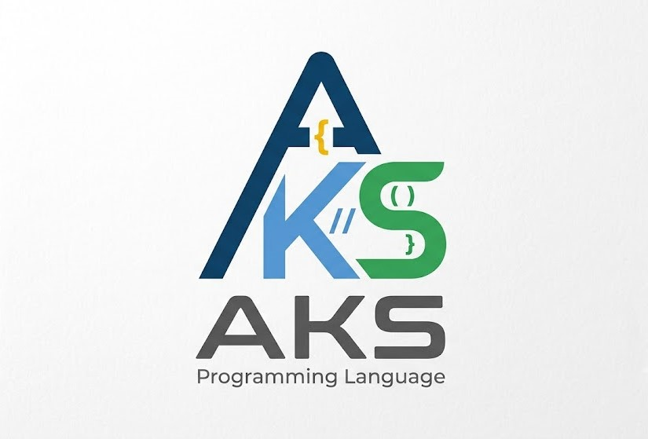

<p align="center">
  
</p>

# AKS Language Support for Visual Studio Code

Official Visual Studio Code extension providing rich language intelligence, syntax highlighting, Language Server Protocol (LSP) diagnostics, and native debugging (DAP) for the **AKS Programming Language**.

---

## Features

- **Syntax Highlighting**: Complete TextMate grammar covering variables, functions, structs, algebraic data types, contracts (`requires`, `ensures`), algebraic effects (`effect`, `perform`, `handle`), lexical regions, actors, numbers, and string templates.
- **Language Server Protocol (LSP)**: Automatic connection to `aksls` providing real-time compiler diagnostics, type hints, auto-completion, and symbol navigation.
- **Integrated Debugging (DAP)**: Native Run & Debug (`F5`) integration powered by AKS's built-in Debug Adapter Protocol server (`aks dap`). Set breakpoints, inspect call stacks, examine variables, and evaluate expressions.
- **One-Click Execution**: Run the active `.aks` script in an integrated terminal with `AKS: Run Current File`.
- **Automatic Formatting**: Format files using `aksfmt` via `AKS: Format Document with aksfmt`.
- **Productivity Snippets**: Instant templates for functions, structs, async tasks, region arenas, supervised actors, contracts, and unit tests.

---

## Getting Started

1. Install the **AKS compiler** and ensure `aks` and `aksls` are available in your system `PATH`.
2. Install this extension in Visual Studio Code.
3. Open any `.aks` file — syntax highlighting, auto-completion, and diagnostics will activate automatically.

---

## Debugging

To debug an AKS script:
1. Open the file you wish to debug.
2. Open the **Run and Debug** view (`Ctrl+Shift+D` or `Cmd+Shift+D`).
3. Click **Run and Debug** and select **AKS Debugger**.
4. Alternatively, create a `.vscode/launch.json` file:

```json
{
  "version": "0.2.0",
  "configurations": [
    {
      "type": "aks-dap",
      "request": "launch",
      "name": "Debug AKS Script",
      "program": "${file}"
    }
  ]
}
```

---

## Extension Settings

This extension contributes the following settings:

- `aks.executablePath`: Path to the `aks` compiler binary (default: `aks`).
- `aks.languageServerPath`: Path to the `aksls` language server binary (default: `aksls`).
- `aks.trace.server`: Traces communication between VS Code and the AKS Language Server (`off`, `messages`, `verbose`).

---

## Requirements

- VS Code version `1.75.0` or higher.
- AKS Compiler & Language Server (`aks`, `aksls`).

---

## License

This extension is licensed under the [MIT License](https://github.com/aks-lang/aks-lang/blob/main/LICENSE).
